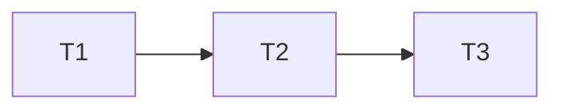

# Execução das cobranças simplificadas

Escritor único root; revisão independente somente leitura até handoff do relatório.

## Test Coverage Matrix

| Code Layer              | Required Test Type | Coverage Expectation                                | Location Pattern                      | Run Command                                                      |
| ----------------------- | ------------------ | --------------------------------------------------- | ------------------------------------- | ---------------------------------------------------------------- |
| Composição              | unit               | Identidade, órfãos, fontes, vínculo e ordem         | test/order-billing-operations.test.js | node --test test/order-billing-operations.test.js                |
| Vue/comandos existentes | E2E                | Lista, estados, payloads, ACL, falhas, teclado/axe  | test/e2e/_billing_.spec.js            | Playwright focado                                                |
| Integração              | build + smoke      | Gates, SQL existente e persistência local sintética | validadores e ambiente dedicado       | npm run validate; npm run test:e2e; npm audit --audit-level=high |

## Gate Check Commands

| Gate Level | When to Use | Command                                                                            |
| ---------- | ----------- | ---------------------------------------------------------------------------------- |
| Quick      | Composição  | node --test test/order-billing-operations.test.js                                  |
| Full       | UI          | unit + Playwright billing/order-timeline/orders                                    |
| Build      | Fechamento  | npm run validate; npm run test:e2e; npm audit --audit-level=high; git diff --check |

## Execution Plan

## Task Breakdown

### T1: Compor operações por identidade (BCS-T01)

- [x] Concluída: quatro testes aprovados, sem skips. Cobrança agrupa seus
  pagamentos; manual é deduplicado por fonte/ID; eventos preservam vínculos
  e registros órfãos, sem alterar totais nem fabricar datas.

**Where**: `apps/edge-web/src/lib/order-billing-operations.js`

**Depends on**: none

**Tests**: unit BCS-01/02, cobrança/pagamento, manual duplicado, órfãos e cursor parcial.

**Gate**: Quick.

### T2: Integrar lista e ações reais (BCS-T02)

- [ ] Concluída.

**Where**: `apps/edge-web/src/components/order/OrderBillingSection.vue`,
`OrderBillingWorkspace.vue`, novo `OrderBillingOperations.vue` e E2E.

**Depends on**: T1

**Tests**: BCS-01–08, regressão dos comandos e leitura, teclado, foco, axe e 320px.

**Gate**: Full e Build.

### T3: Revisão independente e operação local (BCS-T03)

- [ ] Concluída.

**Where**: `.specs/features/billing-simplified/validation.md` e runbook.

**Depends on**: T2

**Tests**: matriz independente, sensor isolado, smoke persistido e gates finais.

**Gate**: Build e validate_state.py.

## Cross-check

| Dependency | Diagram | Definition |
| ---------- | ------- | ---------- |
| T1 → T2    | yes     | yes        |
| T2 → T3    | yes     | yes        |
