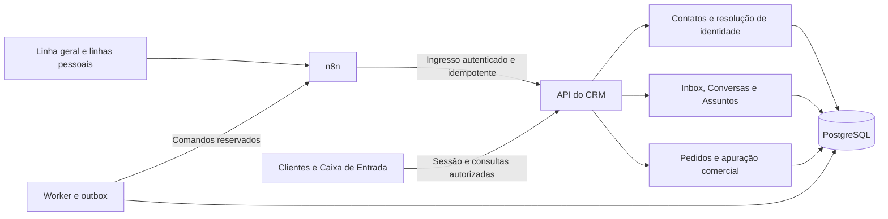

# Arquitetura do CRM Silmer 2.0

Design proposto no [RFC 075](../../../docs/rfc/075-crm-20-centrado-no-cliente.md)
para os [requisitos C20](spec.md). Funciona dentro do monólito modular com
Vue 3, Fastify, PostgreSQL, worker e n8n. Primeiro expandir as leituras.
Depois ativar a resolução entre linhas em escopo restrito.
[Arquitetura vigente](../../../ARCHITECTURE.md)

## Fronteiras

| Fronteira   | Autoridade e responsabilidade                                                                                                                                                                               |
| ----------- | ----------------------------------------------------------------------------------------------------------------------------------------------------------------------------------------------------------- |
| Contatos    | `Contact.id` é a identidade comercial estável. `ContactIdentity` identifica origem e conta de canal. A correlação provada tem escopo, validade e trilha de revisão. Carteira continua vínculo independente. |
| Inbox       | Conversa pertence a um ciclo de uma identidade e de uma linha. Mesmo Contato pode ter dois ciclos paralelos. Assunto continua sendo o vínculo comercial entre Conversa e Pedido, inclusive em pós-venda.    |
| Pedidos     | `orders.contact_id`, origem e snapshots são mantidos. Pedidos de atendimento e da loja conservam seus contratos de escrita, impressão, cobrança, exportação e ACL.                                          |
| API e Vue   | A API compõe a projeção comercial com ACL por recurso. Clientes e Inbox consomem a mesma semântica e tratam permissão revogada e respostas atrasadas.                                                       |
| Integrações | O CRM decide Contato, ciclo, idempotência, revisão, autorização e epoch. O n8n continua usando a API autorizada. Workflow legado continua compatível.                                                       |

[Identidades e ciclos](../../../modules/database/migrations/0006_phase2_inbox_contacts.expand.sql) ·
[Assuntos](../../../modules/inbox-channels/src/application/subject-service.js) ·
[Contrato n8n](../../../docs/integrations/n8n/README.md)

## Leitura comercial

Propor três leituras aditivas sob `/api/v1/contacts/:contactId`. Fixar os
nomes e os tipos no OpenAPI no T03. Manter a resposta do detalhe atual para
os consumidores existentes.

Proteger as novas leituras com configuração desabilitada por padrão na API.
Os consumidores preservam o painel e o perfil vigentes quando o resumo
estiver indisponível. Ativar a leitura por escopo aprovado após T06.

| Leitura proposta                   | Resposta e garantias                                                                                                                                                                             |
| ---------------------------------- | ------------------------------------------------------------------------------------------------------------------------------------------------------------------------------------------------ |
| `GET .../commercial-summary`       | `confirmedOrderCount`, `soldAmountCents`, `averageTicketCents`, `lastSaleDate` e referência mínima ao último Pedido autorizado. Toda a projeção de vendas usa o mesmo conjunto de IDs elegíveis. |
| `GET .../commercial-orders`        | Projeção da lista com número, origem, estado, data comercial, valor quando permitido e link autorizado. Itens e ficha continuam na rota de Pedido.                                               |
| `GET .../commercial-conversations` | Metadados permitidos de ciclo e linha, início, fim e estado. Sem mensagem, anexo ou transcrição na projeção.                                                                                     |

A API autentica a sessão e comprova acesso ao Contato. Dentro de cada
consulta, aplica o predicado de visibilidade de Pedido ou Conversa antes de
selecionar IDs, contar ou paginar. Uma associação ativa e verificável pode
ajudar a localizar o Pedido histórico apenas dentro do escopo que a comprova.
Aplicar a ACL comercial ao Pedido e, se a origem for apresentada, a ACL da
Conversa de origem à referência. Deduplicar o Pedido por ID antes de agregar.
A resposta para um Contato fora do universo do leitor segue o contrato
indistinguível de inexistente. Rota de detalhe volta a autorizar na navegação.
[ACL de Contatos](../../../modules/contacts/src/adapters/contact-access.js) ·
[ACL comercial](../../../modules/orders/src/adapters/order-contact-access.js)

As listas usam ordenação determinística por data e ID, paginação por cursor,
limite inicial 25 e máximo 100, sujeitos ao padrão do leitor existente.
Vincular escopo do cursor ao leitor, Contato e filtro. Reaplicar autorização a
cada página. A UI cancela ou descarta requisições antigas ao trocar de
contexto e limpa resultados ao receber invalidação autorizada ou nova
resposta de acesso negado. Cada sessão recupera sua própria projeção.

O cálculo inicial toma como referência a apuração de vendas do CRM. Usar
`order_date`, valor comercial oficial vigente e centavos inteiros. Os três
indicadores usam os mesmos filtros de C20-03, com desempate por ID no último
Pedido. Em T02, medir vendas confirmadas sem data ou valor confiável e
resolver com Produto em D03 antes de fechar o contrato. Pedidos da loja sem
Contato e pagamentos ficam fora desse cálculo. Uma read model pode ser
avaliada depois de medir os planos. A primeira entrega usa consultas
indexadas no PostgreSQL e evita descriptografar ficha para gerar o resumo.
[Apuração vigente](../../../modules/orders/src/adapters/postgres-order-repository.js)

## Resolução de identidade e concorrência

A identidade de transporte segue única no escopo vigente. A busca de
telefone já existente fornece candidatos. O primeiro piloto usa a
normalização brasileira já suportada. D01 decide quais provas podem
fundamentar **um vínculo canônico ativo** por telefone normalizado da
Silmer. Propor um registro dedicado, com chave de busca HMAC no padrão do
CRM, FK para Contato, método e referência de verificação, vigência,
estado, versão e rastreabilidade da mudança. O banco impõe unicidade
apenas sobre vínculos verificados ativos. Usar o envelope existente quando
for necessário recuperar texto do número. Evidências históricas ficam
revogadas ou expiradas e nunca disputam a chave ativa. Telefone compartilhado
sem titularidade individual comprovada segue revisão.

1. Validar transporte, linha, geração, confiança e tempo do evento na API.
   Correlacionar evento e deduplicar a mensagem antes de resolver a nova
   identidade. Reentrega posterior ao fechamento devolve o ciclo original.
2. Preservar vínculo atual verificável da identidade. Para uma identidade
   nova em ingresso elegível, obter bloqueio transacional pela chave canônica
   na mesma ordem em todos os caminhos que a alteram. Relê-la sob o bloqueio.
   No caso inicial comprovado, gravar Contato, vínculo e identidade na mesma
   transação. Na segunda linha, reutilizar o Contato. Unicidade no banco
   protege resoluções concorrentes.
3. Se houver conflito, vínculo revogado, evidência expirada ou fornecedor que
   não comprove o número, usar a saída compatível da política D01. Contato
   provisório, quando necessário para preservar a entrada, fica isolado de
   históricos e carteiras de terceiros. Encaminhar a decisão autorizada com
   metadados mínimos. Um identificador opaco do provedor nunca vira telefone
   por heurística.
4. Resolver o ciclo dentro da linha com a trava e o índice existentes.
   Arquivamento conserva o ciclo ativo. Fechamento é terminal e o próximo
   inbound válido abre novo ciclo. Preservar modo humano na linha pessoal e
   ownership, epoch, reservas, outcome e referências da linha anterior.

T08 fixa a ordem de bloqueio em relação ao evento, telefone, identidade,
Contato e ciclo após traçar todos os escritores. Manter as ordens já
compatíveis e testar transações concorrentes em PostgreSQL real. Rotas de
primeiro envio e eco preservam a origem. Número digitado para um envio
humano não cria prova por si, mesmo quando o transporte aceita a mensagem.
[Ingressos atuais](../../../modules/n8n-integration/src/postgres-repository.js) ·
[Primeiro envio](../../../apps/api/src/seller-whatsapp-first-send-runtime.js)

## Upgrade, ativação e recuperação

1. **Expandir** com migração aditiva. Confirmar upgrade a partir da versão
   anterior suportada e startup do código anterior sobre a base expandida.
   Índices e limitações de lock seguem o ensaio de T07. Flags de novos
   efeitos entram desabilitadas no commit que os introduz.
2. **Inventariar e observar** resultados candidatos sem mudar a resolução.
   Permitir modo de observação com acesso operacional explícito, contagens
   sem PII e resultado comparado ao baseline. Levantar colisões, contatos sem
   canal, órfãos, relações e pedidos sem vínculo. Classificar candidatos
   elegíveis e casos para revisão. Revisar com Operação e Privacidade.
3. **Aplicar lotes aprovados** com ID, versão anterior esperada, checkpoint,
   replay seguro e registro reversível. Contabilizar exceções antes de
   promover. Preservar IDs, vínculos históricos comprovados, mídias, fichas e
   datas. Mudança de identidade nunca movimenta carteira, dono da conversa
   ou Pedido implicitamente. A auditoria permite reconstruir a decisão.
4. **Ativar** em duas linhas autorizadas, por flag e allowlist de conta/linha.
   Ordem de runtime: migração compatível, CRM, workflow dependente se
   necessário, flag. Verificar SHA, digest, versão do workflow e origem do
   ingress antes da abertura. Testar falhas de evento, processamento e
   transporte com efeitos incertos preservados.
5. **Pausar** a associação automática e manter atendimento pelo fluxo
   compatível. Para vínculo incorreto, reverter seletivamente com versão e
   revisar as relações criadas durante sua vigência antes de reexpor leitura.
   Preservar mensagens, IDs, pagamentos e resultados externos. Restore é
   último recurso, com runbook vigente e ledger de privacidade reaplicado.
   Qualquer migração destrutiva passa por RFC e entrega posteriores.

[Recuperação vigente](../../../ops/recovery/RUNBOOK.md) ·
[Pré-mortem](pre-mortem.md) · [Gates](validation.md)
