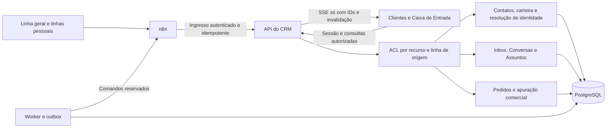

# Arquitetura do CRM Silmer 2.0

Design dos [requisitos C20](spec.md) em duas fases. A Leitura comercial
segue o [RFC 075](../../../docs/rfc/075-crm-20-centrado-no-cliente.md). A
Identidade entre linhas segue o
[RFC 076](../../../docs/rfc/076-identidade-do-cliente-entre-linhas.md).
Funciona dentro do monólito modular com Vue 3, Fastify, PostgreSQL, worker e
n8n. Primeiro expandir as leituras. Depois tornar a visibilidade dependente
da linha de origem (T17) e só então ativar a resolução entre linhas em
escopo restrito.
[Arquitetura vigente](../../../ARCHITECTURE.md)

## Fronteiras

| Fronteira   | Autoridade e responsabilidade                                                                                                                                                                                                                                   |
| ----------- | --------------------------------------------------------------------------------------------------------------------------------------------------------------------------------------------------------------------------------------------------------------- |
| Contatos    | `Contact.id` é a identidade comercial estável. `ContactIdentity` identifica origem e conta de canal. A correlação provada tem escopo, validade e trilha de revisão. Carteira continua vínculo independente, que nunca muda como efeito colateral de identidade. |
| Inbox       | Conversa pertence a um ciclo de uma identidade e de uma linha. Mesmo Contato pode ter dois ciclos paralelos. Assunto continua sendo o vínculo comercial entre Conversa e Pedido, inclusive em pós-venda.                                                        |
| Pedidos     | `orders.contact_id`, origem e snapshots são mantidos. Pedidos de atendimento e da loja conservam seus contratos de escrita, impressão, cobrança, exportação e ACL. Depois de T17, a visibilidade também considera a linha da conversa de origem.                |
| API e Vue   | A API compõe a projeção comercial com ACL por recurso. Clientes e Inbox consomem a mesma semântica e tratam permissão revogada e respostas atrasadas.                                                                                                           |
| Integrações | O CRM decide Contato, ciclo, idempotência, revisão, autorização e epoch. O n8n continua usando a API autorizada. Workflow legado continua compatível.                                                                                                           |

[Identidades e ciclos](../../../modules/database/migrations/0006_phase2_inbox_contacts.expand.sql) ·
[Assuntos](../../../modules/inbox-channels/src/application/subject-service.js) ·
[Contrato n8n](../../../docs/integrations/n8n/README.md)

## Leitura comercial

Fase do RFC 075 (C20-01 a C20-06). Propor três leituras aditivas sob
`/api/v1/contacts/:contactId`. Fixar nomes e tipos no
[OpenAPI](../../../docs/api/openapi.v1.yaml) no T03. O
[teste de contrato atual](../../../test/operation-read-contract.test.js) só
confere `operationId` por expressão regular; T03 acrescenta validação do
schema das respostas novas.

| Leitura proposta                   | Resposta e garantias                                                                                                                                                                                                                                  |
| ---------------------------------- | ----------------------------------------------------------------------------------------------------------------------------------------------------------------------------------------------------------------------------------------------------- |
| `GET .../commercial-summary`       | `confirmedOrderCount`, `soldAmountCents`, `averageTicketCents`, `lastSaleDate` e referência mínima ao último Pedido autorizado. Toda a projeção de vendas usa o mesmo conjunto de IDs elegíveis. Com contagem zero, ticket e última venda são `null`. |
| `GET .../commercial-orders`        | Projeção da lista com número, origem, estado, data comercial, valor quando permitido e link autorizado. Itens e ficha continuam na rota de Pedido.                                                                                                    |
| `GET .../commercial-conversations` | Metadados permitidos de ciclo e linha, início, fim e estado. Sem mensagem, anexo ou transcrição na projeção.                                                                                                                                          |

**Relação com o que existe.** O detalhe `GET /api/v1/contacts/:contactId` já
devolve `conversations` filtradas por `contactConversationVisible`, sem
paginação. `commercial-conversations` é a lista paginada que o perfil novo
usa. O campo atual do detalhe permanece para os consumidores existentes até
nova decisão, e as duas leituras usam o mesmo predicado.
[`ClientOrders.vue`](../../../apps/edge-web/src/components/ClientOrders.vue)
lê `/api/v1/orders?owner=me&cancellation=all&limit=100` e filtra `contactId`
no navegador. Assim, páginas inteiras podem vir sem o Contato, pedidos podem
faltar e só aparecem os do próprio vendedor. O `GET /api/v1/orders` público
não aceita filtro por Contato; a lista interna `contactIds` só vem da busca
por nome. `commercial-orders` corrige isso: T01 caracteriza o defeito e T04
substitui o componente. O painel da Inbox mostra hoje o Pedido da conversa
ativa
([`ConversationOrderSummary.vue`](../../../apps/edge-web/src/components/inbox/ConversationOrderSummary.vue)),
não o último Pedido do Contato; T05 acrescenta este.
[Detalhe do Contato](../../../modules/contacts/src/adapters/postgres-contact-read-repository.js)

**Flag.** Proteger as novas leituras com configuração desabilitada por padrão
na API, no padrão de `SELLER_CLIENTS_ENABLED`: valor ausente equivale a
desligado, só `'true'` ou `'false'` são aceitos e valor inválido derruba a
partida; allowlist `*_SELLER_IDS` em JSON. Nome proposto
`CONTACT_COMMERCIAL_READ_ENABLED`, com `CONTACT_COMMERCIAL_READ_SELLER_IDS`,
fixado no T03. No padrão atual, `'true'` exige allowlist não vazia; se a
leitura for liberada sem allowlist, T03 registra a diferença. Os
consumidores preservam o painel e o perfil vigentes quando o resumo estiver
indisponível. Ativar a leitura por escopo aprovado após T06.
[Configuração vigente](../../../apps/api/src/operation-runtime.js)

**Autorização.** A API autentica a sessão e comprova acesso ao Contato.
Dentro de cada consulta, aplica o predicado de visibilidade de Pedido ou
Conversa antes de selecionar IDs, contar ou paginar. Uma associação ativa e
verificável pode ajudar a localizar o Pedido histórico apenas dentro do
escopo que a comprova. Aplicar a ACL comercial ao Pedido e, se a origem for
apresentada, a ACL da Conversa de origem à referência. Deduplicar o Pedido
por ID antes de agregar. A resposta para um Contato fora do universo do
leitor segue o contrato indistinguível de inexistente. Rota de detalhe volta
a autorizar na navegação.
[ACL de Contatos](../../../modules/contacts/src/adapters/contact-access.js) ·
[ACL comercial](../../../modules/orders/src/adapters/order-contact-access.js)

**SSE.** A projeção não ganha evento com dados. Os consumidores tratam
`inbox.contact.changed`, `inbox.order.changed` e `stream.reset` como
invalidação genérica e releem pela API autorizada. T03 não usa
`inbox.order.changed` para levar dados do resumo. A política única de
autorização dos eventos de Pedido é responsabilidade de T17.

**Paginação.** Os leitores atuais usam padrão 25 e máximo 100 em Pedidos,
50 e 100 em Contatos, com cursores por `(updated_at, id)`. As listas
comerciais usam ordenação determinística por `(order_date, id)` decrescente,
cursor, limite inicial 25 e máximo 100. Vincular o escopo do cursor ao
leitor, Contato e filtro. Reaplicar autorização a cada página. A UI cancela
ou descarta requisições antigas ao trocar de contexto e limpa resultados ao
receber invalidação autorizada ou nova resposta de acesso negado. Cada
sessão recupera sua própria projeção.

**Apuração.** O cálculo toma como referência a apuração de vendas do CRM:
`status='confirmado' AND NOT is_test AND cancelled_at IS NULL`. Status de
Pedido são só `pendente` e `confirmado`
([domínio](../../../modules/orders/src/domain/order.js)). Teste é `is_test`,
que só existe em Pedido da loja; cancelado é `cancelled_at IS NOT NULL`;
reabrir volta a `pendente` e grava `reopened_at`. O reaberto ainda não
reconfirmado fica fora e o reconfirmado conta, salvo decisão diferente em
D03. O valor é `final_amount_cents`, em centavos inteiros: o resumo não
recalcula itens nem descriptografa ficha. `order_date` é `date` gravada na
confirmação no fuso America/Sao_Paulo. Os três indicadores usam os mesmos
filtros de C20-03, com desempate por ID no último Pedido. A apuração atual
devolve ticket 0 com contagem zero; a leitura comercial devolve `null` para
ticket e última venda, e o contrato documenta a diferença. Pedido da loja
tem sempre `contact_id IS NULL` e fica fora do resumo por Contato, embora o
dashboard o inclua; D03 aprova o rótulo que deixa essa divergência clara.
Pagamentos também ficam fora. Em T02, medir vendas confirmadas sem data ou
valor confiável e resolver com Produto em D03 antes de fechar o contrato.
[Apuração vigente](../../../modules/orders/src/adapters/postgres-order-repository.js)

**Índice e plano.** Não há índice em `(contact_id, order_date, id)`; o mais
próximo é `orders_contact_updated` em `(contact_id, updated_at, id)`
([migração 0035](../../../modules/database/migrations/0035_manual_contacts_orders.expand.sql)).
T03 inclui migração expand com índice parcial para o universo de vendas e
registra o plano de consulta (G06). `orderReadable` roda `EXISTS` aninhados
por linha, então o plano mede o predicado junto com o índice. Uma read model
pode ser avaliada depois de medir os planos. A primeira entrega usa
consultas indexadas no PostgreSQL.

## Visibilidade e carteira entre linhas (D06, T17)

Fase do RFC 076. Antes de qualquer reuso de Contato entre linhas, a
visibilidade precisa deixar de depender só do Contato. Fatos verificados no
código de `0c89a1c7`:

- `orderReadable`
  ([ACL comercial](../../../modules/orders/src/adapters/order-contact-access.js))
  mostra o Pedido ao seu vendedor (`manual_owner_id`, `sales_owner_id` ou
  responsável atual da conversa) e, para os demais, deriva a visibilidade do
  Contato: o `contact_id` gravado e o Contato atual da identidade da
  conversa, ambos por `commercialContact`. A linha da conversa de origem não
  entra no predicado. Pedido da loja, sem Contato, fica visível.
- `contactVisible`
  ([ACL de Contatos](../../../modules/contacts/src/adapters/contact-access.js))
  torna um Contato visível a todos os vendedores quando ele tem qualquer
  identidade da linha geral, quando o leitor tem vínculo ativo de carteira ou
  quando é Contato manual (`wallet_created=false`) sem identidade de linha
  pessoal.
- Desenho vigente: a WAP-07 diz que "Pedido segue a ACL comercial"
  ([WhatsApp por vendedor](../seller-whatsapp/spec.md)). Num Contato já
  compartilhado, Pedidos de conversas da linha pessoal ficam visíveis aos
  demais vendedores por desenho.
- Consequência da união: unir um cliente hoje privado da linha pessoal do
  vendedor A (só identidade pessoal) a um Contato com identidade da linha
  geral torna o Contato visível a todos. Os Pedidos que hoje só A vê passam a
  aparecer ao vendedor B, e a proteção de cliente privado da WAP-07/08 deixa
  de valer para eles. Efeito inverso: um Contato manual que ganha identidade
  pessoal fica oculto para os demais, e seus Pedidos somem para quem não é
  dono.
- Nenhum caminho de produção une Contatos hoje. `mergeIdentity` e
  `unmergeIdentity` só existem no módulo contacts, sem rota montada na API;
  `identity_links` é apenas lido por Assuntos, Pedidos e cobrança para
  respeitar uniões existentes. O
  [primeiro envio](../../../apps/api/src/seller-whatsapp-first-send-runtime.js)
  anexa, porém, uma identidade pessoal nova a um Contato existente da
  carteira do vendedor. Se esse Contato já tiver identidade da linha geral, o
  estado misto já existe sem união, coberto pela ACL comercial da WAP-07;
  T01 caracteriza e T02 mede.
- O inbound da linha pessoal cria `seller_client_link` automaticamente
  quando não há vínculo
  ([ingressos](../../../modules/n8n-integration/src/postgres-repository.js),
  bloco após `if (personal && !personal.pending)`). Um vínculo `revoked` faz o
  ingresso lançar `N8nForbiddenError` e a mensagem é rejeitada.
- O evento SSE `inbox.order.changed` leva `conversationId` e `orderId` e é
  autorizado pela conversa (`assertReadable` em
  [`operation-runtime.js`](../../../apps/api/src/operation-runtime.js)), não
  por `orderReadable`. Pedido sem conversa vira `stream.reset`.

Modelo-alvo proposto para D06:

1. **Linha de origem.** A visibilidade de Pedido e de Contato considera a
   linha da conversa de origem. Pedido de conversa de linha pessoal segue a
   ACL daquela conversa, mesmo que o Contato seja compartilhado. Unir
   identidades nunca amplia a visibilidade, e "o vendedor do pedido sempre o
   mantém" continua valendo. Essa opção substitui, para Pedidos de conversa
   pessoal, a frase "Pedido segue a ACL comercial" da WAP-07 e retira dos
   demais vendedores esses Pedidos nos Contatos já mistos. O aceite de
   Produto usa a medição de T02. Alternativa, se D06 rejeitar: manter a ACL
   comercial e só unir clientes sem histórico privado da linha pessoal após
   aceite explícito da exposição.
2. **Carteira.** O reuso do Contato não cria vínculo de carteira implícito
   sem regra aprovada, conforme a ADR 090, que proíbe transferir
   responsabilidade implicitamente.
3. **Vínculo revogado.** A mensagem nunca pode ser perdida. A entrada fica
   preservada em Contato isolado, sem reativar o vínculo, e segue para
   revisão autorizada.
4. **SSE de Pedido.** Uma política única autoriza `inbox.order.changed` pelo
   mesmo predicado do Pedido e, quando a referência à conversa for exibida,
   também pela ACL da conversa.

T17 altera `orderReadable`, `contactVisible` e a autorização do SSE de
Pedido para considerar a linha de origem. Contatos sem identidade pessoal
não mudam de resultado; a diferença nos Contatos já mistos é a aprovada em
D06 e fica caracterizada em teste. A regressão compara antes e depois de unir, em
fixture sintética, uma identidade pessoal a um Contato da linha geral (G02).
T17 depende de T01 e D06; T09 depende de T08 e T17.

## Resolução de identidade e concorrência

**Estado atual.** Cada identidade nova no inbound cria um Contato novo
(`provisional=true`, `wallet_created` verdadeiro na linha pessoal) e a
identidade, ambos no escopo da conta da linha. Com telefone confirmado, o
inbound grava `contact_phone_lookup`, que devolve candidatos e nunca une
Contatos
([migração 0038](../../../modules/database/migrations/0038_contact_phone_details.expand.sql)).
`phone_status='confirmed'` é obrigatório para toda identidade WhatsApp
([migração 0006](../../../modules/database/migrations/0006_phase2_inbox_contacts.expand.sql)),
e o primeiro envio grava `confirmed` a partir de número digitado; o status
atual não distingue prova, e T07 precisa de proveniência explícita.
[`normalizeContactPhone`](../../../modules/contacts/src/domain/contact-details.js)
aceita formas nacionais com 10 e 11 dígitos sem conciliar o nono dígito:
variantes são candidatos distintos e vão para revisão, nunca para união
automática. A ADR 033 (item 3) e a ADR 090 ("Nunca unir por telefone/nome")
vedam a união automática. O ADR resultante de D01/D06 as supersede
expressamente só para a prova aprovada. A migração 0038 não é editada: o
runner guarda o checksum SHA-256 de cada arquivo e recusa a partida em
divergência ([`migrations.js`](../../../modules/database/src/migrations.js)).
O comentário dela fica como histórico; o novo significado vai no cabeçalho
da nova migração expand de T07 e no ADR. `RULES.md` já admite união com
correlação verificável e auditável; nenhuma invariante muda.

**Provas candidatas para D01.**

- Linha geral (Meta Cloud API): número do remetente informado pela Meta no
  inbound. Prova controle da conta WhatsApp naquele momento, não
  titularidade individual.
- Linha pessoal (Evolution): telefone só quando há um único `remoteJidAlt`
  correspondente. `@lid` sem correspondência nunca vira telefone
  (`EVOLUTION_IDENTITY_UNRESOLVED`).
- Número digitado no primeiro envio, no cadastro manual ou no chat do site
  nunca prova (ADR 033, item 4).

**Padrão recomendado.** Associação assistida como padrão inicial do piloto.
A busca por telefone já sugere candidatos; um operador autorizado confirma
com auditoria, reaproveitando `identity_links` e `mergeIdentity`, que
existem mas não estão montados na API. Associação automática só para as
provas aprovadas em D01 e depois de T17.

**Vínculo canônico.** D01 decide quais provas podem fundamentar **um vínculo
canônico ativo** por telefone normalizado da Silmer. Propor um registro
dedicado, com chave de busca HMAC no padrão do CRM, FK para Contato, método
e referência de verificação, vigência, estado, versão e rastreabilidade da
mudança. O banco impõe unicidade apenas sobre vínculos verificados ativos.
Usar o envelope existente quando for necessário recuperar texto do número.
Evidências históricas ficam revogadas ou expiradas e nunca disputam a chave
ativa. Telefone compartilhado sem titularidade individual comprovada segue
revisão. Merge e desfazer merge (`identity_links`) mudam
`current_contact_id`; o vínculo canônico acompanha essas operações, e os
leitores de `identity_links` em Assuntos, Pedidos e cobrança continuam
coerentes.

1. Validar transporte, linha, geração, confiança e tempo do evento na API.
   Correlacionar evento e deduplicar a mensagem antes de resolver a nova
   identidade. Reentrega posterior ao fechamento devolve o ciclo original.
2. Preservar vínculo atual verificável da identidade. Para uma identidade
   nova em ingresso elegível, obter bloqueio transacional pela chave canônica
   na mesma ordem em todos os caminhos que a alteram. Relê-la sob o bloqueio.
   No caso inicial comprovado, gravar Contato, vínculo e identidade na mesma
   transação. Na segunda linha, reutilizar o Contato sem criar vínculo de
   carteira implícito. Unicidade no banco protege resoluções concorrentes.
3. Se houver conflito, vínculo revogado, evidência expirada ou fornecedor que
   não comprove o número, usar a saída compatível da política D01/D06. A
   entrada é preservada num **Contato isolado**, separado de históricos e
   carteiras de terceiros; o nome evita confusão com o campo existente
   `contacts.provisional`, verdadeiro em todo Contato criado por inbound.
   Encaminhar a decisão autorizada com metadados mínimos. Um identificador
   opaco do provedor nunca vira telefone por heurística.
4. Resolver o ciclo dentro da linha com a trava e o índice existentes.
   Arquivamento conserva o ciclo ativo. Fechamento é terminal e o próximo
   inbound válido abre novo ciclo. Preservar modo humano na linha pessoal e
   ownership, epoch, reservas, outcome e referências da linha anterior.

**Bloqueios existentes.** O inbound trava, por
`pg_advisory_xact_lock(hashtextextended(chave, 0))`,
`n8n-conversation:{provider}:{conta}:{conversa}`, depois
`n8n-inbound:{provider}:{conta}:{evento}` e depois `identity:{lookupHash}`;
na linha pessoal segue com `FOR UPDATE` no Contato, na identidade e no
vínculo de carteira. Todas as chaves incluem a conta da linha, então duas
linhas não se serializam. O cadastro manual
([`operation-runtime.js`](../../../apps/api/src/operation-runtime.js)) trava
`hashtext(phoneHash)` antes do Contato. O primeiro envio trava
`identity:{hash}` antes do Contato. `lock_timeout` é 1500 ms. T08 escolhe uma
única chave entre linhas, uma única função de hash e uma ordem compatível
com os caminhos de inbound, cadastro manual e primeiro envio, depois de
traçar todos os escritores de evento, telefone, identidade, Contato, vínculo
e ciclo. Testar transações concorrentes em PostgreSQL real.

**Resolvedor duplicado.**
[`postgres-contact-identity-repository.js`](../../../modules/contacts/src/adapters/postgres-contact-identity-repository.js)
tem `resolveInboundIdentity`, `mergeIdentity` e `unmergeIdentity`, mas só é
usado em testes; a produção resolve em
[`modules/n8n-integration`](../../../modules/n8n-integration/src/postgres-repository.js).
O resolvedor de testes trava `hashtext(phoneHash)` antes da identidade; o de
produção não usa essa trava. T08 escolhe um caminho e alinha ou remove o
outro.

Rotas de primeiro envio e eco preservam a origem. Número digitado para um
envio humano não cria prova por si, mesmo quando o transporte aceita a
mensagem.

## Upgrade, ativação e recuperação

1. **Expandir** com migração aditiva. Confirmar upgrade a partir da versão
   anterior suportada e startup do código anterior sobre a base expandida.
   Índices e limitações de lock seguem o ensaio de T03 e T07. Flags de novos
   efeitos entram desabilitadas no commit que os introduz.
2. **Inventariar e observar** resultados candidatos sem mudar a resolução.
   Permitir modo de observação com acesso operacional explícito, contagens
   sem PII e resultado comparado ao baseline. Levantar colisões, contatos sem
   canal, órfãos, relações, pedidos sem vínculo e Contatos que já misturam
   identidades de linhas diferentes. Classificar candidatos elegíveis e casos
   para revisão. Revisar com Operação e Privacidade.
3. **Aplicar lotes aprovados** com ID, versão anterior esperada, checkpoint,
   replay seguro e registro reversível. Contabilizar exceções antes de
   promover. Preservar IDs, vínculos históricos comprovados, mídias, fichas e
   datas. Mudança de identidade nunca movimenta carteira, dono da conversa
   ou Pedido implicitamente. A auditoria permite reconstruir a decisão.
4. **Ativar** em duas linhas autorizadas, por flag e allowlist de conta/linha,
   somente com T17 mesclada. Ordem de runtime: migração compatível, CRM,
   workflow dependente se necessário, flag. Verificar SHA, digest, versão do
   workflow e origem do ingress antes da abertura. Testar falhas de evento,
   processamento e transporte com efeitos incertos preservados.
5. **Pausar** a associação automática e manter atendimento pelo fluxo
   compatível. Para vínculo incorreto, reverter seletivamente com versão e
   revisar as relações criadas durante sua vigência antes de reexpor leitura.
   Preservar mensagens, IDs, pagamentos e resultados externos. Restore é
   último recurso, com runbook vigente e ledger de privacidade reaplicado.
   Qualquer migração destrutiva passa por RFC e entrega posteriores.

[Recuperação vigente](../../../ops/recovery/RUNBOOK.md) ·
[Pré-mortem](pre-mortem.md) · [Gates](validation.md)
