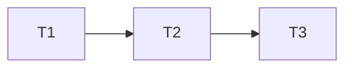

# Execução DDE

## Test Coverage Matrix

| Code Layer | Required Test Type | Coverage Expectation                                  | Location Pattern        | Run Command                                                             |
| ---------- | ------------------ | ----------------------------------------------------- | ----------------------- | ----------------------------------------------------------------------- |
| Comando    | unit/HTTP          | ACL, dia, replay, preservação financeira e estado     | test/_order_.test.js    | node --test test/manual-order-service.test.js test/order-routes.test.js |
| Interface  | E2E                | Botão, somente entrega, teclado, erro e reconciliação | test/e2e/order*.spec.js | Playwright focado                                                       |
| Integração | Build + revisão    | lint/tipos/build, regressão e smoke local             | gates existentes        | npm run validate e checks focados                                       |

## Gate Check Commands

| Gate Level | When to Use | Command                                                                 |
| ---------- | ----------- | ----------------------------------------------------------------------- |
| Quick      | Backend     | node --test test/manual-order-service.test.js test/order-routes.test.js |
| Full       | UI          | Playwright timeline/orders/billing focado                               |
| Build      | Fechamento  | npm run validate; git diff --check; validate_state.py                   |

## Execution Plan

## Task Breakdown

### T1: Permitir correção autorizada de entrega existente (DDE-T01)

- [x] Concluída: 65 testes de serviço/HTTP aprovados, sem skips;
  typecheck/lint e diff check aprovados. Fingerprint mantém compatibilidade
  quando deliveredOn é omitido e distingue as datas explícitas.

**Where**: comando confirmDelivery no serviço/runtime/rota, OpenAPI e testes.

**Depends on**: none

**Tests**: DDE-02/03; data, ACL, fingerprint, replay e invariantes.

**Gate**: Quick + typecheck/lint.

### T2: Unificar ação da seção (DDE-T02)

- [ ] Concluída.

**Where**: OrderMilestonesSection.vue, OrderView.vue e E2E.

**Depends on**: T1

**Tests**: DDE-01–04, remoção de edição genérica e persistência da correção.

**Gate**: Full e Build.

### T3: Verificar e disponibilizar localmente (DDE-T03)

- [ ] Concluída.

**Where**: `.specs/features/order-delivery-date/validation.md` e runbook.

**Depends on**: T2

**Tests**: revisão independente, sensor isolado e smoke sintético persistido.

**Gate**: validate_state.py e diff check, commit/push/PR.

## Cross-check

| Dependency | Diagram | Definition |
| ---------- | ------- | ---------- |
| T1 → T2    | yes     | yes        |
| T2 → T3    | yes     | yes        |
