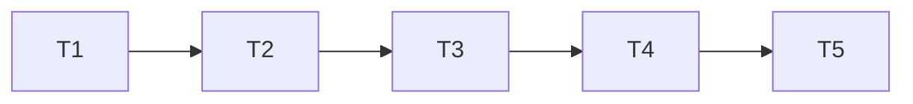

# Execução da linha do tempo real

Um escritor por vez no checkout principal, conforme AGENTS. Especialistas
entregam os arquivos e evidências; o Tech Lead integra, verifica e publica
um commit por tarefa. Sem worktree persistente, sem mudança em produção.

## Test Coverage Matrix

Proveniência: AGENTS.md, CONTRIBUTING.md, package.json e testes de cobrança,
milestones, Dashboard e pedidos existentes.

| Code Layer               | Required Test Type                       | Coverage Expectation                                                                     | Location Pattern                                               | Run Command                                                                                 |
| ------------------------ | ---------------------------------------- | ---------------------------------------------------------------------------------------- | -------------------------------------------------------------- | ------------------------------------------------------------------------------------------- |
| Projeção financeira      | unit + PostgreSQL integration            | Ambas fontes, correções, ACL, datas, replay e flags                                      | test/order-timeline*.test.js                                   | node --test test/order-timeline*.test.js com DB exclusivo quando live                       |
| Composição e leitura Vue | unit + E2E                               | Legado, estados, ordem, erro/stale e leitura compartilhada                               | test/order-timeline*.test.js e test/e2e/order-timeline.spec.js | node --test e Playwright focados                                                            |
| Entrega                  | E2E + regressão de API/domínio existente | Cancelar/Escape, ACL, contexto congelado, conflito, falha incerta e pagamento preservado | test/e2e/order-timeline.spec.js e testes existentes de pedido  | Playwright focado e node --test test/manual-order-service.test.js test/order-routes.test.js |
| Integração               | checks + visual                          | Build, tipos, lint, fronteiras, tokens, contraste/axe e regressão relevante              | validadores existentes                                         | npm run validate; npm run test:e2e                                                          |

## Gate Check Commands

| Gate Level | When to Use            | Command                                                                                                               |
| ---------- | ---------------------- | --------------------------------------------------------------------------------------------------------------------- |
| Quick      | Projeção/funções puras | node --test test/order-timeline*.test.js                                                                              |
| Full       | API/UI                 | TEST_DATABASE_URL sintético exclusivo + teste PostgreSQL; Playwright orders/order-timeline/dashboard/delivery focados |
| Build      | Integração             | npm run validate; npm run test:e2e; npm audit --audit-level=high; git diff --check                                    |

## Execution Plan

## Task Breakdown

### T1: Registrar o contrato aprovado

- [x] Concluída: spec e rastreabilidade registradas antes do código.
      **Where**: `.specs/features/order-timeline/spec.md`

**Depends on**: none

**Tests**: validadores estruturais de spec/tasks.

**Gate**: Quick, validate_spec.py e validate_tasks.py aprovados.

- Entrega: requisitos e plano, com RFC 063 ligada à autorização do proprietário.

### T2: Projetar eventos financeiros autorizados (DTL-T01)

- [x] Concluída: projeção aditiva, seis testes unitários e oito PostgreSQL
      aprovados, sem skips; typecheck, ESLint focado e diff check aprovados.
      **Where**: `apps/api/src/order-billing-runtime.js`

**Depends on**: T1

**Tests**: projeção e PostgreSQL sintético dedicado, com ACL e cenários DTL-01–05/09.

**Gate**: Full, testes de projeção, PostgreSQL e typecheck.

- Suporte: função pura nova se necessária e testes co-localizados na tarefa.
- Entrega: timelineEvents/deliveryConfirmation aditivos; sem migration ou escrita nova.

### T3: Ligar a interface horizontal aos dados e à entrega (DTL-T02/T03)

- [x] Concluída: seis testes puros de composição, 15 E2E novos, regressões
      de Pedidos/Cobranças e gate validate aprovados. Smoke pela API local persistiu
      dois recebimentos e entrega. Gate global de navegador e revisão final em T4.
      **Where**: `apps/edge-web/src/components/order/OrderMilestonesSection.vue`

**Depends on**: T2

**Tests**: funções puras, E2E de pedidos, leitura, entrega, teclado e axe.

**Gate**: Full e Build, todos os critérios DTL-01–12 com evidência.

- Suporte: OrderView, OrderBillingSection, slot opcional OrderSheetHead e função
  de composição; root mantém posse dos testes E2E após handoff do especialista.
- Entrega: eventos reais, estados e comando existente, sem fixtures no produto.

### T4: Verificar a integração e disponibilizar localmente (DTL-T04)

- [x] Concluída: revisão independente e sensor aprovados, gates e retestes
      de ambiente registrados; smoke persistido disponível na porta 4180.
      **Where**: `.specs/features/order-timeline/validation.md`

**Depends on**: T3

**Tests**: revisão independente, discriminação em cópia isolada, smoke real local

com dados sintéticos, gates finais e teste de regressão conforme escopo.
**Gate**: Build; relatório PASS e validate_state.py.

- Suporte: runbook/RFC e rastreabilidade canônica atualizados;
  [PR 348](https://github.com/romulosutil/crm-silmer/pull/348) revisável, sem merge/deploy.
- Entrega: evidência por requisito, limitações explícitas, commit/push e ambiente local atualizado.

### T5: Discretizar os detalhes da linha do tempo (DTL-T05)

- [x] Concluída: solicitação visual do proprietário em 11/11/2026.
  O status Registro revertido sai da parte inferior do evento, mantendo o
  evento de reversão e o estado nos detalhes. Um chevron sem texto repetido
  abre detalhes nativos com nome acessível, foco e alvo de 44px.

**Where**: OrderMilestonesSection.vue e runbook.

**Depends on**: T4

**Tests**: DTL-05/06/12; 19 E2E existentes aprovados, lint/tipos/tokens/build
  e diff check aprovados; revisão independente sem findings. Smoke sintético
  local com recebimento e reversão reais, Enter/Space e axe desktop/320px
  aprovados. Sem alteração de API ou cálculo financeiro.

**Gate**: checks focados e smoke local; commit/push no PR 348.

## Cross-check

| Dependency | Diagram | Definition |
| ---------- | ------- | ---------- |
| T1 → T2    | yes     | yes        |
| T2 → T3    | yes     | yes        |
| T3 → T4    | yes     | yes        |
| T4 → T5    | yes     | yes        |

Testes acompanham a camada alterada: T2 cobre backend; T3 acompanha frontend
e entrega; T4 valida o conjunto sem substituir seus testes.
