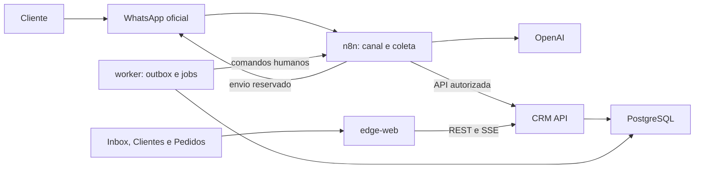

# TDD — CRM Silmer MVP

## Melhor Envio — T139 (02/11/2026)

[ADR 054](docs/adr/054-cotacao-na-conversa-vinculada-ao-pedido.md), MEVQ-01–08:
`POST /api/v1/conversations/:conversationId/shipping-quotes` calcula para
`subjectId`, `orderId`, `orderVersion` e embalagem explícita;
`POST /api/v1/conversations/:conversationId/shipping-quotes/:quoteId/select`
seleciona um serviço retornado, com os mesmos alvos/versionamento.
`GET /api/v1/orders/:orderId/shipping-quote` consulta a estimativa autorizada.
A ação operacional `shipping.quote` é independente de `shipping.manage`.
O servidor confere dono, modo humano, conversa aberta, vínculo e versão antes
e depois do efeito remoto. Resultados e CEPs persistidos são cifrados com
contexto por cotação; auditoria e idempotência não guardam PII em claro.
Uma versão posterior do pedido exige nova consulta. Não há mudança de valor
comercial, status, pagamento ou envio automático. O fluxo administrativo T138
abaixo conserva seu contrato independente.

## Melhor Envio — T138 (01/11/2026)

Conforme [ADR 053](docs/adr/053-conexao-e-cotacao-administrativa-melhor-envio.md),
`modules/shipping` é composto por `shipping-runtime.js` e `shipping-routes.js`
na API. `/api/v1/shipping/melhor-envio/{status,authorize,complete,quote,disconnect}`
exige ação administrativa `shipping.manage`, sessão humana e CSRF nas escritas.
Migration expand 0049 adiciona conexão cifrada e estado OAuth de uso único
por usuário/sessão, com reserva durável e fencing para renovação. A UI Vue
`/melhor-envio` remove o callback da URL e cota uma embalagem com medidas/peso
explícitos. Nenhum dado do destinatário, frete ou preço é gravado no pedido.
Configuração/rollback e evidências no [runbook](docs/runbooks/melhor-envio.md).

## Transporte aprovado — Evolution/Baileys (29/10/2026)

A [ADR 050](docs/adr/050-evolution-baileys-como-ponte-do-whatsapp.md) autoriza
Evolution/Baileys como ponte até a API oficial: API privada, PostgreSQL exclusivo,
cache local, sem Redis. O perfil fixado em `ops/evolution/` protege logs e
webhook e expurga mensagens de transporte anteriores a sete dias. O gerador
`ops/n8n/workflows/create-evolution-workflow.mjs` preserva a jornada atual e
restaura somente a fronteira do transporte quando a fonte já usa WAHA.
Persistência antes do ACK, reservas, epoch, resultado incerto e Inbox mantêm
seus contratos. Meta e terceiros são preservados. Preparação, pareamento,
cutover e homologação são gates distintos no
[runbook](docs/runbooks/evolution-baileys.md), EVOL-01. Estado WAHA abaixo é histórico.
Em 29/10, identidade da nova conta e publicação do principal foram confirmadas;
texto de entrada, handoff e resposta humana pela Inbox chegaram ao WhatsApp Web
uma vez. Os sete workflows Meta foram preservados. Recibos `delivered`/`read`,
mídia e recuperação permanecem pendentes em EVOL-01D.

## Transporte anterior da nova linha — WAHA/WEBJS; WPPConnect pausado (histórico)

A [ADR 046](docs/adr/046-retomar-waha-para-atendimento-da-nova-linha.md)
pausa o WPPConnect preparado pela ADR 045: API privada e build verificados,
mas Chromium falhou em namespace com `EPERM`; não houve pareamento ou aplicação
de `--no-sandbox`. Fonte e volume permanecem preservados, com serviço parado.
O WAHA/WEBJS existente foi retomado com volumes novos de sessão e mídia,
separados da conta anterior bloqueada, para a nova linha da Inbox real.
O adapter de 101 nós foi regenerado do principal atual de 92 nós, preservando
jornada, site, notas, domínio, IDs, webhooks e contratos CRM. A sessão `default`
está em `WORKING` e sua identidade corresponde exatamente à configuração
privada. O principal foi despublicado, importado no mesmo ID e publicado como
“WAHA-01D · Nova linha na Inbox”, com backup protegido da versão anterior.
Fila e execuções em andamento foram conferidas antes da troca; replay permanece
desabilitado. Entrada real, transferência, takeover e resposta humana foram
observados. O adapter normaliza somente um `+` inicial do destinatário E.164
nos envios humanos de texto e mídia; a correção de dois nós foi publicada como
“WAHA-01D · Envio humano E.164”. Resultado incerto anterior foi preservado,
sem replay. Mídia e recuperação continuam sem homologação real.
Não há domínio de teste ou banco/Redis adicional.
[Estado WAHA](docs/runbooks/waha-webjs.md) e
[preparação WPPConnect](docs/runbooks/wppconnect.md).

## Exceção de transporte — WAHA/WEBJS

A [ADR 043](docs/adr/043-piloto-whatsapp-waha-webjs.md) autoriza o piloto da
linha temporária via WAHA/WEBJS. O adaptador em
`ops/n8n/workflows/create-waha-workflow.mjs` transforma uma exportação do fluxo
existente sem alterar a fonte: conserva nós de domínio, contratos CRM, site,
painel, reservas e tratamento de resultado incerto. O candidato fica inativo;
a publicação exige pareamento, identidade verificada e homologação. A API do
WAHA fica privada, autenticada por credencial própria; o webhook do n8n exige
outra credencial. [Runbook e evidências](docs/runbooks/waha-webjs.md).

## Financeiro — implementação autorizada em 22/10/2026

A [ADR 040](docs/adr/040-financeiro-com-fila-e-check-manual.md) e o
[RFC 028](docs/rfc/028-financeiro-com-fila-e-check-manual.md), de 21/10/2026,
definem o perfil Financeiro sem permissões herdadas de Vendedor. A
política central e as constraints de identidade permitem o novo perfil
sem abrir as ações comerciais ou alterar o handoff exclusivo de Vendedor.
Admin mantém a gestão de contas. Requisitos [FINQ-01–19](.specs/features/financeiro/spec.md);
evidências e homologação pendente em [FINQ-T01–T06](.specs/features/financeiro/tasks.md).

O servidor filtra listagem, contagens e detalhe por confirmado, pagamento
integral registrado e não teste, abrangendo todas as origens/responsáveis.
“Pago em” (`paidOn`) representa quitação integral; revisar registros legados
antes da ativação. Conclusão e reversão financeiras são estado próprio e
auditável, sem alterar snapshot, status, preço, datas ou travas da loja. Os
comandos usam sessão/CSRF, versão, idempotência, transação e revalidação
de elegibilidade. Rotas GET /finance/orders e /finance/orders/{id}, POST
/complete e /reopen sob /api/v1 estão no [OpenAPI](docs/api/openapi.v1.yaml).
Migrations 0042/0043 acrescentam função, revisão de pagamento legado,
order_finance e order_finance_events. Cada comando bloqueia ator vigente e
pedido; idempotência, estado, eventos e auditoria compartilham a transação.

O login do Financeiro abre sua fila, com navegação restrita e composição
Fila e detalhe no shell existente. Reutilizar componentes, tokens semânticos,
marca, tipografia, temas e padrões de acessibilidade de [design.md](design.md)
e ADRs 035/036. A referência da conversa não autoriza copiar seu CSS ou
redesenhar o CRM. Olist permanece manual e sem credenciais, chamadas ou jobs.
Complemento [ADR 042](docs/adr/042-perfis-e-requitacao-do-financeiro.md): seletor
de perfis em Usuários, revogação de sessões na troca, pagamento/check novos
quando a reconfirmação muda o valor e revisão explícita de datas legadas.
Versão financeira é independente da comercial; esta última só participa do
controle de concorrência. Uma trigger no preço invalida o check ativo e limpa
pagamento manual; loja preserva gateway com cobertura do total (ADR 038).

Complemento [ADR 041](docs/adr/041-consulta-administrativa-do-financeiro.md),
[RFC 029](docs/rfc/029-consulta-administrativa-do-financeiro.md) e FINQ-16:
leituras do painel aceitam Financeiro ou Admin ativo (`COMMERCIAL_ADMIN`),
com o mesmo universo de pedidos elegíveis. Admin mantém menu completo,
login e permissões atuais, sem trocar perfil. A capacidade administrativa
não concede os comandos financeiros; a UI de consulta omite essas ações e
a API deve negá-las. FINQ-T01/T03/T05 cobrem essa distinção. O print foi
rejeitado como referência visual: FINQ-12 exige comparar com as telas e
componentes reais do CRM, sem copiar sua aparência.

Baseline técnica atualizada em 05/10/2026 após a PR #142. Esta síntese
substitui o desenho anterior que ainda tratava Kanban, Negócio e pagamentos
como runtime do lançamento. Decisões e aprovações históricas permanecem nos
ADRs e no Git. Esta revisão não cria evidência de produção.

Tech Lead e responsável de privacidade: `silmer:romulo.sutil`, conforme
T00.6. A exceção solo é restrita ao piloto interno; não comprova infraestrutura
ou recuperação. Fontes: [RULES](RULES.md), [spec CRM](.specs/features/crm-mvp/spec.md),
[spec Pedidos](.specs/features/pedidos-mvp/spec.md) e
[topologia](EASYPANEL-TOPOLOGY.md).

## 1. Escopo e processos

O monólito modular usa JavaScript ESM, Vue 3/Vue Router/Vite no frontend,
Fastify na API e PostgreSQL para domínio e filas. Node.js `24.20.0` e npm
`11.19.0` são fixados. Outros frameworks, store global, microserviços e Redis
não fazem parte da baseline.

| Processo | Responsabilidade                                          |
| -------- | --------------------------------------------------------- |
| edge-web | SPA compilada, headers, proxy API/SSE; TLS pelo EasyPanel |
| api      | Sessão, ACL, REST, comandos, consultas e eventos          |
| worker   | Outbox CRM→n8n, jobs internos, retenção e reconciliação   |
| postgres | Dados oficiais, auditoria e jobs persistentes             |
| n8n      | WhatsApp, OpenAI, coleta guiada e handoff; banco próprio  |

O produto inclui Inbox, Clientes, Pedidos, Dashboard, Financeiro, Usuários e Conta, conforme ACL.
Pedido/Ficha já existem. Negócio/Kanban estão aposentados pela ADR 004;
Instagram é fase posterior. Cobrança PIX, envio automático da Ficha, arquivos
duráveis e cancelamento comercial seguem como fronteiras pendentes.

## 2. Caminho de runtime

Toda mensagem válida inicia o workflow; a UI não dispara o bot. O n8n nunca
acessa o banco do CRM. O CRM determina autorização, gates e versão atual.
Falhas n8n/Meta/IA ficam visíveis. Não há fallback silencioso Meta→CRM.

## 3. Fronteiras e dados

| Módulo ativo            | Responsabilidade                                                   |
| ----------------------- | ------------------------------------------------------------------ |
| identity-access         | Contas, função Vendedor, capacidades, sessões e revogação          |
| contacts                | Contato e identidades de canal; associação verificável             |
| inbox-channels          | Conversas, mensagens, handoffs e operação humana                   |
| n8n-integration         | Eventos canônicos, briefing, reserva e comandos                    |
| orders                  | Pedido pendente/confirmado, ficha, snapshot e impressão            |
| integration-reliability | Idempotência, fila, efeito incerto e reconciliação                 |
| audit-privacy           | Auditoria e retenção de mídia; demais controles com gates próprios |
| configuration/catalog   | Configuração e catálogo versionados existentes                     |

Tabelas centrais incluem usuários/sessões, contatos/identidades, conversas,
mensagens, handoffs e `crm.orders`, com ficha e snapshot em colunas JSONB.
Também existem `audit_events`, `n8n_events`, `n8n_commands`, idempotência e jobs.
A numeração do Pedido usa a sequência `crm.order_number_seq` (migração 0023).
Conferir a migration específica antes de alterar SQL.

Migrations até `0048_message_transcript_delivery_code.expand.sql` estão versionadas.
Isso não prova aplicação no ambiente alvo. Tabelas/módulos de Negócio,
qualificação e execução antiga permanecem por compatibilidade com migrations
publicadas; não orientam novas telas. Remoção exige contract separado,
análise dos dados e compatibilidade de rollback.

O domínio usa transações, unicidade, locking e versões otimistas. JSONB é
restrito a payloads e snapshots adequados. Ledger externo de tombstones e
reaplicação no restore têm gate T06.3/issue #3; auditoria não os substitui.

## 4. API e automação

INBOX-UX-05 / PCX-17: a Inbox abre Todas e pede
`GET /api/v1/inbox/conversations?archived=false&sort=urgency`.
A API autoriza conversation.read, ordena o universo antes de LIMIT e emite
cursor HMAC vinculado à ordenação, filtros e ator; ordenar não filtra por dono.
A posição composta do cursor permanece privada. Sem sort, as ordenações e
cursores anteriores permanecem válidos. A UI percorre nextCursor com
Ver mais conversas, invalida páginas em trânsito ao trocar filtros/atualizar,
e preserva lista, foco e rascunho após falha de página adicional.
Contrato e rollback: [inbox-prioridades](docs/runbooks/inbox-prioridades.md).

REST `/api/v1` segue o OpenAPI versionado. Os três endpoints n8n são inbound,
attachment e events. Usam Basic Auth de serviço com `AUTOMATION_EXECUTOR`,
idempotência, correlação e identificação de workflow. Credenciais n8n→CRM e
CRM→n8n são distintas, sem sessão humana nem acesso administrativo.

No contrato legado do n8n, briefing pertence à Conversa. O contrato por
Assunto da ADR 032 ainda requer adaptação do agente e do workflow. O CRM
confere epoch/revisão antes do efeito.
`message.send.requested` reserva um único envio antes da Meta.
`send_authorized: false` em replay não permite novo envio. Timeout após o
ponto de não retorno vira `message.send.unknown`, sem retry cego.
Status confirmados não regridem; entrega publica SSE na mesma transação.

Handoff é reivindicado por CAS, com um vencedor. Takeover invalida decisões
antigas. Conversa transferida não volta ao bot (ADR 015).

ADR 052 / RFC 041 (implementado, aguardando implantação):

- `automation.stall.sweep` no worker, a cada `ASSISTANT_STALL_SWEEP_INTERVAL_MS`
  (padrão 60000). Pega a conversa em modo assistente, aberta e sem handoff
  ativo cuja revisão de entrada mais recente não teve resposta efetiva:
  `inbound_revision > claimed_revision`, ou revisão consumida por resposta
  `failed`/`outcome_unknown` ou presa em `sending` há mais de
  `ASSISTANT_SENDING_GRACE_MINUTES` (2, constante no código desta versão). A
  última mensagem do cliente precisa ser mais antiga que
  `ASSISTANT_STALL_MINUTES` (padrão 5; 2..60 com clamp; valor não numérico
  impede a subida) e das últimas 24 h, por `created_at`. Sob lock e na mesma
  transação: handoff sem dono `automation_failure` com resumo fixo cifrado
  com `N8N_INTEGRATION_ENVELOPE_KEY` (o worker precisa dela), modo humano,
  `requer_atencao`, epoch novo, histórico e auditoria. O lote é resiliente
  por candidato e registra `automation_stall_sweep_completed` (`candidates`,
  `handed_off`, `failed`). É idempotente e não envia mensagem ao cliente. A
  API usa a mesma regra e a mesma env no cartão do painel inicial (antes, 10
  minutos fixos) e no `stalled_now`.
- Migração `0046_handoff_reasons_preferred_seller.expand.sql`: motivos
  `automation_failure` e `partnership`; `crm.handoffs.preferred_user_id text`
  com FK para `crm.users` (que usa id `text`). `requested_seller_id` fora dos
  Vendedores ativos é ignorado e auditado (`PREFERRED_SELLER_NOT_ACTIVE`).
  Encerrar a conversa resolve o handoff ativo com `conversation_closed` no
  histórico; sem dono, recebe quem encerrou, pelo CHECK da 0013.
- Migração `0047_automation_turns.expand.sql`: `crm.automation_turns`, uma
  linha por evento n8n aceito, só códigos, contagens e tempos, com CHECK em
  cada campo; índice parcial de auditoria `integration.n8n.stale_fence`.
- Migração `0048_message_transcript_delivery_code.expand.sql`: transcrição do
  áudio de entrada em `crm.messages` (envelope AES-256-GCM com a chave das
  mensagens, ou código de falha), `delivery_failure_code` e o evento
  `message.transcribed`.
- `GET /api/v1/inbox/assistant/performance?days=1..90` (padrão 7): agregados
  do agente, `private, no-store`, ação `assistant.performance.read`
  (`COMMERCIAL_ADMIN`); tela `/dashboard/agente`, só para administrador.
- `GET /api/v1/inbox/conversations/:id/assistant-context`: último turno e
  mensagens do bot contra o teto, `conversation.read`, `no-store`.
- Inbound: `subject_ids` em `recent_messages`, áudio transcrito como texto e
  `contact_context` só com `previous_cycles`, `previous_orders_count` (0..99,
  sem teste nem desta conversa) e `last_closed_at`. Read model da Inbox:
  `handoff.preferredSellerFirstName` na lista, `preferred_seller` ao lado de
  `handoff` no detalhe, `transcript` no áudio e código de falha do bot.
- Workflow `mvp-simple-20` só envia os campos novos quando o inbound traz
  `contact_context`; contra CRM antigo, mantém o contrato da `mvp-simple-19`.

As migrações são expand-only, compatíveis com a release atual, e vão num PR
próprio, implantado e aplicado à mão no console da API antes do PR do código:
o inbound novo lê colunas da 0048. Depois vem a publicação do workflow. Passo a passo:
[runbook da VND-L03](docs/runbooks/vendedor-l03-implantacao.md). Teste com
PostgreSQL real: `node --test --test-concurrency=1 test/vendedor-evolucao-postgres-live.test.js`.

Contrato, diagnóstico e rollout: [n8n](docs/integrations/n8n/README.md) e
[ator técnico](docs/runbooks/automation-executor.md).

ADR 028: `POST /api/v1/integrations/n8n/store-orders` recebe do workflow da
loja o pedido pago, depois do `payment_check` da InfinitePay. Mesmo contrato
das rotas n8n (Basic do `AUTOMATION_EXECUTOR`, ação `store.order.record`,
`Idempotency-Key` igual a `pedido_id`, correlação, identidade do workflow,
problem+json), corpo até 16 KB e 60 chamadas por minuto. A idempotência é pela
chave natural `pedido_id` (recibo com o hash dos dados comparados); o
comprovante que chega depois é gravado; divergência e NSU repetido são `409`.
Desligada sem `STORE_ORDERS_HMAC_KEY`; as URLs da resposta usam
`APP_BASE_URL`. Contrato do nó: [n8n](docs/integrations/n8n/README.md);
variáveis e implantação: [loja do site](docs/runbooks/loja-do-site.md).

## 5. Pedido, impressão e métricas

Pedido tem `pendente` e `confirmado` (ADR 006). A ADR 056 supersede a abertura
pelo primeiro ponto: a API bloqueia criação automática, preserva o briefing
da conversa e somente comando humano autorizado cria o pendente após intenção
de fechamento. Observações n8n durante bot/humano não enviam mensagens;
tabelas aditivas `order_assistance_*` guardam evidência cifrada e decisões.
Aceite, criação e auditoria usam a mesma transação; epoch/revisão/versões e
alvo explícito protegem concorrência. Agregados e omissões humanas alimentam
Desempenho, sem alegar recall completo (OA-01–12).
O número é reservado na criação do Pedido. O vendedor responsável completa e
confirma; a confirmação fixa pessoa, horário e snapshot. Reabertura preserva
o número e a rastreabilidade. Nome do pendente acompanha
o Contato; o confirmado preserva seu snapshot (ADR 018).

Pedido manual sem conversa (ADR 032) guarda Contato e vendedor responsável,
usa a mesma ficha, numeração, versão e autorização do Pedido de atendimento.

ADR 039 / T136: Primeiro contato do Pedido manual sem conversa é o instante
de criação. A migration `0041_manual_order_first_contact.expand.sql` preenche
somente datas nulas desses pedidos com `created_at`, preservando snapshots.
`GET /api/v1/orders/delivery-tasks` deriva `{items}` dos pedidos manuais
confirmados, não teste, sem entrega e do responsável autenticado, ordenados
por prazo e número; não depende de scheduler nem das tabelas de tarefas legadas.
`POST /api/v1/orders/:orderId/delivery-confirmation`, com `expectedVersion` e
Idempotency-Key, exige responsável ou administrador humano, grava o dia de
São Paulo e preserva pagamento/status/snapshot. A ADR 059 / ACT-04 amplia esse
comando para pedidos de atendimento confirmados e não teste com ou sem
conversa; a leitura legada `delivery-tasks` continua restrita aos manuais.
`POST /api/v1/orders/:orderId/payment-confirmation` exige versão, idempotência,
data válida até hoje em São Paulo e `receivedInFull: true`; preserva entrega e
só libera revisão legada mediante declaração explícita de quitação integral.
O PATCH de milestones aceita somente `paidOn` para manuais; pedidos por
conversa mantêm o contrato anterior.
Rollback de aplicação exige compatibilizar esse PATCH antes de voltar o
frontend; não apaga datas nem auditoria. O backfill não exige reversão.
A identidade do canal permanece ausente até correlação verificável. O fluxo
legado n8n continua restrito a um pendente por Conversa até Assuntos e alvo
explícito serem implantados em CRM e workflow.

A [ADR 059](docs/adr/059-central-de-acoes-e-performance-comercial.md),
[ACT-01–12, PERF-01–08 e CHK-01–08](.specs/features/dashboard-actions/spec.md)
e ACT-T01 acrescentam `GET /api/v1/dashboard/actions`, decisões pessoais em
`POST /api/v1/dashboard/actions/:actionId/decision` e desempenho em
`GET /api/v1/dashboard/performance?days=7|30`. A API revalida pessoa ativa,
função e capacidades na transação; decisões conferem posse, versão do alvo,
revisão da mensagem e versão própria, com recibo idempotente cifrado e auditoria.
O formulário captura versão/valor sem substituição silenciosa por SSE.
`0056_dashboard_actions` guarda decisões e captura o responsável comercial na
confirmação, separado do executor; não preenche atribuição histórica sem
prova. Loja e sem atribuição reconciliam separadamente com o total.

`0057_dashboard_checkpoints` guarda snapshot cifrado imutável do relatório e
estado mínimo por destinatário. O preview/status humano exige administrador;
os comandos `prepare`, `reserve` e `complete` sob
`/api/v1/integrations/n8n/dashboard/checkpoint/` exigem a capacidade técnica
`dashboard.checkpoint.execute`. n8n agenda às 08h em São Paulo, para o dia
civil anterior, e transporta somente após reserva exclusiva; replay nunca
relibera envio. Telefones vêm de configuração privada, não do browser nem do
Git. Resultado incerto exige reconciliação, e aceitação do provider não prova
entrega. A flag é desativada por padrão; ACT-T02 e o
[runbook](docs/runbooks/dashboard-central.md) separam configuração, publicação
e homologação real da evidência local.

O contrato `subject-v1` (CP-T04) devolve os Assuntos e seus briefings cifrados
por Assunto no inbound. Toda alteração posterior à abertura leva
`subject_id` e `order_id` no evento n8n; o CRM valida Contato, Pedido, seleção
humana, epoch, revisão e idempotência antes de projetar na ficha. O primeiro
`open_order` cria/recupera Assunto junto ao Pedido e retorna ambos os IDs;
replay não autoriza novo envio. O workflow legado mantém seu briefing na
Conversa até a troca, feita somente após instalar o CRM.

Novo cadastro manual exige nome e telefone; e-mail é opcional (ADR 033).
Novo Pedido manual exige telefone no Contato, inclusive se legado, mas a
consulta e a correção do legado permanecem disponíveis. A busca por telefone
usa números normalizados das identidades confirmadas e do cadastro manual;
duplicatas são apresentadas para escolha humana sem união automática.

Cadastro completo do cliente (ADR 047, CP-25..28): a migration
`0044_contact_registration.expand.sql` adiciona `registration_envelope`
(AES-256-GCM, AAD `crm.contacts.registration.v1`) e
`registration_fields_complete`. `PUT /api/v1/contacts/:id/registration`, com
`expectedVersion` e Idempotency-Key, substitui o cadastro, incrementa a versão
do Contato e audita sem valores pessoais; erro de campo responde
`{error: {code, field}}`. Só o detalhe devolve `registration`; lista e busca
devolvem `registrationStatus`, completo quando os campos obrigatórios, o
celular e o e-mail existem. `POST /api/v1/postal-codes/lookup` recebe o CEP no
corpo, fora de URL e logs de proxy, consulta o ViaCEP pela API (HTTPS, 3 s,
16 KB, sem redirect, 30/min) e responde 404/503 para cair no preenchimento
manual. A idempotência guarda só id, versão e estado, e respostas com cadastro
usam `no-store`. Rollback de aplicação ignora as colunas novas.

Encerrar Conversa usa comando humano com versão e chave idempotente. A
transação registra `state = encerrada`, `terminal_at`, `closed_by`, motivo
`concluido`/`sem_pedido`, auditoria e comando de fechamento ao n8n. Com Pedido
pendente criado na Conversa ou vinculado por Assunto, a API exige
reconhecimento explícito, sem alterar o Pedido. A reserva de novos pedidos na
Conversa rejeita ciclo terminal; uma
nova mensagem válida abre o próximo ciclo pela chave da identidade.

Assuntos da Conversa são gravados em `crm.conversation_subjects` (migração
0037), com Pedido opcional do Contato corrente e um alvo atual por ciclo.
`crm.message_subject_links` aceita múltiplos Assuntos por Mensagem; a
atribuição pode ser corrigida. Comandos humanos de criação, seleção e
atribuição são idempotentes, autorizados ao responsável ou administrador e
auditados. A Inbox consulta até 100 Pedidos por vez, com filtro por trecho do
número; a API confirma o vínculo Pedido/Contato. O vínculo de Assunto com
Pedido manual não altera o dono nem a ficha do Pedido.

ADR 048 / CP-29..31: quando um evento do agente com alvo explícito é aceito,
as mensagens de entrada do turno (revisão maior que `claimed_revision` lida
antes da cerca e até `source_revision`) recebem vínculo
`assigned_by_kind='agent'`, sem sobrescrever vínculo existente nem revisão
humana resolvida; o primeiro `open_order` liga o turno enquanto houver um só
Assunto. Handoff `subject-v1` de `low_confidence` sem alvo, com Assunto na
Conversa, abre linhas em `crm.message_subject_reviews` (migração 0045) para as
mensagens sem vínculo. A leitura de Assuntos devolve `assignedByKind` e
`needsSubjectMessageIds` (revisão aberta e sem vínculo); a atribuição humana
resolve a revisão, inclusive com lista vazia, sem tocar handoff, epoch ou
`automation_state`. Auditoria só com IDs e contagens
(`AGENT_SUBJECT_ASSIGNMENT`, `AGENT_SUBJECT_AMBIGUOUS`). Instalar a 0045 antes
da API; não há backfill.

ADR 020 / PR #142 define Técnica por item (`tipo_servico`) e Arte por pedido.
Gerar exige pontos obrigatórios dos itens, arte e entrega prometida. A edição
parcial é permitida. `summary.aplicacao`, `modelo` e campos antigos seguem
preservados para compatibilidade, sem criar novos critérios de geração.

ADR 025: cada item tem `publico` (masculino, feminino, infantil, unissex) e
`quantidade_informada` opcionais, que não bloqueiam gerar. A divisão dita ao
bot (`audiences`) vira um item por público quando o domínio a lê sem dúvida
(`modules/orders/src/domain/audiences.js`); "Tecido" passa a "Modelo de
malha". O bot pergunta pelo produto, com kits e pontos passivos (ADR 024).

`GET /api/v1/orders/:orderId/print` exige sessão de leitura autorizada e
Pedido confirmado. Retorna HTML imprimível da v6 (público de cada item e
"Modelo de malha"), escolhida em `modules/orders/src/print/index.js` e
aprovada provisoriamente pelo PO em 06/10/2026. PDF sintético e hashes são
artefatos de aprovação, sem prova de envio externo. V2 a v5 não são
sobrescritas. Assinatura física de Rose/Operação na v6 segue obrigatória
antes da produção.

`GET /api/v1/orders/:orderId/pdf` usa a mesma permissão e a mesma ficha,
renderizada no Chromium headless incluído na imagem do runtime (ADR 037).
Responde `application/pdf` como anexo privado sem cache; pendente responde 409.
O renderer desliga JavaScript, bloqueia requisições externas, limita duas
renderizações simultâneas e a rota limita dez requisições por minuto. O PDF
não é persistido. A Web Share API compartilha o arquivo quando disponível;
o WhatsApp é escolhido pela pessoa no aparelho. Na loja, o registro de
primeiro acesso ocorre após renderização bem-sucedida; `HEAD` não registra.

Pedido da loja (ADRs 027 e 028): `origin = loja`, sem conversa, nasce
confirmado pelo ator `system:loja-do-site` ao preço de
`modules/orders/src/domain/store-catalog.js` (R$ 180,00, prazo por cor), com
`paid_on` no dia em que a InfinitePay confirmou e as colunas do gateway
(`payment_source`, `payment_confirmed_at`, `paid_amount_cents`,
`payment_transaction_nsu` único, `payment_invoice_slug`), `store_number` e
`lead_time_business_days`; o link do comprovante fica na ficha cifrada.
Qualquer escrita humana depois é `409 ORDER_LOCKED`. Imprime `ficha-loja-v1`
na mesma rota, com `?download=1` para anexo; teste (`is_test`) fica fora das
métricas.

Dashboard/listas usam read models autorizados. Vendido/vendas contam
confirmados e não representam recebimentos. SSE usa IDs e metadados mínimos.
Reconexão recupera estado; conflito preserva rascunho até atualização.
Teclado, foco e ARIA fazem parte do aceite.

## 6. OpenAI, acesso e privacidade

OpenAI é o provedor do MVP ([ADR 021](docs/adr/021-adotar-openai-no-mvp.md)).
O workflow usa `gpt-5.6-luna` via Responses API, parser estruturado e
validação CRM. Um segundo provedor é evolução, sem fallback automático.
Spikes Gemini são históricos; seus testes não aprovam OpenAI.

Modelo implantado, billing, chave, request real, persistência/cache, DPA,
retenção, região e ZDR precisam de evidências do projeto efetivo.
`store: false` não comprova ZDR. Produção com PII segue condicionada à
política aprovada. A fonte do nó não explicita esse parâmetro; não presumir
seu valor no request. [Checklist OpenAI](docs/integrations/openai/README.md).

Função humana: Vendedor, capacidades ortogonais e deny-by-default.
MFA saiu do CRM pela migration 0012; proteção do EasyPanel é distinta.
Cookie seguro, CSRF, revogação e ACL no servidor continuam obrigatórios.
Auditoria de negócio difere de log técnico. Logs não contêm mensagem,
prompt, resposta completa, comprovante ou segredo. Retenção/acesso/exclusão
seguem P0.6. Aprovar threat model não comprova implantação dos controles.

## 7. Mídia e documentos duráveis

Mídia de canal é privada e temporária. Bytes expiram no fim da jornada ou
em sete dias. Quarentena, limites, MIME/hash e scan precedem acesso.
Worker trata retenção; detalhes em [TRANSIENT-MEDIA](docs/phase0/TRANSIENT-MEDIA.md).

A nova classe de mídia enviada no chat usa RustFS existente, sem exclusão
automática por sete dias ou encerramento (ADR 023). A implementação mantém registro
persistente separado do contrato transitório, leitura privada por conversa,
processamento no worker, normalização OGG/Opus e reserva n8n por referência
imutável. Rascunhos órfãos usam intenção durável e guardas de writer antes de
DELETE/quota. API admite no máximo dois pipelines por bucket; decoder é serial
no worker. Homologação construída e migração de cópias legadas disponíveis estão pendentes
no [plano INBOX-MEDIA-1](.specs/features/inbox-media-rustfs/design.md). O storage
R2 futuro não é dependência dessa entrega; backup externo/restore têm gate próprio.

O pipeline falha fechado: scan e definições vigentes precedem `ready` e
envio. O worker supervisiona um `clamd` persistente, com socket Unix privado
e health por PING. `clamdscan --fdpass` conserva limites e rejeição de malware.
Freshclam reinicia o motor sem carregamento concorrente; o marcador só muda
após readiness. Cada scan conserva a freshness anterior à execução
([ADR 030](docs/adr/030-antivirus-persistente-no-worker.md)).
Recuperar validação temporariamente indisponível reutiliza a mesma
mídia, sem upload ou envio automático. Testes sintéticos DEV não substituem
captura com microfone físico (T24) nem homologação WhatsApp. Persistência de
dados de execução n8n continua condicionada à minimização e ao expurgo
registrados no gate de privacidade da feature.

Perda da única cópia resulta em `lost/unavailable`. Arquivos válidos são
anexados ao pedido. Os arquivos da arte (5 de até 10 MB e a arte final) ficam
no RustFS interno, só pela API, com catálogo cifrado, assinatura do conteúdo,
auditoria e idempotência ([ADR 023](docs/adr/023-arquivos-da-arte-no-rustfs.md)).
O RustFS divide a VPS com o PostgreSQL; o risco é aceito com o bucket no
backup off-host e no drill. S3/R2 externo segue diferido na issue #29; isso
não dispensa backup de bancos/documentos duráveis. Pedidos/Fichas e auditoria
não herdam a retenção curta de mídia.

## 8. Deploy, recuperação e observabilidade

A central **Saúde e erros** (ADR 055, OPS-ERR-T01) usa o shell Vue e o
PostgreSQL existentes. A API exige a conta humana operadora designada,
ativa e com `COMMERCIAL_ADMIN`, inclusive na consulta e no replay de uma
triagem. Captura 5xx e ingestão idempotente dos estados de falha de
jobs/comandos n8n produzem grupos por origem e código controlado, sem
payload ou erro livre. A triagem usa versão, CSRF, idempotência e auditoria;
recorrências reabrem grupos resolvidos. Retenção técnica de 30 dias e
rollback expand-only no [runbook](docs/runbooks/saude-erros.md).

Manter deploy automático GitHub→EasyPanel
([ADR 022](docs/adr/022-manter-deploy-automatico-github-easypanel.md)).
Auditar origem/ref, gatilho, SHA implantado, build/imagem, saúde e rollback.
CI publica GHCR por SHA/digest com scan, SBOM e provenance; isso não comprova
consumo da imagem nem vínculo do deploy externo com CI. Se o deploy antecede
os gates, registrar e corrigir no fluxo escolhido antes do go-live.

Migrations seguem expand/contract e precedem workflows dependentes de campos
novos. Rollback recupera release anterior compatível, pausa automação e
preserva efeitos incertos. Restore de banco é último recurso, com ledger
de exclusões reaplicado antes de readiness.

Backup externo de CRM e n8n, chave de credenciais recuperável e escrow são
obrigatórios. Drills isolados demonstram RPO ≤ 60 minutos e RTO ≤ 240 minutos
do conjunto. Mocks não comprovam esses objetivos.
[Runbook recovery](ops/recovery/RUNBOOK.md), issue #3 e topologia detalham gates.

Monitor off-host, alertas API/worker/jobs/n8n/backup, roteamento e drills
permanecem issue #11. Hardening deve ser comprovado no container implantado.
Health público não substitui monitor off-host.
[Relatório atual](docs/runbooks/production-readiness-checks.md).

## 9. Verificação e rastreabilidade

Gates oficiais: `npm ci`, `npm run validate`, `npm run test:e2e` e
`npm audit --audit-level=high`. CI acrescenta PostgreSQL real serializado,
scan obrigatório e artefatos de release. Migrations, ACL, disputa/replay,
PII, timeout e efeitos incertos têm cenários negativos pertinentes.

Carga T07.1 usa envelope aprovado na issue #8, sem presumir SLOs medidos.
UAT valida atendimento, Pedido/Ficha, acessibilidade e falhas. Liberar
tráfego exige evidências de WhatsApp, privacidade, assinatura física,
backup, alertas e recuperação.

Tarefas: [CRM](.specs/features/crm-mvp/tasks.md) e
[Pedidos](.specs/features/pedidos-mvp/tasks.md). Entrega de 05/10:
OPS-DOC-01, OPS-CI-01, OPS-CHK-01 e OPS-AI-01. Relatórios distinguem checks
concluídos de lacunas externas; documentação não autoriza go-live.

## Correção administrativa de quantidade da loja (ADR 038)

`POST /api/v1/orders/:orderId/store-correction` usa a sessão humana de
`order.edit` e exige adicionalmente `COMMERCIAL_ADMIN`. O comando contém
versão, quantidade e valor anteriores esperados, nova quantidade e motivo
técnico fechado. Não aceita cliente, produto ou dados de pagamento.

O serviço limita a produtos unitários de catálogo com um item e uma grade;
recalcula o subtotal e exige Pix InfinitePay inteiro suficiente. O repositório
revalida administrador ativo sob lock, bloqueia pedido/recibo, compara a
versão e grava envelope, peças, subtotal, evento e auditoria juntos. Um
marcador técnico derivado do comando reconhece repetição após commit com
resposta perdida. O executor mantém a proteção de mesma chave/outro corpo.
O fingerprint original não muda, e o replay n8n lê o pedido já corrigido.
Confirmação, pagamento, primeira impressão e número ficam preservados.
Contrato detalhado no OpenAPI e operação no runbook da loja; LOJ-39–LOJ-41,
T135 e [RFC 026](docs/rfc/026-correcao-administrativa-quantidade-loja.md).

## CHAN-WA-01 — Fronteira de atendimento

Conforme ADR 044, o CTA público leva ao WhatsApp sem formulário. O trigger
antigo do chat encadeia somente resposta fixa, sem CRM/IA/upload. Os nós
legados ficam sem entrada pública para compatibilidade histórica. Preservar
o guard publicado, IDs de webhook e credenciais ao implantar. Pedido de
mochila/bolsa ou dois pedidos explicitamente separados transfere sem patch.
