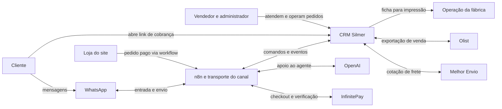
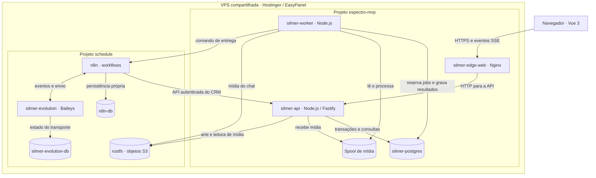
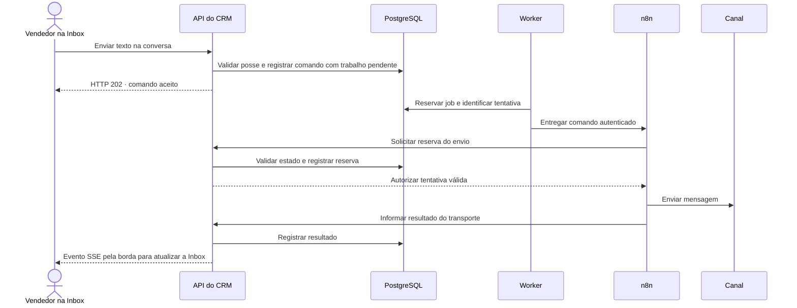

# Como o CRM Silmer funciona

**Guia de arquitetura · 24 de novembro de 2026.** Código de referência `40420566` da `master`. O inventário de serviços e a rota da borda foram consultados no EasyPanel nessa data. As setas nos diagramas representam relações confirmadas no código ou nos contratos. A versão em execução de cada serviço exige uma conferência de release própria.

O CRM organiza o trabalho que começa com uma mensagem e pode terminar em um pedido confirmado, uma ficha para a fábrica e um recebimento. A decisão que explica boa parte da arquitetura é **quem tem autoridade para mudar o estado comercial**. O n8n pode pedir o registro de uma mensagem, um vendedor pode assumir a conversa e um provedor pode informar um pagamento. Em cada caso, o CRM valida quem está agindo, a operação permitida e o estado atual antes de gravar no PostgreSQL.

## 1. Quem conversa com o sistema?

Visão de contexto no estilo C4. Leia cada seta como um verbo. Uma conversa é o histórico de atendimento de um canal. Um assunto identifica o que está em discussão naquela conversa. Um pedido tem ciclo de vida e autorização próprios. Isso permite tratar dois pedidos na mesma conversa e consultar uma ficha sem conceder acesso a todo o histórico do cliente. [Decisão sobre Pedido, Conversa e Assunto](../adr/032-separar-pedido-conversa-e-assunto.md)

A mensagem válida inicia a jornada no n8n. Na linha geral, o agente pode qualificar, sugerir a abertura do pedido e transferir o atendimento. O vendedor decide a abertura do pedido de atendimento. Na linha pessoal, a atribuição é ao titular e a entrada é humana. Já o pedido pago da loja entra por outro contrato. São três origens com regras distintas, embora compartilhem o CRM. [Abertura humana](../adr/056-abertura-de-pedido-com-confirmacao-humana.md) · [Linhas pessoais](../adr/090-whatsapp-pessoal-carteira-e-cadastro-compartilhado.md) · [Pedido da loja](../runbooks/loja-do-site.md)

## 2. Onde cada parte executa?

O CRM é um **monólito modular**. Uma mudança de negócio pode envolver vários módulos do mesmo código. Em execução, o navegador, a API e o worker têm papéis distintos. A API responde ao operador enquanto o worker pode esperar um serviço remoto, processar mídia ou reconciliar uma tentativa anterior. O PostgreSQL guarda tanto o estado comercial quanto o trabalho pendente.

O desenho combina a **distribuição física** dos serviços e as **dependências lógicas**. A seta n8n → API representa o contrato HTTP, independentemente do endereço de ingresso escolhido. A chamada do navegador tem um caminho concreto no painel e no código: HTTPS → serviço de borda na porta 8080 → Nginx → API na porta 3000. Para `/api/v1/events`, o proxy desativa o buffering para que o navegador receba cada evento assim que ele chega. [Nginx](../../docker/nginx.conf) · [Configuração versionada](../../ops/easypanel/topology.json)

### Inventário observado no EasyPanel

| Projeto | Serviços vistos em 24/11 | Responsabilidade e alcance da evidência |
| --- | --- | --- |
| `espectro-mvp` | `silmer-edge-web`, `silmer-api`, `silmer-worker` | Borda, aplicação HTTP e tarefas em segundo plano. O painel mostrava deploy automático habilitado nos três. Dois domínios HTTPS apontavam para a mesma borda, incluindo o domínio comercial. |
| `espectro-mvp` | `silmer-postgres`, `silmer-chat-spool-init` | Banco do CRM e auxiliar de preparação do volume temporário. API e worker compartilham o spool. O auxiliar prepara permissões e pode ficar parado após essa etapa. |
| `schedule` | `n8n`, `n8n-db` e auxiliares de execução e de backup | O painel lista a orquestração compartilhada e sua persistência. A periodicidade de backup e a versão publicada dos workflows pedem evidência própria. |
| `schedule` | `silmer-evolution`, `silmer-evolution-db` | Ponte do WhatsApp e banco exclusivo do transporte. A ADR 050 documenta a escolha da ponte enquanto evolui a integração oficial com a Meta. |
| `schedule` | `silmer-waha`, `silmer-wppconnect` | Também aparecem no painel. A documentação de transporte os identifica como alternativas de fases anteriores. A listagem, sozinha, não comprova sessão pareada ou tráfego. |
| `schedule` | `rustfs` | Armazenamento de objetos compartilhado na VPS. Aplicações usam buckets e permissões por finalidade. As notas do painel para API e worker apontavam para esse serviço. |

Há duas referências de tempo na evidência. A listagem, os destinos HTTPS e os controles de deploy foram lidos em **24/11**. As notas de dependência exibidas pelo painel eram de **18/10**. Elas associavam o worker a PostgreSQL, n8n e RustFS, e registravam o mesmo diretório de mídia na API e no worker. Essa distinção explica por que uma versão antiga da topologia pode mencionar um `silmer-n8n` dedicado enquanto o cadastro observado é `schedule/n8n`. O levantamento não mediu tráfego, não consultou segredos e não atesta saúde, digest executado, exposição de cada serviço ou sucesso de restore. [Topologia operacional e histórico](../../EASYPANEL-TOPOLOGY.md) · [Transporte Evolution](../adr/050-evolution-baileys-como-ponte-do-whatsapp.md) · [Operação da mídia](../runbooks/rustfs-chat-media.md)

## 3. Como navegar pelo código?

| Pergunta | Onde começar | O que procurar |
| --- | --- | --- |
| Quem desenha a tela? | [SPA Vue e roteador](../../apps/edge-web/src/router.js) | A rota abre uma view. A tela consulta a API e apresenta ações permitidas. |
| Quem recebe o HTTP? | [Composição da API](../../apps/api/src/server.js) e [registro das rotas](../../apps/api/src/app.js) | A inicialização conecta repositórios e serviços. A rota valida o pedido HTTP, identifica o ator e chama a operação. |
| Quem decide sobre cliente, mensagem e pedido? | [Contatos](../../modules/contacts), [Inbox e canais](../../modules/inbox-channels), [Pedidos](../../modules/orders) | Identidade por canal, conversa, itens, snapshots e transições. Catálogo, configuração, qualificação e gestão de trabalho também vivem em [módulos do monólito](../../modules). O nome histórico `deals-pipeline` permanece no código após a retirada do Kanban comercial. |
| Quem limita o acesso e preserva a trilha? | [Identidade e acesso](../../modules/identity-access), [auditoria e privacidade](../../modules/audit-privacy) | Sessão, capacidades e escopo do registro. A auditoria comercial preserva a decisão. Logs técnicos servem ao diagnóstico. |
| Quem entrega comandos externos? | [Integração n8n](../../modules/n8n-integration/src), [confiabilidade](../../modules/integration-reliability/src), [worker](../../apps/worker/src/worker.js) | Comando persistido, fila, tentativa, indicação de início do efeito e resultado. [Olist](../../modules/olist) e [frete](../../modules/shipping) têm módulos próprios. |
| Onde o contrato vira persistência? | [Banco e migrações](../../modules/database) e [contratos de integração](../integrations/n8n/README.md) | Restrições e transações sustentam idempotência e concorrência. O n8n solicita mudanças por HTTP com credencial técnica de escopo limitado. |

O operador entra com sessão em cookie. Nos comandos da interface, a API valida a origem e o token CSRF para impedir que outra página opere com a sessão do vendedor. Já o núcleo do contrato n8n → CRM usa autenticação Basic e três rotas para entrada de mensagem, anexo e evento. Cada direção da integração tem sua própria credencial. Os workflows se limitam ao contexto autorizado pela API, inclusive quando consultam a IA. [Sessão e CSRF](../phase1/IDENTITY-ACCESS-BASELINE.md) · [Contrato n8n](../integrations/n8n/README.md) · [Uso de IA](../integrations/openai/README.md)

## 4. Siga uma mensagem de ponta a ponta

Na entrada via Evolution, a ponte recebe a mensagem do WhatsApp. O workflow chama o endpoint de entrada com identidade de origem e chave de idempotência. O CRM resolve contato e conversa, registra a mensagem e devolve o modo de atendimento, a revisão da entrada e a geração da automação (`automation_epoch`). Uma reentrega da mesma operação pode recuperar o resultado anterior. A Inbox recebe por **SSE** um aviso de mudança e relê os dados que o operador pode consultar. [Rotas n8n](../../apps/api/src/n8n-routes.js) · [Distribuidor de eventos](../../apps/api/src/live-event-dispatcher.js) · [Tela da Inbox](../../apps/edge-web/src/views/InboxView.vue)

A volta tem mais etapas. **Quando o vendedor clica em Enviar, o primeiro sucesso significa que o CRM aceitou o trabalho.** A confirmação do transporte vem depois.

**Por que persistir antes de enviar?** O registro de saída, chamado *outbox*, guarda a intenção de envio no banco. Se o worker parar antes de pegá-la, o trabalho continua disponível. A fila usa `FOR UPDATE SKIP LOCKED` para que outra execução possa escolher um job livre. Se o transporte aceitar a mensagem e a conexão cair antes da confirmação, uma nova tentativa pode duplicar o envio. O CRM prevê `outcome_unknown` e reconciliação para esse caso. [Rota de envio](../../apps/api/src/conversation-routes.js) · [Outbox](../../modules/n8n-integration/src/postgres-command-outbox.js) · [Fila PostgreSQL](../../modules/integration-reliability/src/postgres-job-queue.js) · [Entrega ao n8n](../../modules/integration-reliability/src/n8n-command-worker.js)

**O que acontece se o vendedor assumir enquanto a IA prepara uma resposta?** A tomada humana muda a geração da automação. Ao pedir a reserva, a resposta antiga apresenta uma geração obsoleta e perde autorização. Se o provedor já recebeu o envio, o CRM precisa acompanhar o resultado daquele efeito. Na linha pessoal, a geração também ajuda a vincular o evento à instância correta. A leitura de outras linhas pessoais exige supervisão designada e a permissão de consultar um pedido é verificada separadamente. [Contrato da reserva](../integrations/n8n/README.md) · [Supervisão de linhas pessoais](../adr/095-supervisao-das-linhas-pessoais.md)

## 5. Do pedido aos sistemas externos

| Operação | Caminho | Regra que define a fronteira |
| --- | --- | --- |
| Produzir a ficha | Vendedor → API → snapshot do pedido → renderização PDF com Chromium | O PDF para impressão e o detalhado partem do mesmo snapshot. Isso preserva a versão da ficha usada pela fábrica. [ADR 093](../adr/093-ficha-de-pedido-para-impressao.md) |
| Cobrar um pedido | Cliente abre o link do CRM → clica em Pagar → CRM → worker → n8n → InfinitePay → n8n → API | Abrir a página apenas consulta. O clique inicia a tentativa quando a integração está habilitada. O CRM controla valor reservado, concorrência com cancelamento e conciliação do pagamento. [ADR 098](../adr/098-link-de-pagamento-do-crm-e-cobrancas-que-somam.md) |
| Exportar ao ERP | Operador revisa pedido confirmado → API reserva a operação → worker integra com Olist | A autorização e o cadastro exigidos para exportação são verificados no servidor. Um resultado remoto incerto exige conferência antes de repetir uma escrita. [Runbook Olist](../runbooks/olist-phase6.md) |
| Cotar frete e preencher endereço | API → Melhor Envio para cotação. API → ViaCEP para sugestão de endereço | Credenciais de frete ficam na fronteira de servidor. Na consulta de endereço, só o CEP precisa sair do CRM. [Frete](../runbooks/melhor-envio.md) · [Cadastro do cliente](../adr/047-cadastro-completo-do-cliente.md) |
| Enviar arquivo no chat | API → spool → worker e antivírus → bucket de mídia no RustFS | O banco permite rastrear o estado do arquivo. O spool é transitório. A política de mídia do chat distingue objetos preservados, anexos de arte do pedido e referências temporárias do canal. [Pipeline de mídia](../runbooks/rustfs-chat-media.md) · [Mídia temporária](../phase0/TRANSIENT-MEDIA.md) |

## 6. O que acontece quando uma peça falha?

| Situação | Impacto esperado | Evidência para investigar |
| --- | --- | --- |
| Borda responde, mas a Inbox não carrega | O Nginx consegue servir o frontend enquanto a API ou o banco está indisponível. | Comparar `/healthz` da borda com `/api/health/ready` da API. A prontidão da API inclui banco e migrações. [Verificações operacionais](../runbooks/production-readiness-checks.md) |
| Worker ou n8n deixa de entregar | A interface pode continuar aceitando comandos. A idade do job e o estado da tentativa revelam onde o envio parou. | Comparar heartbeat, fila pendente, comandos em processamento e resultados incertos. [Observabilidade](../../ops/observability/README.md) |
| RustFS fica indisponível | A ficha pode continuar no banco enquanto seus arquivos ficam inacessíveis. O PostgreSQL contém os metadados e referências. | Conferir acesso ao bucket correto, estado do processamento e capacidade do spool. [Arte do pedido](../runbooks/ativacao-arquivos-da-arte.md) |
| A VPS inteira é perdida | Os dois projetos EasyPanel compartilham o host. Podem cair ao mesmo tempo a aplicação, os três bancos e os bytes dos arquivos. | Restaurar em host limpo exige cópias externas, dados e chave do n8n, objetos do CRM e reaplicação do registro de exclusões. O gate versionado do ensaio está `blocked`. [Plano de recuperação](../../ops/recovery/RUNBOOK.md) · [Gate do drill](../../ops/recovery/drill-gate.json) |

**RPO de 1 hora** é a perda máxima de dados que o projeto pretende tolerar. **RTO de 4 horas** é o prazo pretendido para retomar a operação. Demonstrá-los exige um restore cronometrado com verificação dos dados. Uma cópia no mesmo host ajuda em falhas locais e continua vulnerável à perda da VPS.

**Como uma versão chega ao usuário?** O fluxo aprovado passa por PR e gates do GitHub antes da integração na `master`. O CI define quais mudanças exigem imagens e produz artefatos identificáveis por SHA/digest. O EasyPanel mantém deploy automático das aplicações. Para investigar divergência entre tela e código, relacione o SHA aprovado, o build de cada serviço, o digest em execução e o health da versão. Migrações de expansão permitem voltar à imagem anterior compatível durante a janela de rollback. [CI](../../.github/workflows/ci.yml) · [Decisão de deploy](../adr/022-manter-deploy-automatico-github-easypanel.md) · [Migrações](../../modules/database/README.md)

## 7. Por onde estudar e como manter o mapa

1. **Comece por uma resposta na Inbox.** Percorra a sequência da seção 4. Localize o retorno `202` na rota e o registro da tentativa no worker. Explique em que ponto seria seguro repetir a operação.
2. **Depois estude a propriedade dos dados.** Escolha um anexo e identifique os metadados no PostgreSQL, os bytes transitórios e o objeto preservado. Pergunte o que voltaria se fosse restaurado somente o banco.
3. **Por fim, avalie uma mudança concreta.** Para justificar outro worker, observe idade da fila, tempo de processamento e uso do banco. Para justificar outro host, examine disponibilidade exigida e duração real de backup e restore. Os critérios de evolução do piloto estão na [topologia operacional](../../EASYPANEL-TOPOLOGY.md).
4. **Atualize a visão afetada quando a arquitetura mudar.** Uma nova integração muda o contexto. Uma troca de hospedagem muda a implantação. Uma mudança de reserva muda a sequência. Registre a proposta em RFC e a decisão aceita em ADR segundo a [convenção do repositório](../../AGENTS.md).

**Rastreabilidade.** Este guia descreve a arquitetura existente. Relaciona o inventário a INT-3 / OPS-CHK-01 (T00.3), a jornada a ORC-01–08 e INB-01, e a recuperação a T07.3. A especificação e os runbooks mantêm os critérios e evidências de cada entrega. [Requisitos](../../.specs/features/crm-mvp/spec.md) · [Tarefas](../../.specs/features/crm-mvp/tasks.md) · [Síntese arquitetural](../../ARCHITECTURE.md) · [Desenho técnico](../../TECHNICAL-DESIGN.md)
