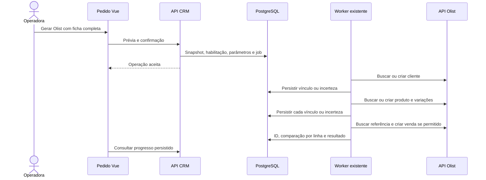
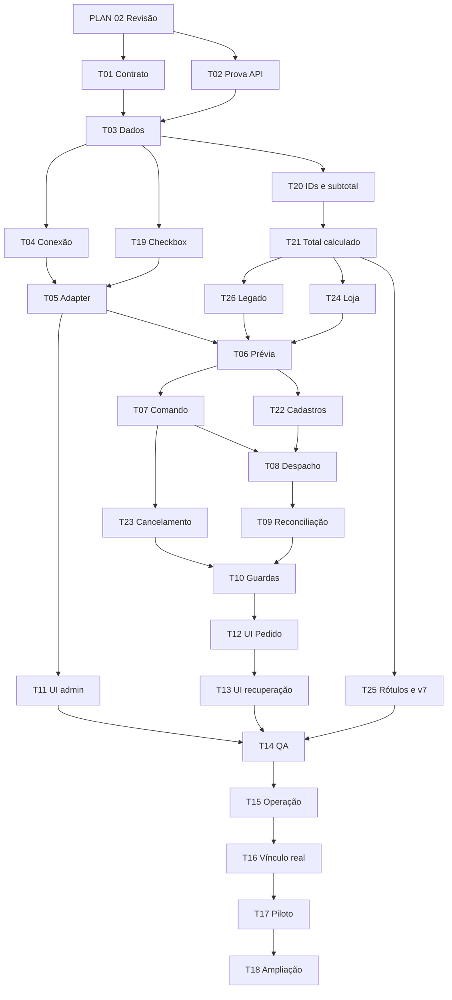

# Geração assistida de pedidos de venda no Olist

Emenda de escopo de 05/11/2026: [RFC 046](046-olist-escopo-inicial-de-centavos-exatos.md)
/[ADR 059](../adr/059-olist-exportacao-com-unitario-exato-em-centavos.md) supersede
a amplitude monetária inicial: somente unitários exatos em centavos, com
frações bloqueadas antes de qualquer inclusão. F1/T02 foram fechados após a
[prova real C05–C07](../integrations/olist/evidence/exact-cent-proof-result.json)
desse subconjunto. Os demais requisitos e gates posteriores continuam vigentes.

RFC 044. Especificação de produto, desenho técnico e plano de execução.
Revisão 2 de 04/11/2026. Responsável: Tech Lead. Decisor: proprietário.
Público: Produto, Backend/Dados, Integrações, Frontend/A11y, QA e DevOps.

**Status:** decisões de produto registradas na
[ADR 057](../adr/057-olist-por-habilitacao-subtotal-por-tamanho-e-cancelamento.md).
F1/T02 concluídos no escopo `exact-cent-v1`; Fase 2 (T03/T04/T19/T05)
implementada e validada localmente em 05/11/2026, no
[commit 6a79cc8a](https://github.com/romulosutil/crm-silmer/commit/6a79cc8aecc3111dbfad5b8b14220f3b3df860aa).
Fase 3 iniciada pela fatia T20b de composição persistida opt-in
([contrato e limites](../runbooks/olist-phase3.md)); T20/T21/T26/T24 concluídas em
domínio/API; T06/T22/T07 concluídas em 06/11/2026, com o gate F3 ainda aberto. As fases 4–6 permanecem pendentes.
A geração real continua desligada, sem deploy, conexão real homologada ou
piloto nesta entrega. A revisão substitui
as recomendações iniciais de preço unitário digitado, cadastro apenas existente, posse do pedido e edição após
envio. Não há issue/PR específica vinculada nesta etapa.

**Objetivo:** usuário habilitado gera venda Olist a partir de qualquer Pedido
com ficha e cadastro completos, resolvendo ou criando cliente, produto e
variações. No CRM, cada linha de tamanho recebe quantidade e **subtotal**;
o total é calculado. Cancelamento serve à higiene/métricas antes da exportação.

O documento concentra OLIST-01–50, seis fases e OLIST-T01–T26. OLIST-PLAN-01
registra a proposta original; OLIST-PLAN-02 registra esta revisão documental.
Nenhum dado da operadora piloto, credencial ou cadastro real é versionado.

## Índice

1. [Contexto e fontes](#contexto-e-fontes)
2. [Escopo e decisões](#escopo-e-decisões)
3. [Jornadas e permissões](#jornadas-e-permissões)
4. [Requisitos e aceite](#requisitos-e-aceite)
5. [Mapeamento comercial](#mapeamento-comercial)
6. [Arquitetura e dados](#arquitetura-e-dados)
7. [Contratos propostos da API](#contratos-propostos-da-api)
8. [Envio e recuperação](#envio-e-recuperação)
9. [Interface e acessibilidade](#interface-e-acessibilidade)
10. [Segurança e operação](#segurança-e-operação)
11. [Fases e tarefas](#fases-e-tarefas)
12. [Validação e liberação](#validação-e-liberação)
13. [Acompanhamento e handoff](#acompanhamento-e-handoff)

## Contexto e fontes

Hoje a venda pode ser redigitada do CRM para o Olist. O exemplo privado
informado mostrou correspondência de grade e total, mas origens diferentes
para responsável CRM, vendedor ERP, ordem de compra e prazo de pagamento.
Esses valores não podem ser inferidos. URLs compartilháveis, cadastros e
documentos reais do caso ficam fora do repositório versionado.

O Pedido mantém `pendente` e `confirmado`; confirmação não significa quitação.
O cadastro estruturado do cliente existe, mas seus campos opcionais precisam
ser validados para o uso exigido pelo ERP. A baseline é Vue 3, API, worker e
PostgreSQL no monólito modular atual.

### Fontes internas

- [RULES](../../RULES.md), [spec CRM](../../.specs/features/crm-mvp/spec.md),
  [PRD](../../CRM-MVP-ESPECIFICACAO.md) e
  [plano macro](../../.specs/features/crm-mvp/tasks.md).
- [TDD](../../TECHNICAL-DESIGN.md), [arquitetura](../../ARCHITECTURE.md),
  [topologia](../../EASYPANEL-TOPOLOGY.md) e [design](../../design.md).
- [ADR 006](../adr/006-pedido-dois-status.md),
  [ADR 032](../adr/032-separar-pedido-conversa-e-assunto.md),
  [ADR 047](../adr/047-cadastro-completo-do-cliente.md): Pedido, autoria e cadastro.
- [ADR 040](../adr/040-financeiro-com-fila-e-check-manual.md),
  [ADR 041](../adr/041-consulta-administrativa-do-financeiro.md),
  [ADR 042](../adr/042-perfis-e-requitacao-do-financeiro.md) e
  [Financeiro](../../.specs/features/financeiro/spec.md): quitação/check separados.

A ADR 057 substitui o adiamento da integração e o total digitado para o novo
contrato. Habilitação Olist é ortogonal ao perfil e não concede outras ações
comerciais ou financeiras. A revisão também aprova cancelamento local anterior
à exportação e os rótulos Previsão de entrega/Aplicação. As emendas canônicas
distinguem comportamento aprovado para implementar de código já publicado;
ADRs anteriores permanecem imutáveis.

O grafo consultado na descoberta original era de 04/10/2026, anterior à
baseline analisada. Este worktree não possui grafo; a revisão confirma as
fronteiras com `rg` e fontes atuais. Não regenerar nem versionar o grafo.

### Fontes oficiais externas

Consulta em 04/11/2026. T02 revalida e registra versão/hash do schema usado,
sem credenciais ou respostas reais.

| Fonte                                                                                                                     | Contrato relevante                                                                                                                                              |
| ------------------------------------------------------------------------------------------------------------------------- | --------------------------------------------------------------------------------------------------------------------------------------------------------------- |
| [Aplicativos e limites](https://ajuda.olist.com/hubs-e-plataformas-via-api/aplicativos-api-v3-configuracoes-e-utilizacao) | Aplicativo privado, extensão Gestão de Aplicativos, permissões por módulo e limites por conta. Crescer consta na tabela; conferir habilitação efetiva da conta. |
| [OAuth](https://api-docs.erp.olist.com/documentacao/comecando/autenticacao)                                               | Autorização por código e refresh. A documentação informa quatro horas de acesso e um dia de refresh; usar expiração devolvida e prever reconexão.               |
| [Criar pedido](https://api-docs.erp.olist.com/api-reference/pedidos/criar-pedido)                                         | `POST https://api.tiny.com.br/public-api/v3/pedidos`; retorno com `id` e `numeroPedido`.                                                                        |
| [Listar pedidos](https://api-docs.erp.olist.com/api-reference/pedidos/listar-pedidos)                                     | Consulta paginada, inclusive por `numeroPedidoEcommerce`, útil para reconciliação.                                                                              |
| [Uso próprio](https://api-docs.erp.olist.com/documentacao/clientes/orientacoes)                                           | Uso exclusivo da conta dispensa homologação de parceiro pelo Olist. Aceite operacional e testes Silmer continuam necessários.                                   |

Fontes adicionais consultadas para cadastro automático:
[criar contato](https://api-docs.erp.olist.com/api-reference/contatos/criar-contato),
[criar produto](https://api-docs.erp.olist.com/api-reference/produtos/criar-produto)
e [criar variação](https://api-docs.erp.olist.com/api-reference/produtos/criar-varia%C3%A7%C3%A3o-do-produto).
Há operações oficiais de inclusão; campos fiscais, identidade/SKU, tamanhos,
precisão e recuperação continuam sujeitos à prova de contrato em T02.

Não presumir sandbox, unicidade remota de referência, header de idempotência,
item sem produto ou link de impressão retornado. T02 precisa provar essas
capacidades. MCP de terceiros não é dependência desta proposta.

## Escopo e decisões

### Primeira entrega

- Checkbox **Habilitado Olist** por usuário, administrado em Usuários.
- Operação Olist em qualquer Pedido, independente de responsável, perfil,
  origem ou status comercial, desde que completo, ativo e ainda não exportado.
- Busca e criação de cliente, produto pai e variações/tamanhos ausentes,
  com vínculos duráveis, controle de duplicidade e recuperação por etapa.
- Preço comercial como subtotal por linha de tamanho no CRM e total calculado.
- Parametrização central da conta ERP e dos dados comerciais por uma operadora,
  com autoria/configuração versionada para futura ampliação.
- Cancelamento local pré-exportação para higiene, filas e métricas.
- Novos rótulos **Previsão de entrega** e **Aplicação**, esta por item CRM.
- Vínculo de vendas existentes, histórico, diagnóstico e reconciliação.

Fora: edição/sincronização/cancelamento de venda já enviada, emissão ou
cancelamento fiscal, baixa/conciliação financeira, estoque, etiquetas,
expedição, lote, divisão em várias vendas, webhooks e IA no ERP. Cadastro
automático não autoriza apagar entidades remotas ou sobrescrever cadastros
existentes. Não enviar arte, PDF, atendimento ou anexo. n8n mantém a jornada.

Loja e teste não têm exclusão genérica por origem. Loja preserva suas travas,
preço/pagamento gateway e dados originais. Ausência de dado exigido gera
pendência explícita, sem inventar previsão ou cliente fiscal. O piloto exige
ambiente/conta/caso controlados; marca de teste não torna um POST inofensivo.

### Registro das decisões

| ID  | Resultado da revisão                                                                                                                         | Situação                                                                      |
| --- | -------------------------------------------------------------------------------------------------------------------------------------------- | ----------------------------------------------------------------------------- |
| D1  | Integração por API oficial no monólito/worker/PostgreSQL existentes; sem MCP ou nova infraestrutura.                                         | Encaminhamento técnico da ADR 057                                             |
| D2  | Checkbox por usuário permite Olist em qualquer Pedido completo, sem posse/admin implícitos. Usuário desabilitado, inclusive Admin, não gera. | Decidida pelo PO                                                              |
| D3  | Buscar cliente e produto/variações; criar ausentes e guardar vínculos, conectando atributos verificáveis.                                    | Decidida pelo PO; schema fiscal/identidade a comprovar                        |
| D4  | Subtotal por tamanho informado no CRM, total soma linhas; unitário ERP é derivação técnica.                                                  | Decidida pelo PO em esclarecimento                                            |
| D5  | Operação inicial centralizada numa pessoa; parâmetros da conta/configuração central, sem inferir vendedor ERP pelo dono CRM.                 | Centralização decidida; valores reais a preencher na ativação                 |
| D6  | Referência estável e consultável; idempotência por cliente/produto/variação/venda, sem ocupar ordem de compra.                               | Contrato técnico a validar em T02                                             |
| D7  | Não editar após envio. Cancelamento CRM é higiene/métricas antes do Olist; nenhuma propagação de cancelamento remoto.                        | Esclarecida pelo PO                                                           |
| D8  | Uma única operadora piloto designada no chat. Vincular sua conta ativa por ID validado em configuração privada; não hardcode de nome/e-mail. | Operadora decidida; amostra/período/retenção e parâmetros operacionais em T15 |

- [x] D1–D5 e D7 registradas na ADR 057, sem confundir registro com implementação.
- [x] D8 registra piloto individual sem expor identificação no repositório.
- [ ] D3/D6: provar identidade fiscal, produto pai/variação, campos obrigatórios,
      limites, precisão, referências e recuperação de cada inclusão.
- [ ] D5: preencher IDs comerciais reais e verificar gatilhos da conta.
- [ ] D8: definir amostra/período, quotas, retenção, suporte e reconexão antes do piloto.

### Glossário obrigatório

| Termo                | Definição e exemplo sintético                                                                                                                    |
| -------------------- | ------------------------------------------------------------------------------------------------------------------------------------------------ |
| Item do CRM ou grupo | A peça com atributos comuns: camisa, cor, tecido, Aplicação e gola. Possui várias linhas de tamanho. Não renomear todo `items[]` para linha ERP. |
| Linha de tamanho     | Identidade estável dentro de um grupo, tamanho, quantidade e subtotal. Ex.: grupo A, M, 10 peças, subtotal R$ 180.                               |
| Item da venda Olist  | Linha comercial vinculada à variação/produto do tamanho; corresponde à linha de tamanho CRM, nunca ao grupo inteiro.                             |
| Cliente ERP          | Comprador/Contato do CRM, não conta de acesso de funcionário. Buscar/criar cliente não cria usuário autenticável Olist.                          |
| Unitário ERP         | Representação derivada de subtotal/quantidade, sem substituir o subtotal no CRM nem atualizar preço de catálogo existente.                       |

O mesmo tamanho M em dois grupos permanece duas linhas distintas, com seus
produtos, subtotais e vínculos. Reordenação não muda identidade de grupo/linha.

## Jornadas e permissões

### Habilitar e gerar

1. Admin gerencia checkbox Habilitado Olist em criação/edição de usuário.
   Default falso; mudança autorizada, versionada, auditada e efetiva nas
   sessões/jobs atuais. Não habilitar a operadora real nesta entrega documental.
2. Usuário ativo habilitado acessa uma projeção Olist do Pedido de qualquer
   responsável/origem. Perfil Financeiro habilitado recebe só essa projeção e
   comandos Olist, sem Inbox, edição geral ou administração de conta ERP.
   A entrada própria permite localizar Pedido por número ou ID exatos, com
   projeção mínima e limitada; não depende de aparecer na fila financeira.
3. Pessoa completa ficha/cadastro e subtotais pelos comandos comerciais
   normais. Habilitação Olist não concede correção do Pedido alheio: pendência
   aponta a origem e o responsável autorizado pela correção.
4. Prévia valida todos os dados antes de qualquer inclusão remota; mostra
   vínculos encontrados, o que será cadastrado e a composição de cada linha.
   Não há preço digitado na prévia nem total independente.
5. Confirmar congela snapshot/configuração e autoriza a sequência resolver
   cliente → produto/variações → venda. Mostrar etapas e acompanhar resultado.
6. Revogar checkbox, desativar usuário ou cancelar localmente antes da etapa
   de venda impede o próximo efeito. Efeitos já iniciados são reconciliados.

Ser `confirmado` não prova completude: o validador atual retorna lista vazia
nesse estado e não cobre cadastro/subtotais novos. Criar validador específico,
independente de status. Exportar um pendente completo não confirma venda CRM,
não libera PDF nem altera métricas comerciais. Sua confirmação posterior só
pode congelar o mesmo conteúdo exportado, sem alterar itens/cadastro/valores.

### Vínculo existente e reconciliação

Admin usa diagnóstico protegido para buscar venda já existente e conferir
cliente, conta, produto/grade, subtotal por linha e total. Vínculo justificado
usa as mesmas constraints da criação. Referência de outro Pedido bloqueia;
ausência numa venda antiga não impede conferência humana. Não buscar por URL
arbitrária nem adivinhar `doc.view`. Usuário habilitado lê o estado da sua
operação sem ganhar poder de forçar reconciliação, alterar vínculo ou remover
constraints. Caso privado original: vincular, zero POST de criação.

### Cancelar no CRM

Cancelamento local terminal, com motivo, autor, data/hora, versão e auditoria;
sem exclusão física, estorno ou chamada de cancelamento ao ERP. A representação
proposta é marcador `cancelledAt/cancelledBy/reason`, preservando os dois
status comerciais e exibindo Cancelado como situação efetiva. T23 deve validar
esse desenho no ADR técnico de implementação sem escolher terceiro status
silenciosamente. Sem restaurar/reabrir cancelado nesta primeira entrega.

Usar autorização comercial vigente (responsável/Admin); checkbox Olist não
concede cancelamento de qualquer Pedido. Pedido já vinculado/exportado ou com
resultado de venda incerto não pode ser cancelado por essa ação. Com venda
na fila mas efeito ainda não reservado, cancelamento serializa com worker e
invalida envio. Cadastros já criados são preservados, sem compensação destrutiva.

Cancelados saem das vendas ativas, receita vendida, afazeres, filas de
produção/entrega e fila financeira ativa. Histórico, pagamento/check anteriores
e snapshots ficam consultáveis pelo escopo próprio; cancelar não declara
devolução de dinheiro nem apagamento de obrigação fiscal. Pedido pago/loja
exige esse aviso e os mesmos controles, sem modificar gateway ou checkout.

| Ação                                                                   | Usuário ativo habilitado            | Usuário desabilitado para Olist | Admin                       | Automação                  |
| ---------------------------------------------------------------------- | ----------------------------------- | ------------------------------- | --------------------------- | -------------------------- |
| Projeção/conferência/geração Olist de qualquer Pedido completo         | Sim, inclusive de outro dono/perfil | Não pela capacidade Olist       | Só gera se checkbox ativo   | Não                        |
| Leitura comercial anterior                                             | Conforme ACL anterior               | Conforme ACL anterior           | Conforme ACL anterior       | Conforme contrato anterior |
| Editar Pedido ou cancelar localmente                                   | Checkbox não concede; ACL comercial | ACL comercial                   | ACL comercial vigente       | Não pelo contrato Olist    |
| Gerenciar checkbox/conexão/configuração e reconciliação administrativa | Não por habilitação                 | Não por habilitação             | Ação administrativa própria | Não                        |

Não usar allowlist de e-mail como modelo permanente. Piloto é uma restrição
adicional de rollout por ID validado, separada do checkbox e do perfil.

## Requisitos e aceite

Requisitos de produto aprovados na ADR 057; detalhes de contrato/DDL seguem
as validações técnicas desta RFC. Registro documental não comprova implementação.

| ID       | Critério de aceite                                                                                                                                                                                              |
| -------- | --------------------------------------------------------------------------------------------------------------------------------------------------------------------------------------------------------------- |
| OLIST-01 | Comando humano de usuário habilitado pode gerar em qualquer Pedido ativo/completo, sem restringir dono, perfil, origem ou status. PDF, pagamento e mensagens não iniciam Olist.                                 |
| OLIST-02 | Checkbox ortogonal default falso validado em cada efeito; Admin não herda envio. Busca/projeção Olist por número ou ID de qualquer Pedido, sem Inbox/edição/listagem geral.                                     |
| OLIST-03 | Admin mantém checkbox, conexão e parâmetros centrais; OAuth com sessão/expiração/uso único; callback inválido não grava credencial.                                                                             |
| OLIST-04 | Tokens cifrados, refresh serializado/fencing; revogação e resposta tardia não reativam conta nem checkbox.                                                                                                      |
| OLIST-05 | Validar conta/empresa em conexão/reconexão; outra conta não reutiliza vínculos, cadastros, parâmetros ou jobs.                                                                                                  |
| OLIST-06 | Prévia valida ficha/cadastro/subtotais/configuração por versões e expiração, independente de status, sem escrita ERP. Mudança pede nova conferência.                                                            |
| OLIST-07 | Buscar cliente por vínculo/documento verificável; ausente e completo, criar cliente comprador. Ambíguo não cria nem seleciona automaticamente.                                                                  |
| OLIST-08 | Buscar produto e tamanho por identidade comercial/código/atributos; criar pai/variações ausentes, vincular atributos verificáveis sem associação por nome sozinho.                                              |
| OLIST-09 | Linha de tamanho CRM vira item comercial Olist; grupo CRM continua grupo. IDs estáveis, quantidade inteira positiva e soma pela grade, sem quantidade informada.                                                |
| OLIST-10 | Subtotal por tamanho é a autoridade, em centavos; grupo soma linhas e total soma grupos. Backend rejeita total arbitrário e não inventa rateio/desconto.                                                        |
| OLIST-11 | Vendedor/parâmetros ERP centrais versionados, compra/vencimento explícitos. Data ERP usa orderDate existente ou dia operacional do comando se ausente, congelado sem confirmar CRM. Pix não prova recebimento.  |
| OLIST-12 | Allowlist de campos e schema oficial em cada cadastro/venda; não exportar IA, atendimento, arte, anexo ou notas internas.                                                                                       |
| OLIST-13 | Referências estáveis distintas para cliente/produto/variação/venda, pesquisáveis e sem confundir com ordem de compra; não presumir unicidade do provedor.                                                       |
| OLIST-14 | Uma operação lógica por Pedido/conta e uma reserva compartilhada por identidade de cadastro; chaves/abas/processos diferentes não duplicam efeitos.                                                             |
| OLIST-15 | Snapshot, reserva, auditoria e publicação locais atômicos; cada etapa tem reserva de efeito própria antes de HTTP.                                                                                              |
| OLIST-16 | Timeout/crash/corpo inválido/falha ao persistir de qualquer inclusão vira incerteza dessa etapa; não repetir nem avançar dependências até prova.                                                                |
| OLIST-17 | Reconciliação só lê; zero após incerteza não autoriza nova criação, inclusive cliente/produto. Múltiplos/divergentes exigem análise.                                                                            |
| OLIST-18 | Vínculo manual confere venda existente por conta/cliente/produto/quantidade/subtotal por linha/total, com constraints e auditoria comuns.                                                                       |
| OLIST-19 | Exportação não muda status, quitação, entrega ou Nota criada. Cancelamento local filtra universos ativos, preservando históricos e sem estorno.                                                                 |
| OLIST-20 | Sem comando fiscal, estoque, baixa ou cancelamento ERP. Conferir gatilhos de cadastro/venda e bloquear piloto com efeito incompatível.                                                                          |
| OLIST-21 | Snapshot comercial reservado não admite edição incompatível; após exportação/vínculo não há reabertura para edição. Pedido cancelado não inicia exportação.                                                     |
| OLIST-22 | UI cobre prévia, busca/criação de cliente/produto/tamanho/venda, sucesso, falha e incerteza por etapa; reload recupera estado persistido.                                                                       |
| OLIST-23 | Checkbox, grade monetária, cancelamento e geração operáveis por teclado/leitor; labels/erros/foco previsíveis sem anúncio excessivo.                                                                            |
| OLIST-24 | Vue/shell/tokens atuais, celular/desktop; sem framework/store global/domínio em window ou nova infraestrutura.                                                                                                  |
| OLIST-25 | Logs/métricas/auditoria sem PII/token/payload/URL compartilhável; identidade da operadora piloto em configuração privada, não em código/diff.                                                                   |
| OLIST-26 | Quotas/timeout/paginação/corpo/retries por conta consideram todos os cadastros/variações/venda; não transformar clique em tempestade de chamadas.                                                               |
| OLIST-27 | Revogar checkbox/desligar integração impede próximo efeito de toda etapa. Preservar resultado/reconciliação de efeitos iniciados e cadastros existentes.                                                        |
| OLIST-28 | Retenção/backup cifrado/recovery para todas as etapas. Restore não autoriza recriar entidades possivelmente já existentes no ERP.                                                                               |
| OLIST-29 | Migração expand para identidade de linha/subtotal/checkbox/cancelamento; legado continua legível e configuração ausente não quebra startup.                                                                     |
| OLIST-30 | Histórico de atores/versões/parâmetros/etapas/tentativas e IDs externos; replay não duplica evento de efeito ou cancelamento.                                                                                   |
| OLIST-31 | Gates incluem dinheiro/legado, cadastros concorrentes, cancelamento/métricas/Financeiro/loja, A11y, ficha versionada e piloto único autorizado.                                                                 |
| OLIST-32 | Link ERP validado/gerado no servidor; sem URL arbitrária, hash adivinhado ou compartilhamento criado. Sem URL confiável mostrar número.                                                                         |
| OLIST-33 | Admin edita checkbox em Usuários com sessão/CSRF/versão/auditoria. Usuário não se habilita nem altera a configuração para escapar do piloto.                                                                    |
| OLIST-34 | Ficha completa inclui campos principais de cada grupo, grade, Aplicação, origem da arte, Previsão de entrega, condição e subtotais; nome/adicionais não viram obrigatórios.                                     |
| OLIST-35 | Cadastro do comprador tem tipo/documento válido, nome/razão social, contato e endereço fiscal exigidos pelo schema, IE/isento conforme regra explícita; não fabricar dado faltante.                             |
| OLIST-36 | Dois Pedidos do mesmo comprador compartilham reserva por conta/documento protegido; uma criação, com dependências aguardando resultado.                                                                         |
| OLIST-37 | Produto pai por identidade comercial normalizada; variação por pai/atributos/tamanho. Dois pedidos compartilham criação, sem confundir tamanhos de grupos distintos.                                            |
| OLIST-38 | Cadastros já existentes não são sobrescritos pelo preço negociado ou diferenças cadastrais. Diferença relevante exige resolução humana segura.                                                                  |
| OLIST-39 | Persistir cada cadastro confirmado antes da etapa seguinte; falha da venda não apaga cliente/produto/variação nem reinicia inclusões concluídas.                                                                |
| OLIST-40 | Unitário ERP é derivado do subtotal/quantidade com precisão/arredondamento comprovados por linha; se inexato, bloquear só exportação, preservando validade comercial CRM.                                       |
| OLIST-41 | Não compensar inexatidão entre linhas, dividir linha artificialmente, inventar desconto ou mudar quantidade/subtotal. Ler subtotais por linha e total após criar.                                               |
| OLIST-42 | IDs de grupo/linha estáveis em edição/reordenação; duplicação cria IDs novos. Mesmo tamanho em grupos diferentes mantém seus vínculos e subtotais.                                                              |
| OLIST-43 | Quantidade alterada exige revisão humana do subtotal; não manter preço aprovado implicitamente nem recalcular por unitário antigo contra desconto de fábrica.                                                   |
| OLIST-44 | Legado sem subtotais continua legível; não dividir total histórico. Enriquecimento humano versionado preserva total/snapshot confirmado; diferença bloqueia exportação.                                         |
| OLIST-45 | Cancelar Pedido local pré-exportação é terminal, motivado, auditado e idempotente; não excluir físico, desfazer quitação/nota ou cancelar ERP.                                                                  |
| OLIST-46 | Cancelados excluídos de vendas/valor vendido e filas ativas, com filtro consistente antes de paginação, métricas sem dupla contagem e histórico acessível.                                                      |
| OLIST-47 | Corrida cancelamento/worker tem um vencedor antes do efeito de venda; vendido/vinculado/incerto não cancela localmente. Não gerar segundo Pedido automaticamente.                                               |
| OLIST-48 | Uma operadora piloto validada por ID privado mais checkbox. Configuração comercial da empresa central, sem inferir responsável ERP por usuário CRM.                                                             |
| OLIST-49 | Entrega prometida vira Previsão de entrega e Técnica do campo 4 vira Aplicação, na UI/erros/ARIA/ficha. Preservar chaves e sem reativar summary.aplicacao.                                                      |
| OLIST-50 | Nova ficha-canonical-v7 para rótulos, mantendo v2–v6/amostras/hashes/snapshots históricos intactos. Não adicionar dinheiro à ficha por inferência; seleção v7 depende de aprovação da amostra e gates vigentes. |

## Mapeamento comercial

### Completude e fonte da verdade

Validar todos os campos principais da ficha, grade e subtotais, Aplicação por
grupo, origem da arte, Previsão de entrega e condição de pagamento. Nome do
Pedido e adicionais continuam opcionais. Cliente precisa de documento/tipo,
nome ou razão social, contato/endereço exigidos pelo ERP e IE/isento quando
aplicável. Dado fiscal não é deduzido de conversa ou preenchido com zero.

Loja usa adapter de seu snapshot próprio, sem depender da existência de
Contato. Falta de previsão/cadastro explícito deve ser corrigida por comando
aditivo próprio que preserve checkout/gateway/ficha original; o checkbox não
libera edição da loja. Sem esse adapter/dado completo, informar pendência por
campo em vez de excluir a origem ou inventar valor.

| Informação                          | Origem e vínculo                                                                                                                                                                 |
| ----------------------------------- | -------------------------------------------------------------------------------------------------------------------------------------------------------------------------------- |
| Cliente                             | Cadastro CRM e documento normalizado; vínculo por conta/identidade fiscal. Cliente ERP não é usuário funcionário.                                                                |
| Grupo CRM                           | IDs estáveis e atributos comerciais: peça, cor, tecido, Aplicação, gola/público relevantes.                                                                                      |
| Produto pai ERP                     | Identidade comercial normalizada do grupo; referência/SKU determinístico e atributos verificados. Não nome sozinho.                                                              |
| Tamanho/variação                    | Variação ligada ao pai e atributos; reutilizar tamanho existente ou criar ausente. Guardar IDs, sem misturar grupos.                                                             |
| Linha da venda                      | ID de linha de tamanho → variação/produto, quantidade e subtotal; um item Olist por linha CRM.                                                                                   |
| Subtotal/total                      | Subtotal digitado por tamanho; total do grupo/pedido calculado pelo backend. Não há total independente na confirmação nem na prévia Olist.                                       |
| Vendedor/natureza/depósito/situação | Configuração central por conta e revisão, preenchida pela operadora/administrador. Não inferir por dono CRM.                                                                     |
| Compra/vencimento                   | Campo explícito por venda ou default central aprovado; sem contador inventado. Pix não implica quitação ou data de recebimento.                                                  |
| Data da venda ERP                   | orderDate comercial quando existente; se nulo no pendente, dia de São Paulo do comando de geração aceito, congelado no snapshot. Retry não troca a data nem confirma Pedido CRM. |
| Previsão de entrega                 | Campo atual summary.data_entrega_confirmada com novo rótulo; não usar deliveredOn.                                                                                               |
| Aplicação                           | items[].tipo_servico permanece por grupo; summary.aplicacao histórico segue desativado.                                                                                          |
| Observações                         | Seleção de conteúdo comercial mínimo; não copiar notas internas, atendimento, arte ou arquivos.                                                                                  |

### Dinheiro por subtotal

```text
subtotal da linha de tamanho = valor negociado informado em centavos
subtotal do grupo CRM = soma dos subtotais das suas linhas
total do pedido = soma dos subtotais dos grupos
unitário ERP = derivação técnica para representar subtotal / quantidade
```

Exemplo sintético: grupo camisa, M 10 peças/subtotal R$ 180 e G 20 peças/
subtotal R$ 320. Total R$ 500. O desconto por quantidade não precisa seguir
um preço uniforme; o CRM não substitui esses valores por média.

Quantidade inteira positiva e subtotal inteiro positivo com limites/overflow
validados. Rascunho pode omitir subtotal e ficar incompleto; zero/negativo não
vira preço de venda válido sem decisão comercial própria. Alterar quantidade
marca subtotal para revisão humana; não aplicar automaticamente unitário
anterior nem aceitar subtotal como revisado por mera conservação do campo.

T02 comprova escala unitária e ordem de arredondamento ERP. Usar aritmética
exata/racional até a serialização. Se houver representação unitária aceita
cujo subtotal remoto seja igual em centavos, enviar sem mudar fonte CRM.
Se não houver, manter Pedido válido no CRM e bloquear somente Olist com
pendência legível. Não inventar desconto, dividir linha, compensar entre
tamanhos, mudar quantidade ou distribuir resíduo.

Comparar cada subtotal e o total após criação, inclusive se ERP agrega itens
com o mesmo produto. Total global igual não encobre erro numa linha. Preço
negociado não sobrescreve catálogo ERP encontrado. Criar produto ausente só
envia preço de cadastro se schema exigir e política central definir sua fonte.

Legados preservam total e snapshot existentes. Não inferir subtotais dividindo
o total. Comando de enriquecimento humano específico preenche linhas com
controle de versão e soma igual ao total confirmado, sem alterar a ficha
histórica. Composição divergente exige correção comercial antes de exportar;
não repartir automaticamente valores. Dados da loja vêm do checkout/catálogo.

## Arquitetura e dados

API oficial no monólito e worker/PostgreSQL existentes, sem nova infraestrutura.
n8n mantém canais/IA/jornada e não acessa banco CRM. Cadastro e venda não formam
transação distribuída; são etapas com vínculos e recuperação independentes.



Antes de cada criação, revalidar habilitação/ator, conta, cancelamento,
completude e revisão congelada. Não manter SQL aberto durante HTTP. Efeito
iniciado precisa de reconciliação mesmo se a habilitação for revogada depois.

| Fronteira                          | Alteração planejada                                                                                                                     |
| ---------------------------------- | --------------------------------------------------------------------------------------------------------------------------------------- |
| modules/olist proposto             | Resolução/criação por entidade, snapshots, recursos compartilhados, adapter oficial e sequência de exportação.                          |
| modules/orders                     | IDs de grupo/linha, subtotal, total calculado, enriquecimento legado, cancelamento, métricas/Financeiro, loja e guardas pós-exportação. |
| modules/contacts                   | Cadastro estruturado e versões, sem duplicar fonte de PII. Loja usa seu snapshot sem inventar Contato.                                  |
| modules/identity-access e Usuários | Checkbox ortogonal, projeção Olist entre donos/perfis, administração restrita e revogação em sessões/jobs.                              |
| API e confiabilidade               | Rotas/runtime/OpenAPI, sessão/origem/CSRF/idempotência/auditoria; adaptar fila/outbox para atomicidade por etapa.                       |
| worker                             | Handlers por etapa com fencing, reservas e incerteza; preservar handlers n8n/mídia/WhatsApp.                                            |
| edge-web e impressão               | Grade com subtotais, total somente leitura, cancelamento, progresso e novos rótulos; ficha v7 sem reescrever v2–v6.                     |
| Operação                           | Configuração comercial central por conta, flags, piloto por ID privado, runbook Olist e recovery de todas as etapas.                    |

### Modelo lógico proposto

DDL/índices em T03/T20. IDs abaixo são internos e estáveis; não usar posição
de array como identidade. Migração expand precisa preservar leitores antigos.

| Registro               | Conteúdo e constraints                                                                                                                                                        |
| ---------------------- | ----------------------------------------------------------------------------------------------------------------------------------------------------------------------------- |
| Usuário                | olistEnabled boolean default false ou capacidade equivalente exposta como checkbox; revisão de autorização e auditoria. Não criar perfil Olist nem e-mail hardcoded.          |
| Conexão/configuração   | Conta/empresa/ambiente, geração, parâmetros comerciais/revisão, tokens cifrados e refresh com fencing. Estado OAuth único ligado à sessão.                                    |
| Grupo/linha            | IDs estáveis, quantidade, subtotalCents e revisão de aprovação do subtotal. Guardar modo legado ou novo, sem retrocalcular valores desconhecidos.                             |
| Cancelamento           | Proposta de marcador terminal com autor/instante/motivo e versão. Não apaga status anterior, valores, confirmação ou eventos.                                                 |
| Recurso ERP            | Conta, tipo cliente/produto/variação, identidade protegida, estado, geração, tentativa, referência e ID remoto. Unique por conta/tipo/identidade.                             |
| Dependência            | Exportação referencia recursos compartilhados; uma inclusão atende vários Pedidos sem duplicar cliente/produto.                                                               |
| Prévia                 | Ator/checkbox/revisões de fontes/configuração, plano de cadastros, validade proposta de 15 minutos, snapshot cifrado e hashes protegidos.                                     |
| Exportação             | Unique conta/Pedido; referência, estado/etapa, revisão, snapshot cifrado, origem created/linked, ID/número remoto, autores/horários. Unique conta/ID venda remoto preenchido. |
| Etapa/tentativa/evento | Recurso ou exportação, reserva/início de efeito/fencing, resultado/código seguro. Histórico append-only sem payload em auditoria.                                             |

Identidade de cliente usa documento normalizado protegido por HMAC; produto
usa assinatura comercial aprovada e código/SKU estável. Variação inclui pai
e atributos/tamanho. Nome sozinho não deduplica. Produto compartilhado não
inclui o preço negociado do Pedido em sua identidade. Alteração de atributos
não reutiliza mapeamento incompatível nem renomeia produto existente à força.

Cadastros/snapshots/respostas idempotentes com PII ficam cifrados com versão
de chave/AAD por conta/entidade/finalidade. Jobs levam só IDs. Não usar hash
simples de documento como anonimização nem copiar AAD de outra integração.

### Concorrência e compatibilidade

Transação local publica job/outbox junto da reserva/snapshot/auditoria. Worker
usa reserva de recurso compartilhado e efeito de uso único por tentativa.
Definir ordem de locks para evitar deadlock entre duas exportações do mesmo
cliente/produto. Recurso incerto bloqueia dependentes, sem recriação paralela.

Revalidar cadastro, Pedido, subtotais, parâmetro central, conexão e checkbox
antes de todo efeito. Registrar plano cancelado/invalidado antes de nova
etapa; não descartar um cliente já criado. Snapshot comercial não muda depois
da reserva ou envio. Confirmação posterior de pendente só aceita conteúdo
idêntico; não reabre para edição. Cancelamento compete com reserva da venda.

Novos pedidos usam soma de subtotais; total recebido do navegador não é fonte.
Durante rollout, contrato antigo só pode aceitar valor declarado se igual ao
calculado e com preços completos, sem fallback que restaure total livre.
Legados confirmados mantêm snapshot/total e precisam enriquecimento próprio.
Rollback de código não pode reabrir a edição de total arbitrário nem liberar
envio/cancelamento que a versão nova bloqueava.

## Contratos propostos da API

Rotas e nomes são propostos, ainda sem código. Seguir sessão/origem/CSRF,
Idempotency-Key, versão e application/problem+json. Não aceitar ator, conta,
total independente ou payload ERP arbitrário. Todas as buscas/prévias têm
escopo de projeção Olist, paginação e limites, sem proxy genérico.

### Usuários e Pedido CRM

| Recurso                                 | Contrato                                                                                                                                               |
| --------------------------------------- | ------------------------------------------------------------------------------------------------------------------------------------------------------ |
| Gestão de usuários existente            | Admin salva checkbox com versão/CSRF/idempotência/auditoria. Proibir autoelevação e checkbox por payload de login/perfil não autorizado.               |
| Ficha/grade existente                   | Linhas com IDs, tamanho, quantidade e subtotalCents; backend refaz grupo/total e exige revisão de subtotal após mudança de quantidade.                 |
| Confirmação existente                   | Valor final somente leitura, calculado pelo backend; manter revisão/condição humana, sem aceitar outro total.                                          |
| POST /api/v1/orders/:id/price-breakdown | Proposta: enriquecimento legado autorizado/versionado que preserva total e snapshot confirmado. Rejeitar pedido já enviado ou diferença de composição. |
| POST /api/v1/orders/:id/cancel          | Proposta: cancelamento local pré-exportação, motivo/versão, idempotência e guarda transacional com worker; não chama ERP.                              |

### Descoberta para usuário habilitado

POST /api/v1/integrations/olist/order-lookup, ação olist.export: aceitar
exatamente número CRM ou UUID, com rate limit e sem filtros/listagem geral.
Retornar ID, número, situação efetiva, pendências mínimas e próxima ação,
sem conversa, cadastro completo ou universo de clientes. Permitir localizar
pendente, loja e Pedido de outro dono, independente da fila Financeiro.
Desabilitado não usa esse recurso; acesso comercial anterior permanece próprio.
Frontend abre seletor dessa entrada Olist e navega só à projeção autorizada.

### Administração ERP

Prefixo proposto /api/v1/integrations/olist, ação olist.manage. GET /status;
POST /authorize, /complete, /disconnect, /lookups, /mappings e /settings.
Settings guarda dados comerciais centrais e revisão; leitura de candidatos
comerciais não expõe segredo. Piloto por ID privado não é campo editável por
usuário comum. Checkbox não concede gestão da conexão.

OAuth: estado aleatório de dez minutos, sessão/callback e consumo único;
PKCE se comprovado. Callback UI remove query sensível antes de telemetria e
completa com sessão/CSRF. HTTPS/hosts oficiais fixos, sem redirect com token.
Refresh serializa API/worker e persiste par/fencing atomicamente. Expiração
e retorno incerto pedem recuperação/reconexão, sem retry ilimitado de token.

Permissões do aplicativo passam a incluir criação de contatos e produtos/
variações além de pedidos. Não pedir exclusão, emissão fiscal, estoque ou baixa.
Se provedor agrupar incluir/editar, documentar abrangência e limitar adapter:
um cadastro encontrado não é atualizado silenciosamente. O fluxo não cria
contas de acesso nem autenticações de compradores.

### Operação por Pedido

Prefixo proposto /api/v1/orders/:orderId/olist.

| Método/recurso                   | Ação e resultado                                                                                                                           |
| -------------------------------- | ------------------------------------------------------------------------------------------------------------------------------------------ |
| GET /                            | Projeção atual por habilitação ou leitura comercial já autorizada: etapa/estado, número, código seguro, ações e vínculos mínimos.          |
| POST /candidates                 | olist.export: candidatos relacionados ao Pedido, sem busca geral de clientes ERP.                                                          |
| POST /previews                   | olist.export: apenas revisão; retorna completude, total calculado, representação por linha e plano de vínculos/cadastros; não escreve ERP. |
| POST /exports                    | olist.export: previewId/expectedOrderVersion/expectedIntegrationVersion; 202 com operação/Location, sem novo preço.                        |
| POST /existing/previews e /links | olist.link administrativo: venda existente conferível, motivo/versões; sem POST de criação.                                                |
| POST /reconcile                  | olist.reconcile administrativo: recurso/etapa/versão/motivo; enfileira leituras, sem criar.                                                |
| POST /retry                      | Mesma operação, nova prévia e prova de ausência de efeito na etapa falha; negar incerteza/sucesso/vínculo/cancelado.                       |

Operação ausente usa revisão lógica zero protegida na inserção concorrente.
Replay revalida acesso e retorna mesma operação. Completude do Pedido não é
inferida de status confirmado ou missingFields vazio. Sem forçar envio,
excluir vínculo, cancelar ERP ou liberar cadastro incerto por timeout.

Erros: 400 formato/chave, 401 sessão CRM, 403/404 escopo, 409 versão/chave/
efeito/etapa conflitantes, 422 pendência por campo ou subtotal não representável,
429 quota e 503 integração indisponível antes de aceitar. Após 202, consultar
estado persistido. Projeções com dados usam Cache-Control: no-store.
Códigos seguros incluem OLIST_NOT_ENABLED, OLIST_ORDER_INCOMPLETE,
OLIST_SUBTOTAL_NOT_REPRESENTABLE, OLIST_RESOURCE_OUTCOME_UNKNOWN e
ORDER_ALREADY_EXPORTED. Não refletir corpo/erro remoto cru.

T04 define nomes/schema de flags, client ID/secret, callback, envelope e conta
esperada; são configuração planejada. Flags criação/cadastros e geração da
conexão coordenam processos. Orçamento por conta no PostgreSQL inclui todas
as etapas/outras integrações, com timeout/páginas/corpo/retries limitados e
Retry-After aplicável. UI consulta estado CRM, não ERP irrestritamente.

## Envio e recuperação

### Estados e etapas

Separar estado global de exportação, etapa atual e estado de cada recurso
compartilhado. UI desativado/desconectado/pendência não cria status comercial.

| Estado                                  | Regra                                                                                                                  |
| --------------------------------------- | ---------------------------------------------------------------------------------------------------------------------- |
| not_exported / queued                   | Ausente ou aceito sem efeito de venda. Pode invalidar/cancelar localmente antes da reserva da venda.                   |
| resolving_customer / resolving_products | Consultar/criar recursos com estado e tentativa próprios. Mostrar quantidade de variações e vínculos concluídos.       |
| sending                                 | Efeito de venda reservado. Bloquear edição e cancelamento local até resultado.                                         |
| succeeded / linked                      | Venda conferida por linha/total ou vínculo existente; sem reabertura de edição ou cancelamento nesta entrega.          |
| failed_safe                             | Prova de ausência de efeito na etapa; reconferir/revalidar antes de retomar.                                           |
| outcome_unknown                         | Cliente, produto, variação ou venda pode existir. Bloquear etapa e seus dependentes, reconciliar.                      |
| reconciliation_required                 | Ambiguidade/divergência, sem criação por aproximação.                                                                  |
| cancelled_before_sale                   | Cancelamento CRM ou invalidação anterior à reserva de venda; preservar cadastros/efeitos anteriores e seus resultados. |

### Sequência durável

1. Autorizar checkbox/rollout, validar toda a ficha e cadastro e comprovar
   representação monetária de todas as linhas antes de iniciar inclusões.
   Congelar snapshot/parâmetros; reservar exportação, auditoria e job juntos.
2. Resolver cliente por vínculo/documento. Para ausência comprovada no primeiro
   envio, reservar recurso global conta/documento, revalidar e criar uma vez.
   Persistir ID/identidade antes de avançar. Ambiguidade interrompe sem criar.
3. Resolver produto pai por identidade/SKU/atributos. Reusar recurso compartilhado
   ou criar sob reserva. Resolver/criar cada variação/tamanho, persistindo cada
   vínculo. Não recriar pai por falha de um tamanho e não sobrescrever produto.
4. Revalidar checkbox, Pedido/cancelamento, revisões e configuração. Consultar
   referência da venda. Candidato exato recupera vínculo; divergência pede análise.
5. Reservar efeito da venda com fencing em transação curta; depois um POST.
   Ler e comparar produtos/quantidades/subtotal de cada linha/total/condições.
   Salvar sucesso ou divergência com ID preservado.
6. Persistir resultados/eventos e concluir job de forma recuperável. Nenhuma
   falha posterior desfaz cliente/produto. Retomar usa IDs já confirmados.

Cada recurso usa a mesma regra conservadora de falha: antes do efeito, retry
limitado com revalidação; depois da reserva/transmissão incerta, nenhum novo
POST. Timeout, crash, 5xx, corpo inválido, 2xx sem ID ou sucesso remoto/commit
local falho exigem reconciliação. Rejeição só é sem efeito se comprovada pelo
contrato/testes. 401/403/429 não justificam retry cego de escrita.

Zero em consulta após resultado incerto não prova ausência. Esgotar backoff,
tentativas ou páginas mantém pendência com responsável. Recurso incerto bloqueia
todos os Pedidos dependentes; não criar um substituto com outra chave. Busca
por nome/valor parecido não resolve duplicata. Uma operadora coordena lançamento
manual concorrente durante o piloto, pois constraint local não controla o ERP.

### Cancelamento e recuperação

Cancelamento CRM e reserva da venda serializam com um vencedor. Se cancelamento
vence, nenhum POST de venda posterior é autorizado; cadastro em curso pode
terminar e terá resultado persistido, sem iniciar nova etapa. Se reserva de
venda vence ou resultado é incerto, cancelar é recusado até resolver a situação.
Depois de vínculo/sucesso, não cancelar, editar ou gerar outra venda.

Cancelamento não cria Pedido substituto automaticamente e não propaga chamada
ao Olist. Não automatizar estorno fiscal/financeiro. Uso previsto é higiene e
métricas do CRM anterior à exportação.

Após restore, criação/cadastros desligados, leases/prévias invalidados e
reconciliação da janela de todos os recursos/vendas antes de retomar. Backup
pode não conter entidade já criada. Não apagar vínculos, produtos ou clientes
como rollback e não alterar SQL para liberar POST incerto.

## Interface e acessibilidade

Usuários ganha checkbox Habilitado Olist com descrição do alcance: gerar em
qualquer Pedido completo, sem liberar edição geral. Admin também depende do
checkbox para geração. Perfil restrito habilitado recebe entrada/projeção
Olist própria, sem abrir Inbox, listagem comercial irrestrita ou Financeiro
para quem antes não tinha acesso.

No Pedido, preservar grupo/item CRM; tabela de tamanhos mostra Tamanho,
Quantidade, Subtotal e subtotal do grupo. Total final somente leitura, somado
no backend. Não chamar subtotal de preço unitário. Ao mudar quantidade,
destacar necessidade de revisar o subtotal. Erro aponta grupo e linha por ID,
inclusive tamanho igual em dois grupos. Rascunho incompleto continua salvável.

Bloco Olist mostra completude, plano de cadastros e progresso por cliente,
produto/tamanhos e venda; sucesso mostra ambos os números. Prévia não é lugar
para preço livre. Incerteza apresenta etapa bloqueada sem Tentar novamente
genérico. Pedido já enviado não oferece Reabrir para editar nem Cancelar.
Cancelamento local tem ação distinta, confirmação de motivo/impacto nas filas
e foco retornando ao estado Cancelado; não é exclusão de dados.

Aplicação substitui Técnica no campo 4 de cada grupo, na UI/ARIA/erros/resumos
e ficha. Previsão de entrega substitui Entrega prometida; manter chaves/datas.
Não reativar summary.aplicacao, não fazer replace global de campos legados.
Nova ficha-canonical-v7, snapshot/selector/allowlist e amostra próprios,
preservando templates v2–v6, PDFs/hashes e impressão histórica. Não adicionar
preços à ficha sem decisão: dinheiro continua fora do documento se assim era.
Ativação v7 exige aprovação da amostra e gates físicos vigentes.

Reusar componentes/shell/tokens. Teclado completo, labels de subtotal por
grupo/tamanho, erro associado e resumo focável, tabelas com cabeçalho, foco
previsível na confirmação/cancelamento e Escape com retorno ao acionador.
aria-live anuncia total e mudanças relevantes sem repetir tabela/progresso
inteiros. Validar celular/desktop/zoom/leitor e duas abas/reload. Eventos
existentes ou polling limitado do CRM, sem store global/realtime novo.

## Segurança e operação

Habilitação Olist é capacidade ortogonal, distinta da administração. Gestão do
checkbox requer Admin/sessão/CSRF/versão/auditoria e impede autoelevação.
Revalidar antes de cada inclusão, não só venda. Revogação/desativação/rollout
não descarta efeito iniciado; impedir etapa seguinte. Não dar escrita de
cadastro a qualquer usuário via proxy geral: somente a sequência autorizada
de Pedido completo pode criar cliente/produto.

Conta/IDs/escopo/hosts fixos, sem SSRF/XSS/proxy arbitrário. Minimizar dados
fiscais e de endereço, cifrar envelopes e respostas idempotentes com PII.
Jobs levam IDs e métricas têm labels limitados. Logs/auditoria não contêm
nome/documento/endereço/e-mail/preço/observação/token/corpo ou link compartilhável.
Referências usam HMAC/proteção adequada, sem documento cru em SKU ou código.

Piloto restrito à operadora indicada pelo PO no chat. Na ativação, identificar
a conta CRM, confirmar ativa e guardar ID em configuração privada + checkbox.
Não versionar nome/e-mail nem habilitar implicitamente por login parecido.
Identidade pessoal não é constante de produto. Parâmetros comerciais pertencem
à conta ERP, com revisões, autora e fallback proibido quando incompletos.

OAuth/prévias expiram; tokens apagados ao desconectar; vínculos, cancelamentos
e auditoria seguem retenção de Pedido. T15 fecha retenção de envelopes e
expurgo sem perder deduplicação. Backup cifrado e chaves disponíveis no recovery.
Só dados sintéticos em testes/diffs; prova real em local privado aprovado.

Telemetria por etapa: aceitações, buscas, cadastros/vendas confirmados,
incertezas, falhas seguras, reconexões e conflitos; fila/duração/idade. Não
contar replay como criação. Cancelamento altera métricas CRM sem apagar história
ou criar eventos financeiros. Integrar Saúde e erros sem abrir sua central
restrita. Runbook define operador responsável e reconciliação por recurso.

## Fases e tarefas

Cada tarefa é uma entrega atômica com comportamento/testes/documentação,
commit e push. Gates distinguem decisão, código, deploy e aceite. Papéis são
responsabilidades ainda a alocar; um dono por arquivo. IDs T01–T18 preservados
e replanejados; T19–T26 cobrem as melhorias novas. OLIST-PLAN-02 é só documental.

### Fase 1 Contrato e prova de capacidades

- [x] **OLIST-T01** Consolidar ADR 057/fontes canônicas, revisar requisitos e
      alocar responsáveis. OLIST-01–50. Dono Tech Lead. Depende PLAN-02.
      Evidência: [revisão T01](../integrations/olist/contract-review.md), matriz dos
      50 requisitos, donos por tarefa e gaps F1-G01–08. Concluída documentalmente
      em 04/11/2026; T02/F1 continuam abertos.
- [x] **OLIST-T02** Provar API/conta: cliente, produto pai/variações/tamanhos,
      referências/SKU, cadastro fiscal, permissões, gatilhos e precisão por linha.
      OLIST-03–17, 20, 26, 35–41. Dono Integrações. Leitura/fixtures em paralelo
      com T01; escrita controlada só autorizada no ambiente definido.
      Evidências: [matriz](../integrations/olist/capabilities.md), schema 3.1/hash,
      [relatório atual](../integrations/olist/phase1-report.md) e
      [resultado sanitizado](../integrations/olist/evidence/phase1-controlled-results.json).
      Em 05/11/2026 todas as experiências autorizadas foram concluídas na conta
      operacional: cliente real, pai V com M/G, GG adicional e C01–C04, sem
      repetir inclusão confirmada. C01 perdeu referência e ficou intacto;
      C02–C04 comprovaram origem CRM/referência e consulta. GG retornou ID do pai,
      reconciliado por seis GETs para o filho canônico, com M/G estáveis.
      Correção do cliente omitiu somente codigo após aprovação explícita;
      fiscal/endereço/tipo Cliente/situação B conferidos. Lote adicional consumiu
      120 GETs, oito POSTs (dois rejeitados, seis sucessos) e um GET sem
      autenticação com 401; orçamento esgotado. Coletores encerrados.
      C02–C04 somam R$ 4,12 na UI, com cada subtotal conferido. A API devolve
      unitários arredondados; C03 traz total de produtos 1.08 contra R$ 1,10 na
      UI, e C04 total do pedido 0.01 contra R$ 0,02 na UI. F1-G01 permanece:
      falta leitura monetária automática fiel. T02 desmarcada e T03/Fase 2 não
      liberadas. Em 05/11/2026 o PO decidiu manter o bloqueio e buscar leitura
      confiável, preservando o contrato. A [investigação pública](../integrations/olist/monetary-readback-research.md)
      não comprovou leitor fiel; nenhuma nova consulta autenticada ou mensagem
      externa foi executada. Não inferir precisão máxima, idempotência remota ou
      atomicidade composta. Executor atual com 25 testes locais aprovados.
      Continuação autorizada pelo PO em 05/11: [comparador e prova dividida](../integrations/olist/monetary-readback-plan.md),
      até seis consultas dos pedidos existentes pelas APIs v2/v3. O PO renovou
      as duas credenciais após auditoria no escopo acessível. C02/v3 confirmou
      divergência por linha; C02/v2 HTTP 200 parou no tipo de conteúdo antes do
      parse. O PO autorizou a retomada de cinco leituras: [seis comparações válidas](../integrations/olist/evidence/monetary-readback-live-result.json)
      em sete tentativas totais, zero escrita ERP e journal original preservado.
      V2 reproduziu os mesmos problemas monetários de v3 em C02–C04; fallback
      não resolve G01. F1-G01/T02 seguem abertos, dependentes de rota/contrato
      fiel suportado pelo fornecedor; pergunta preparada, sem envio. Regressão
      111/111 e QA da continuação sem bloqueio; sem liberação de T03.

Fechamento posterior à investigação: em 05/11/2026, a [ADR 059](../adr/059-olist-exportacao-com-unitario-exato-em-centavos.md)
/[RFC 046](046-olist-escopo-inicial-de-centavos-exatos.md) aprovou o subconjunto
de unitários exatos em centavos. [C05–C07 passaram na API e na tela](../integrations/olist/evidence/exact-cent-proof-result.json):
14 GETs, três POSTs, R$ 5,20, identidade opaca por linha e valores/totais
consistentes. F1/T02 fechados **somente nesse escopo**; T03 pode iniciar.
Frações e casos ambíguos permanecem bloqueados, sem correção de C02–C04 ou
liberação de produção/piloto. Os parágrafos anteriores são checkpoints históricos.

Gate F1: esquema de cliente/produto/variação e dinheiro comprovado; sem dado
fiscal inventado ou suposição de idempotência remota. Plano para ausência de
sandbox e campos centrais a preencher, sem decisões técnicas disfarçadas de
regras do PO. Cadastro automático não pode ser substituído por cadastro manual
obrigatório sem nova decisão.

### Fase 2 Dados, habilitação e conexão

- [x] **OLIST-T03** Migração expand/repositórios para conexão, parâmetros,
      recursos ERP, exportação/tentativas/etapas, constraints e outbox/fila.
      OLIST-05–06, 13–16, 28–30, 36–39. Dono Backend. Depende T01/T02.
      Evidência: rollback SQL/concorrência/compatibilidade e ausência de PII em jobs.
- [x] **OLIST-T04** OAuth/refresh/fencing, conta, flags, settings centrais,
      segredos mínimos API/worker e disconnect. OLIST-03–05, 11, 25–29, 48.
      Dono Integrações. Depende T03. Evidência: revogação/expiração/retorno tardio.
- [x] **OLIST-T19** Checkbox em Usuários, política ortogonal, projeção Olist
      entre donos/perfis, default falso e revogação em sessões/jobs. OLIST-02–03,
      23, 27, 33, 48. Dono Backend/Frontend coordenados pelo Tech Lead.
      Depende T03. Evidência: Admin sem checkbox negado, habilitado de outro perfil
      pode localizar Pedido por número/ID e operar sem Inbox/edição/listagem geral,
      sem autoelevação; nenhuma conta real habilitada.
- [x] **OLIST-T05** Adapter de consultas e mapeamentos, orçamento por conta e
      métodos fechados para inclusões. OLIST-07–08, 12–13, 25–26, 32, 35–38.
      Dono Integrações. Depende T04/T19. Evidência: busca exata/ambígua/páginas,
      host/conta incorretos e quota coordenada entre processos.

Gate F2: conexão/ACL protegidas e criação desligada. O checkbox não é profile
novo, não depende de posse e não dá edição de cadastros fora da sequência.

**F2 concluída como entrega de código em 05/11/2026**, por Tech Lead,
Backend/Dados, Integrações, Frontend/A11y e QA. Evidências no
[handoff F2](../integrations/olist/phase2-implementation.md) e no
[runbook](../runbooks/olist-phase2.md): migrações expand 0058/0059, OAuth e
settings cifrados/versionados, checkbox com revogação efetiva, projeção mínima,
quota por conta e outbox compatível com cobranças existentes. `npm run validate`
aprovado (1.779 testes, 15 skips explícitos), 36/36 testes SQL sem skips,
485 E2E aprovados/7 skips previstos e auditoria sem altas/críticas.
Commit/push `6a79cc8a` na branch `codex/olist-phase2`. Sem chamadas autenticadas
ao ERP, habilitação de usuário real, deploy ou piloto. A homologação da conexão,
proxy externo e imagem/digest permanece nos gates operacionais posteriores;
geração e handlers de exportação continuam desligados nesta fase.

### Fase 3 Melhorias CRM e sequência confiável

- [x] **OLIST-T20** IDs estáveis de grupo/linha, subtotais e revisão humana
      após quantidade; migração/compatibilidade estrutural. OLIST-09–10, 29, 42–44.
      Dono Backend. Depende T03. Evidência: reordenação/duplicação/M em dois grupos.
      Preparação local autorizada pelo PO em 05/11: **T20a/T21a** implementam
      [núcleo de domínio](../integrations/olist/implementation-progress.md),
      com IDs, soma exata e revisão após quantidade. Não integra API/banco/UI,
      não fecha T20/T21 nem libera geração ERP ou o gate F1.
      T20 completa persistência cifrada e comandos humanos por ID: atributos,
      inclusão/remoção de grupos/linhas, tamanhos e reordenação de linhas.
      [Contrato, bloqueios e rollback](../runbooks/olist-phase3.md).
- [x] **OLIST-T21** Domínio/API de subtotal e total calculado; confirmação sem
      valor livre e contrato antigo limitado à igualdade calculada. OLIST-10,
      34, 40–43. Dono Backend. Depende T20. Evidência: manipulação/overflow,
      desconto por quantidade, incompleto e revisões concorrentes.
- [x] **OLIST-T26** Leitura/enriquecimento de legado com autoria/versão,
      total confirmado preservado e sem divisão inferida. OLIST-29, 42–44.
      Dono Backend. Depende T20/T21. Evidência: snapshot/total antigos intactos,
      composição igual aceita e divergente recusada; rollout/rollback testados.
- [x] **OLIST-T24** Adapter de completude/preços/cadastro para loja e dados
      complementares autorizados sem alterar checkout/gateway/travas. OLIST-01,
      06–12, 19, 29, 34–35, 44. Dono Backend. Depende T20/T21.
      Evidência: qualquer origem não é bypass de cadastro nem edição de loja.
      Fonte suplementar cifrada, cadastro explícito e locks originais preservados;
      [contrato e testes locais](../runbooks/olist-phase3.md).
- [x] **OLIST-T06** Prévia completa sem escrita, subtotais/representação ERP,
      plano de cadastros e revisões/configuração/expiração. OLIST-06–12, 34–44.
      Dono Backend. Depende T05/T21/T26/T24. Evidência: confirmado legado não é
      prova de completude e inexatidão bloqueia só exportação. Data ERP de pendente
      vem do dia operacional congelado do comando, sem confirmar CRM.
      API de prévia e recibo cifrado de 15 minutos entregues; confirmação de envio
      permanece T07. [Contrato e evidências](../runbooks/olist-phase3.md#t06--prévia-completa-sem-escrita-erp).
- [x] **OLIST-T22** Resolver/criar cliente, pai e variações com reservas
      globais e vínculos compartilhados, recuperação por entidade e sem compensação
      destrutiva. OLIST-07–08, 13–17, 27, 35–39. Dono Integrações.
      Depende T05/T06. Evidência: dois Pedidos criam um cadastro, timeout bloqueia
      dependentes e sucesso anterior não é refeito. Resolvedor interno e migration
      0061 entregues; [reservas, testes e limites](../runbooks/olist-phase3.md#t22--resolução-e-criação-segura-de-cadastros).
      Nenhuma rota criadora/handler está habilitada antes de T07/T08.
- [x] **OLIST-T07** Comando idempotente, snapshot e job por Pedido/conta,
      ACL por checkbox e OpenAPI. OLIST-01–02, 13–15, 30, 33.
      Dono Backend. Depende T06/T19. Evidência: duas chaves/abas/processos e replay
      revogado; nenhum preço/total/conta arbitrário do navegador.
      Comando e migration 0062 entregues; [atomicidade e replay](../runbooks/olist-phase3.md#t07--comando-idempotente-snapshot-e-job).
      Snapshot/job locais sem despacho ERP; T08 continua pendente.
- [ ] **OLIST-T08** Despacho de etapas e venda, reserva de efeito, revalidação
      por etapa e comparação remota de cada linha/total. OLIST-13–17, 20, 25–27,
      36–41. Dono Integrações. Depende T07/T22. Evidência: falhas em toda fronteira,
      revogação entre cadastros/venda e subtotal errado com total global igual.
- [ ] **OLIST-T09** Vínculo existente/reconciliação administrativa de recurso
      e venda só por leitura. OLIST-13–18, 25, 30, 32, 36–39.
      Dono Backend. Depende T08. Evidência: zero/múltiplos/divergentes sem POST extra.
- [ ] **OLIST-T23** Cancelamento local pré-exportação, ACL/motivo/auditoria,
      filtros de vendas/valor/filas/Financeiro e preservação de história/pagamento.
      OLIST-19, 21, 30, 45–47. Dono Backend. Depende T03/T07.
      Evidência: cancelamento idempotente, paginação/métricas corretas e corrida
      com worker; exportado/vinculado/incerto negados, nenhuma chamada cancelar ERP.
- [ ] **OLIST-T10** Integrar guardas pós-exportação/cancelamento, confirmação
      sem alterar snapshot, cadastro compartilhado/revogação/lease/restore.
      OLIST-02, 06, 16, 19, 21, 27–30, 39, 45–47. Dono Backend.
      Depende T08/T09/T23. Evidência: matriz de corridas e regressão de outros workers.

Gate F3: subtotal é autoridade CRM; nenhuma etapa incerta é recriada; alterações
pós-envio bloqueadas; cancelar localmente não cancela ERP nem apaga finanças.
Loja/legado têm contratos explícitos, sem excluir qualquer origem silenciosamente.

### Fase 4 Interface, ficha e recuperação

- [ ] **OLIST-T11** UI administrativa de conexão/settings/mapeamentos, sem
      expor segredos/operadora privada. OLIST-03–05, 11, 22–25, 48.
      Dono Frontend. Depende T04/T05/T19. Evidência: callback limpo, acesso restrito
      e reconexão por teclado, parâmetros centrais versionados.
- [ ] **OLIST-T12** Grade com subtotal por tamanho/grupo/total somente leitura,
      revisão após quantidade e fluxo Olist em qualquer Pedido completo.
      OLIST-01–12, 21–24, 33–35, 40–44. Dono Frontend.
      Depende T06/T08/T10/T21/T26. Evidência: UI não confunde grupo/linha/unitário,
      duas abas, reload, perfil restrito e correção de pendências sem ganhar edição.
- [ ] **OLIST-T13** Progresso de cada cadastro/venda, vínculo, histórico,
      reconciliação e UI de cancelamento local. OLIST-16–18, 22–25, 30, 45–47.
      Dono Frontend. Depende T09/T12/T23. Evidência: sem retry para incerteza,
      Cancelado terminal e sem botões editar/cancelar em enviado.
- [ ] **OLIST-T25** Renomear Previsão de entrega/Aplicação em UI/ARIA/erros;
      adicionar ficha-canonical-v7 e amostra/hashes próprios. OLIST-23–24, 49–50.
      Dono Frontend/Impressão com QA. Depende T20/T21.
      Evidência: v2–v6 intactas, v7 HTML/PDF renderizados, Aplicação por grupo,
      chaves preservadas e sem dinheiro novo na ficha; aprovação da amostra pendente.

Gate F4: fluxo acessível em celular/desktop e rótulos coerentes, sem usar
preço unitário como entrada. Seleção v7 só após amostra aprovada e gates vigentes.

### Fase 5 Validação e preparação operacional

- [ ] **OLIST-T14** Revisão adversarial e regressão integrada de Usuários,
      Pedido/Cliente/Financeiro/loja/impressão/workers. OLIST-01–50.
      Dono QA/Segurança com Tech Lead. Depende T10–T13/T25/T26.
      Evidência: negativos/concorrência/A11y/privacidade e checks completos.
- [ ] **OLIST-T15** Runbook por etapa, retenção, parâmetros reais/gatilhos,
      identidade privada piloto, quotas, telemetria, reconnect/restore/rollback;
      preparar alvo com criação desligada. OLIST-03–05, 11, 16–17, 25–31, 48–50.
      Dono DevOps/Integrações/Privacidade. Depende T14.
      Evidência: ensaio sintético de falhas/restore, digest/migrações/health no alvo,
      amostra/período/suporte definidos; não confundir Docker local com EasyPanel.

Gate F5: sem findings críticos/altos, PII ou comportamento ambíguo nos
contratos. Operadora/conta/parâmetros confirmados, cadastros/fiscal/precisão
comprovados, amostra de ficha aprovada antes da troca, runbook executável.

### Fase 6 Piloto individual e ampliação

- [ ] **OLIST-T16** Vincular caso privado já lançado, sem nova criação.
      OLIST-18–20, 30–32. Dono Operação/Tech Lead. Depende T15.
      Evidência privada: cliente/grade/subtotais/total corretos e zero POSTs criadores.
- [ ] **OLIST-T17** Habilitar somente a conta ativa da operadora designada,
      mais allowlist privada; executar criação controlada e conferir cadastros,
      variações/venda/replay. OLIST-01–50. Dono Operação/DevOps. Depende T16.
      Evidência: uma entidade por identidade, uma venda, cada subtotal correto;
      não simular falha destrutiva com dados reais.
- [ ] **OLIST-T18** Avaliar piloto/pendências e registrar aceite/ampliação,
      release/digest/migrações/amostra v7 e operadores. OLIST-25–31, 48–50.
      Dono Tech Lead/PO. Depende T17. Evidência: critérios atendidos e decisão de
      ampliar ou manter restrito, sem habilitar outros usuários por herança.

Gate F6: aceite PO/Operação, nenhuma incerteza sem responsável, comparação
por linha/entidade e ausência de duplicata observada. Não alegar exactly-once
do provedor; documentar proteção local e limite frente a inclusão manual externa.

### Dependências e paralelismo



Mocks/desenho podem avançar antes dos gates sem liberar operações reais.
T19/T20 e UI administrativa são paralelizáveis com donos de arquivo distintos.
Delegação informa objetivo/aceite, requisitos/tarefa, arquivos permitidos e
preservados, checks e retorno com evidência/riscos/bloqueios. Tech Lead integra.

## Validação e liberação

Testes acompanham cada tarefa; T14 consolida. Prefixo da coluna requisitos é
OLIST-. Concorrência usa processos/conexões independentes, não chamadas sequenciais.

| Cenário                                                                   | Resultado esperado                                                                 | Requisitos            |
| ------------------------------------------------------------------------- | ---------------------------------------------------------------------------------- | --------------------- |
| Habilitado em Pedido de outro dono/perfil/origem/status                   | Projeção/geração quando completo, sem Inbox/edição geral                           | 01–02, 33–35          |
| Desabilitado ou Admin sem checkbox                                        | Sem consulta criadora nem efeito; sem autoelevação                                 | 02–04, 27, 33         |
| Revogar checkbox entre cliente/produto/venda                              | Efeito atual reconciliado, próximo impedido                                        | 04, 16, 27            |
| Perfil Financeiro habilitado procura pendente de outro dono por número/ID | Encontra projeção mínima sem depender da fila financeira ou liberar listagem/Inbox | 01–02, 33             |
| Pendente completo sem orderDate e retry em outro dia                      | Data ERP congelada no comando inicial, status/data de confirmação CRM preservados  | 11, 15                |
| Confirmado legado sem subtotais/cadastro                                  | Não usar missingFields vazio; pendência real                                       | 06, 34–35, 44         |
| Comprador ausente/completo e vários Pedidos simultâneos                   | Uma criação/vínculo compartilhado                                                  | 07, 14–17, 36         |
| Documento ambíguo ou cadastro fiscal ausente                              | Não criar cliente aproximado/usuário funcionário                                   | 07, 35–36             |
| Pai/variação ausentes, M em dois grupos                                   | Reutilizar/criar entidade correta, sem misturar preço/atributo                     | 08–09, 37–39, 42      |
| Falha após cliente/pai/variação criados                                   | Retomar de IDs confirmados sem apagar/recriar                                      | 15–17, 28, 39         |
| Desconto por quantidade e subtotal por tamanho                            | Soma backend e unitário ERP derivado                                               | 10, 40–43             |
| Unitário não representável no ERP                                         | CRM válido, só exportação bloqueada, sem resíduo/linha artificial                  | 40–41                 |
| ERP muda subtotal por linha mas total global coincide                     | Detectar divergência, preservar ID, sem segunda venda                              | 16–17, 40–41          |
| Subtotal ausente/zero/negativo/manipulado/overflow                        | Rascunho incompleto ou rejeição segura; total livre recusado                       | 10, 34, 40–43         |
| Quantidade alterada e subtotal antigo                                     | Revisão humana obrigatória, sem reajuste automático                                | 43                    |
| Legado confirmado com composição diversa do total                         | Não inferir valores nem alterar snapshot                                           | 29, 44                |
| Duas abas/chaves/processos e replay revogado                              | Um efeito por etapa, ACL atual, conflito divergente                                | 14–17, 30             |
| Timeout/crash/5xx/corpo inválido/commit falho em qualquer etapa           | Incerto; zero em busca não autoriza POST                                           | 15–17, 36–39          |
| Settings/conta/cadastro muda durante fluxo                                | Prévia/etapa obsoleta recusada, sem cadastro com parâmetros novos silenciosos      | 05–06, 11, 21         |
| Cancelar pendente/confirmado não exportado                                | Motivo/auditoria, métricas/filas consistentes, história preservada                 | 19, 45–47             |
| Cancelar pago/loja e Financeiro concluído                                 | Sem estorno/gateway alterado; histórico financeiro continua consultável            | 19–20, 45–47          |
| Cancelar concorre com venda/enviado/vinculado/incerto                     | Um vencedor pré-venda; depois da reserva recusar, sem cancelar ERP                 | 16, 21, 45–47         |
| Filtro cancelado com paginação/contagens/dashboard                        | Universo ativo correto antes de paginar, sem dupla subtração                       | 19, 46                |
| Loja sem Contato ou previsão                                              | Adapter/complemento autorizado, sem inventar cliente/data nem destravar checkout   | 01, 06, 19, 34–35, 44 |
| UI subtotal/grupo/linha, rótulos, foco e perfil restrito                  | Sem confundir unitário; teclado/axe/zoom/leitor corretos                           | 23–24, 42, 49         |
| v7 HTML/PDF e v2–v6/hashes                                                | Rótulos novos só em versão nova; artefatos antigos intactos                        | 49–50                 |
| Piloto individual, e-mail parecido, usuário diferente                     | Só ID privado validado + checkbox; sem identidade em diff                          | 25, 48                |
| OAuth/refresh/disconnect/replay/retorno tardio                            | Rejeição segura, sem ressuscitar credencial/habilitação                            | 03–05, 27             |
| Quotas/páginas/SSRF/XSS/logs/idempotência                                 | Limites e redaction, sem PII ou proxy arbitrário                                   | 12, 25–26, 32         |
| Restore com cadastro/venda fora do backup                                 | Criação desligada, reconciliar todas as entidades antes de retomar                 | 16–17, 28–29          |

Fixture/banco/evidência pública são sintéticos. Adicionar testes unitários de
aritmética exata/total, SQL concorrente/constraints/migração/filtros, adapter
com falhas em cada fronteira, E2E/axe por teclado e render visual HTML/PDF v7.

### Checks

Entrega documental: Markdown alterado, links/âncoras/IDs, privacidade,
consistência entre RFC/ADR/fontes e git diff --check. Não requer suíte de
aplicação sem código. Na implementação, versões Node/npm do projeto:

```powershell
git diff --check
npm run validate
npm run test:e2e
npm audit --audit-level=high
```

Criar testes/comandos no runner antes de citar como existentes; test:olist
ainda não existe. Runner SQL dedicado com concorrência um, preservando
concorrência interna dos cenários. Docker/banco local dedicado autorizados.
Gates de segurança/decisões/observabilidade/topologia/recovery seguem
[CONTRIBUTING](../../CONTRIBUTING.md). Código integrado não comprova operação.

### Checklist de deploy

- [ ] ADR 057/fontes/contratos implementados, PRs/checks/revisão concluídos.
- [ ] Migrações expand, legado e rollback preservam valores/IDs/históricos.
- [ ] API/worker compatíveis via GitHub → EasyPanel; digest/health/migrações provados.
- [ ] Segredos/conta/refresh/settings centrais/gatilhos e permissões de cadastro conferidos.
- [ ] Flags desligadas por padrão, quotas e suporte/reconciliação por etapa definidos.
- [ ] Conta da operadora piloto validada por ID privado; só ela habilitada no piloto.
- [ ] v7/amostra aprovadas antes de trocar seleção; versões anteriores intactas.
- [ ] Vínculo do caso real existente sem nova criação; piloto de cadastro/venda autorizado.
- [ ] Recovery de cadastros/vendas e filtros de cancelados ensaiados.

### Checklist de ampliação

- [ ] Amostra/período definidos e concluídos pela única operadora piloto.
- [ ] Uma criação por identidade e venda, sem duplicidade observada.
- [ ] Produtos/tamanhos/cliente e cada subtotal/total corretos; preços de catálogo existentes preservados.
- [ ] Nenhum efeito fiscal/estoque/baixa/cancelamento ERP ou divulgação fora do escopo.
- [ ] Cancelados corretamente tratados no CRM e históricos financeiros preservados.
- [ ] Incertezas analisadas/com responsável, operadores sabem reconciliar/reconectar.
- [ ] Aceite PO/Operação e nova lista de usuários/limites registrados antes de ampliar.

### Rollback

Desligar novas inclusões/cadastros/vendas primeiro; preservar consulta e
reconciliação. Pausar jobs sem efeito; investigar entidades/vendas iniciadas.
Não apagar cliente/produto/vínculo nem cancelar ERP como rollback técnico.
Código anterior só retorna se mantiver as guardas de checkbox, cancelamento,
total calculado e schema expand. Reconciliar a janela antes de retomar.

## Acompanhamento e handoff

Checklists de tarefas são fonte de status. Registrar evidências abaixo sem
duplicar checkboxes. Decisão aceita não marca implementação como concluída.

| Entrega/gate             | Responsável designado                            | Evidência/resultado                                                                                                                                   | Commit/PR                                                                                                                         | Deploy/aceite                                                             |
| ------------------------ | ------------------------------------------------ | ----------------------------------------------------------------------------------------------------------------------------------------------------- | --------------------------------------------------------------------------------------------------------------------------------- | ------------------------------------------------------------------------- |
| OLIST-PLAN-01            | Tech Lead                                        | Proposta original; substituída nos pontos revistos                                                                                                    | c33b5d34                                                                                                                          | Documental                                                                |
| OLIST-PLAN-02            | Tech Lead                                        | ADR 057, OLIST-01–50, T01–T26 e emendas canônicas                                                                                                     | Registrar no handoff                                                                                                              | Documental                                                                |
| F1 / T01–T02             | Tech Lead; Integrações                           | [T01 revisada](../integrations/olist/contract-review.md); [T02 concluída no escopo exato](../integrations/olist/phase1-report.md), frações bloqueadas | Ver histórico OLIST-T01/T02                                                                                                       | F1 fechado no escopo exact-cent-v1; frações fora da exportação automática |
| F2 / T03–T05/T19         | Tech Lead + Backend/Integrações/Frontend/A11y/QA | [Implementação e gates locais concluídos](../integrations/olist/phase2-implementation.md); 36 SQL e 485 E2E aprovados                                 | [6a79cc8a](https://github.com/romulosutil/crm-silmer/commit/6a79cc8aecc3111dbfad5b8b14220f3b3df860aa), push em codex/olist-phase2 | F2 local concluída; geração desligada, sem deploy/piloto                  |
| F3 / T06–T10/T20–T24/T26 | Tech Lead + Backend/Integrações/QA               | T20/T21/T26/T24/T06/T22/T07 concluídas; [comando e gates locais](../runbooks/olist-phase3.md#fechamento-t07--06112026)                                | Branch codex/olist-phase3, entregas OLIST-T06/T22/T07                                                                             | F3 parcial; sem geração/deploy/piloto                                     |
| F4 / T11–T13/T25         | A designar                                       | A preencher                                                                                                                                           | A preencher                                                                                                                       | UI/ficha v7                                                               |
| F5 / T14–T15             | A designar                                       | A preencher                                                                                                                                           | A preencher                                                                                                                       | QA/operação                                                               |
| F6 / T16–T18             | A designar                                       | A preencher                                                                                                                                           | A preencher                                                                                                                       | Piloto/ampliação                                                          |

### Definition of Ready

- [ ] Requisitos/decisões/fontes e dependências identificados.
- [ ] Dono único, arquivos permitidos/preservados e contrato/schema conhecidos.
- [ ] Glossário grupo/linha/item ERP e subtotal/unitário compreendidos.
- [ ] Fixtures sintéticas, negativos/concorrência/recuperação previstos.
- [ ] Evidências/checks/riscos e bloqueios técnicos registrados.

### Definition of Done

- [ ] Critérios atendidos sem trocar decisão aprovada por simplificação silenciosa.
- [ ] Checkbox/ACL/PII/dinheiro/idempotência/cancelamento/A11y verificados na fatia.
- [ ] Testes pertinentes e checks executados; links/fontes/OpenAPI/runbook atualizados.
- [ ] git diff --check, commit atômico/push e PR/issue quando existentes.
- [ ] Mudanças de terceiros preservadas e grafo não alterado/versionado.
- [ ] Deploy/aceite separados, amostra v7 e piloto reais não declarados por teste local.

### Handoff

```text
Tarefa/requisitos e responsável:
Decisões/contratos usados e arquivos alterados:
Comportamento entregue e compatibilidade:
Checks/evidências (dinheiro, negativos, concorrência, recuperação, A11y):
Commit/push/PR:
Migração, configuração e rollback:
Deploy/amostra/piloto/aceite:
Riscos, bloqueios e próximo item desbloqueado:
```

Próximos itens: F1/T02 e F2/T03–T05/T19 concluídos para o escopo aprovado;
continuar a Fase 3 por T08 após T20/T21/T26/T24/T06/T22/T07 concluídas. O rollout depende também da interface na Fase 4.
As preparações anteriores T20a/T21a não fechavam essas tarefas; o fechamento
de T20/T21 está registrado no runbook. A limitação fracionária da ADR 059 permanece registrada. Não liberar
geração real antes de cadastro automático seguro, precisão por linha, filtros
de cancelamento e identidade individual do piloto estarem validados.
