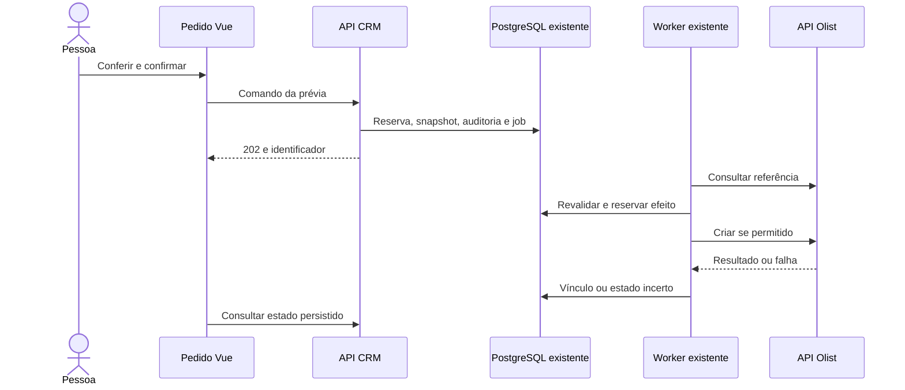
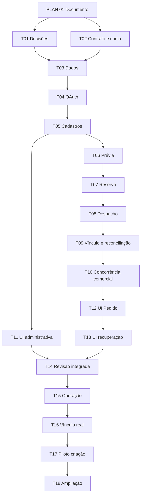

# Geração assistida de pedidos de venda no Olist

RFC 044. Especificação de produto, desenho técnico e plano de execução.
Data: 04/11/2026. Responsável: Tech Lead. Decisor de produto: proprietário.
Público: Produto, Backend/Dados, Integrações, Frontend/A11y, QA e DevOps.

**Status:** proposta para revisão. A preparação documental foi solicitada pelo
proprietário; implementação e ativação não estão concluídas. D1–D8 são escolhas
recomendadas que precisam de decisão antes das tarefas dependentes. Não há ADR
da integração nem issue/PR específica vinculada. T01 usará o próximo número de
ADR disponível, sem reservar ou sobrescrever decisões existentes.

**Objetivo:** gerar uma venda no ERP Olist a partir de Pedido confirmado do
CRM, somente quando uma pessoa autorizada solicitar, com conferência humana,
rastreabilidade e proteção contra duplicidade. Vendas já lançadas manualmente
devem ser vinculadas sem nova criação.

Este documento concentra requisitos `OLIST-01` a `OLIST-32`, seis fases,
tarefas `OLIST-T01` a `OLIST-T18` e checklists. A entrega documental é
`OLIST-PLAN-01`. A preparação não autoriza alterações na conta Olist.

## Índice

1. [Contexto e fontes](#contexto-e-fontes)
2. [Escopo e decisões](#escopo-e-decisões)
3. [Jornadas e permissões](#jornadas-e-permissões)
4. [Requisitos e aceite](#requisitos-e-aceite)
5. [Mapeamento comercial](#mapeamento-comercial)
6. [Arquitetura e dados](#arquitetura-e-dados)
7. [Contratos propostos da API](#contratos-propostos-da-api)
8. [Envio e recuperação](#envio-e-recuperação)
9. [Interface e acessibilidade](#interface-e-acessibilidade)
10. [Segurança e operação](#segurança-e-operação)
11. [Fases e tarefas](#fases-e-tarefas)
12. [Validação e liberação](#validação-e-liberação)
13. [Acompanhamento e handoff](#acompanhamento-e-handoff)

## Contexto e fontes

Hoje a venda pode ser redigitada do CRM para o Olist. O exemplo privado
informado mostrou correspondência de grade e total, mas origens diferentes
para responsável CRM, vendedor ERP, ordem de compra e prazo de pagamento.
Esses valores não podem ser inferidos. URLs compartilháveis, cadastros e
documentos reais do caso ficam fora do repositório público.

O Pedido mantém `pendente` e `confirmado`; confirmação não significa quitação.
O cadastro estruturado do cliente existe, mas seus campos opcionais precisam
ser validados para o uso exigido pelo ERP. A baseline é Vue 3, API, worker e
PostgreSQL no monólito modular atual.

### Fontes internas

- [RULES](../../RULES.md), [spec CRM](../../.specs/features/crm-mvp/spec.md),
  [PRD](../../CRM-MVP-ESPECIFICACAO.md) e
  [plano macro](../../.specs/features/crm-mvp/tasks.md).
- [TDD](../../TECHNICAL-DESIGN.md), [arquitetura](../../ARCHITECTURE.md),
  [topologia](../../EASYPANEL-TOPOLOGY.md) e [design](../../design.md).
- [ADR 006](../adr/006-pedido-dois-status.md),
  [ADR 032](../adr/032-separar-pedido-conversa-e-assunto.md),
  [ADR 047](../adr/047-cadastro-completo-do-cliente.md): Pedido, autoria e cadastro.
- [ADR 040](../adr/040-financeiro-com-fila-e-check-manual.md),
  [ADR 041](../adr/041-consulta-administrativa-do-financeiro.md),
  [ADR 042](../adr/042-perfis-e-requitacao-do-financeiro.md) e
  [Financeiro](../../.specs/features/financeiro/spec.md): quitação/check separados.

A nova decisão deve substituir somente o adiamento da integração Olist,
preservando as permissões e o contrato do Financeiro. ADRs anteriores são
imutáveis. T01 alinhará RULES, PRD/spec, TDD e arquitetura antes de implementar
comportamento que contrarie a descrição vigente de operação manual.

O grafo local consultado é de 04/10/2026, anterior à baseline `ed367202`.
As fronteiras propostas foram confirmadas nos arquivos atuais. Não regenerar
grafo no Windows nem versionar `graphify-out/`.

### Fontes oficiais externas

Consulta em 04/11/2026. T02 revalida e registra versão/hash do schema usado,
sem credenciais ou respostas reais.

| Fonte                                                                                                                     | Contrato relevante                                                                                                                                              |
| ------------------------------------------------------------------------------------------------------------------------- | --------------------------------------------------------------------------------------------------------------------------------------------------------------- |
| [Aplicativos e limites](https://ajuda.olist.com/hubs-e-plataformas-via-api/aplicativos-api-v3-configuracoes-e-utilizacao) | Aplicativo privado, extensão Gestão de Aplicativos, permissões por módulo e limites por conta. Crescer consta na tabela; conferir habilitação efetiva da conta. |
| [OAuth](https://api-docs.erp.olist.com/documentacao/comecando/autenticacao)                                               | Autorização por código e refresh. A documentação informa quatro horas de acesso e um dia de refresh; usar expiração devolvida e prever reconexão.               |
| [Criar pedido](https://api-docs.erp.olist.com/api-reference/pedidos/criar-pedido)                                         | `POST https://api.tiny.com.br/public-api/v3/pedidos`; retorno com `id` e `numeroPedido`.                                                                        |
| [Listar pedidos](https://api-docs.erp.olist.com/api-reference/pedidos/listar-pedidos)                                     | Consulta paginada, inclusive por `numeroPedidoEcommerce`, útil para reconciliação.                                                                              |
| [Uso próprio](https://api-docs.erp.olist.com/documentacao/clientes/orientacoes)                                           | Uso exclusivo da conta dispensa homologação de parceiro pelo Olist. Aceite operacional e testes Silmer continuam necessários.                                   |

Não presumir sandbox, unicidade remota de referência, header de idempotência,
item sem produto ou link de impressão retornado. T02 precisa provar essas
capacidades. MCP de terceiros não é dependência desta proposta.

## Escopo e decisões

### Primeira entrega

Uma conta/empresa Olist por ambiente; conexão administrativa; consultas e
mapeamentos humanos; prévia; criação sob demanda; vínculo existente;
acompanhamento, auditoria e reconciliação por leitura. Uma venda ERP por Pedido
CRM, com linhas por grade quando necessário.

Fora: emissão/cancelamento fiscal, baixa/conciliação financeira, estoque,
etiquetas, expedição, lote, divisão em várias vendas, webhooks, sincronização
bidirecional, alteração/cancelamento remoto após envio e agente de IA no ERP.
Não enviar PDF, conversa, arte ou anexo. Não disparar jornada de atendimento
n8n por botão. Pedidos da loja ficam inicialmente fora da criação, preservando
seu modelo e travas; inclusão futura exige mapeamento/aceite específicos.

### Decisões necessárias

Registrar escolha, autor e data em T01. Decisão aberta bloqueia a tarefa
dependente, sem impedir pesquisa/fixtures sintéticas independentes.

| ID  | Recomendação para decisão                                                                                                                                                    | Decisor                                           | Dependência           |
| --- | ---------------------------------------------------------------------------------------------------------------------------------------------------------------------------- | ------------------------------------------------- | --------------------- |
| D1  | API oficial no monólito, worker/PostgreSQL atuais. Comparar n8n dedicado e MCP sem novo serviço; n8n mantém canais, IA e jornada.                                            | PO/Tech Lead                                      | Código da integração  |
| D2  | Responsável/Admin cria; Admin vincula/reconcilia. Leitura segue `order.read`. Financeiro/automação sem novas ações. Pedido humano confirmado, não teste, mesmo sem quitação. | PO                                                | ACL/elegibilidade     |
| D3  | Usar cliente/produto existentes no ERP; ausência bloqueia e orienta cadastro lá. Sem criar/editar cadastros. Mapear variações, vendedor e condição.                          | PO/Operação                                       | Prévia/payload        |
| D4  | Preço por linha na conferência sem editar total CRM. Divisão sugerida só homogênea e exata; itens distintos precisam composição explícita em centavos.                       | PO/Operação                                       | Dinheiro/UI           |
| D5  | Aprovar situação inicial, natureza, vendedor/comissão, ordem de compra e vencimento. Recomenda-se Aberta após conferir gatilhos reais; não inferir de quitação.              | PO/Operação e responsável fiscal quando aplicável | Primeiro POST externo |
| D6  | Referência CRM estável e consultável sem ocupar ordem de compra. Validar canal/e-commerce, formato, limites e pesquisa.                                                      | Tech Lead/Operação                                | Deduplicação/produção |
| D7  | Após envio, preservar vínculo e mostrar divergência, sem atualizar/criar outra venda. Durante efeito ativo/incerto, bloquear mudança incompatível.                           | PO/Tech Lead                                      | Concorrência/suporte  |
| D8  | Definir conta, operadores, amostra/período, limites, retenção de envelopes, reconexão, suporte e caso controlado de escrita. Verificar efeitos ERP.                          | PO/Operação/DevOps/Privacidade                    | Piloto/ampliação      |

- [ ] D1 registrada e vinculada ao ADR.
- [ ] D2 registrada com matriz de acesso.
- [ ] D3 registrada com cadastro ausente/ambíguo.
- [ ] D4 registrada com múltiplos preços/arredondamento.
- [ ] D5 registrada com condições e efeitos da conta.
- [ ] D6 comprovada com referência persistida/pesquisável.
- [ ] D7 registrada com reabertura/divergência.
- [ ] D8 registrada com operadores, retenção e piloto.

## Jornadas e permissões

### Criar sob demanda

1. Abrir Pedido confirmado; ver pendências ou “Gerar pedido no Olist” conforme
   elegibilidade/rollout.
2. Conferir cliente, variações, grade, preço, vendedor, entrega, vencimento e
   ordem de compra quando informada. Dado ausente leva à origem, sem reabrir
   nem editar Pedido silenciosamente.
3. Backend produz prévia persistida com versões, totais e referência. Fechar
   conferência não cria venda.
4. Confirmar prévia atual; API aceita operação durável. Sair da tela não
   cancela trabalho aceito.
5. Worker revalida/cria; UI acompanha resultado persistido e recuperação.

### Vincular venda existente

Admin informa ID/número ERP. Backend consulta e apresenta candidato, pessoa
confere e confirma. Validar conta, cliente, produtos, quantidades, total e
condições/mapeamentos aprovados. Diferença não é ignorada/corrigida sozinha.
Venda antiga sem referência admite vínculo justificado; referência de outro
Pedido bloqueia. Não aceitar URL arbitrária nem adivinhar hash `doc.view`.
Usar constraints comuns da criação. O caso privado já lançado deve usar essa
jornada, com zero POST de criação.

| Ação                                | Responsável Vendedor    | Outro Vendedor          | Admin           | Financeiro        | Automação/anônimo |
| ----------------------------------- | ----------------------- | ----------------------- | --------------- | ----------------- | ----------------- |
| Estado mínimo do vínculo            | Leitura atual do Pedido | Leitura atual do Pedido | Sim             | Não nesta entrega | Não               |
| Conferir/criar/candidatos do Pedido | Sim se elegível         | Não                     | Sim se elegível | Não               | Não               |
| Vincular/reconciliar                | Não                     | Não                     | Sim             | Não               | Não               |
| Conectar/manter mapeamentos         | Não                     | Não                     | Sim             | Não               | Não               |

Responsável é dono da conversa ou vendedor do Pedido manual, conforme contrato
vigente. Não restringir leitura comercial atual; ler vínculo não libera busca
geral no ERP. Worker só executa operação humana persistida, sem credencial
pública de criação. API revalida ator ativo/escopo, inclusive em replay.

## Requisitos e aceite

Propostos, sujeitos a D1–D8. Após aprovação, incorporar à spec canônica com IDs.

| ID       | Critério de aceite                                                                                                                                 |
| -------- | -------------------------------------------------------------------------------------------------------------------------------------------------- |
| OLIST-01 | Só comando humano em Pedido confirmado, humano, não teste e permitido no rollout cria venda. Confirmar/PDF/pagar/mensagem não disparam integração. |
| OLIST-02 | ACL/escopo na API para criar/candidatos/vincular/reconciliar; negar inativo, outro vendedor, Financeiro e automação. Ocultar botão não basta.      |
| OLIST-03 | Conexão/mapeamentos administrativos; OAuth com sessão, validade e uso único. Callback inválido/repetido não grava credencial.                      |
| OLIST-04 | Tokens cifrados; refresh com reserva/fencing entre processos. Retorno tardio não reativa conexão revogada; expiração pede reconexão.               |
| OLIST-05 | Conta/empresa validada na conexão/reconexão; outra conta não reutiliza mapeamentos/jobs/vínculos.                                                  |
| OLIST-06 | Prévia com versões de Pedido/cadastro/configuração/mapeamentos e expiração, sem escrita ERP; mudança exige reconferência.                          |
| OLIST-07 | Cliente por vínculo válido ou documento verificável; nome parecido/telefone isolado/ausência/ambiguidade não selecionam automaticamente.           |
| OLIST-08 | Variação por mapeamento explícito dos atributos relevantes; ausência bloqueia, sem produto genérico silencioso.                                    |
| OLIST-09 | Linha rastreável ao item/grade; omitir zero; soma igual à grade, sem somar `quantidade_informada`.                                                 |
| OLIST-10 | Preços/condições humanos; linhas fecham exatamente com `finalAmountCents`, sem rateio/desconto inventado.                                          |
| OLIST-11 | Origem explícita de vendedor ERP, compra, previsão e vencimento. Pix não prova recebimento nem define à vista/na entrega.                          |
| OLIST-12 | Allowlist/schema oficial; só dados necessários, sem atendimento, IA, arte, anexos ou notas internas.                                               |
| OLIST-13 | Referência estável por Pedido/conta e busca antes do efeito, sem assumir unicidade garantida pelo provedor.                                        |
| OLIST-14 | Uma operação lógica por Pedido/conta, mesmo com outra chave/aba/sessão/revisão/processo; replay divergente é conflito.                             |
| OLIST-15 | Reserva/snapshot/auditoria/publicação do trabalho atômicos localmente; transação falhou, POST não autorizado.                                      |
| OLIST-16 | Timeout/crash pós-início/corpo inválido/falha ao salvar sucesso tornam incerto; nova criação bloqueada até prova/reconciliação.                    |
| OLIST-17 | Reconciliação só lê; zero candidatos não prova ausência após incerteza. Múltiplos/divergentes exigem análise.                                      |
| OLIST-18 | Vínculo consulta/confere venda, audita e usa constraints comuns; recusar outro cliente/conta/Pedido.                                               |
| OLIST-19 | Estado de integração separado; não mudar status, quitação, entrega, “Nota criada” ou perfil financeiro.                                            |
| OLIST-20 | Sem comandos fiscais/estoque/baixa; conferir gatilhos ERP, bloqueando liberação com efeito incompatível.                                           |
| OLIST-21 | Serializar/bloquear alterações incompatíveis com efeito ativo; mudança posterior mostra divergência sem novo envio.                                |
| OLIST-22 | UI cobre indisponível/pendência/conferência/fila/envio/sucesso/falha/incerteza; reload recupera estado do servidor.                                |
| OLIST-23 | Teclado/leitor de tela, labels, tabela, erros associados e foco previsível; anúncios sem repetição excessiva.                                      |
| OLIST-24 | Vue/shell/tokens atuais, celular/desktop; sem framework/store global/domínio em `window`.                                                          |
| OLIST-25 | Logs/métricas/auditoria/erros sem PII/token/payload/URL compartilhável, com correlação técnica suficiente.                                         |
| OLIST-26 | Limitar rate/páginas/timeout/corpo/retries; orçamento por conta coordenado entre processos e com outras integrações.                               |
| OLIST-27 | Desligar criação impede novos efeitos e preserva leitura/investigação; disconnect invalida tokens e cancela sem efeito, preservando incertezas.    |
| OLIST-28 | Retenção, backup cifrado e recovery; restore não autoriza repetir possível efeito remoto.                                                          |
| OLIST-29 | Migração expand e rollout API/worker compatível; ausência/configuração desligada não quebra startup/ações atuais.                                  |
| OLIST-30 | Histórico de tentativas/atores/versões/início/resultado; replay não duplica evento/auditoria de execução.                                          |
| OLIST-31 | Negativos/concorrência, E2E acessível, checks, piloto autorizado, comparação ERP e runbook; teste local não é produção.                            |
| OLIST-32 | Link validado/gerado no servidor sem host arbitrário/hash adivinhado/compartilhamento público criado; sem URL confiável, mostrar número/instrução. |

## Mapeamento comercial

| Dado                       | Origem e regra                                                                                                          |
| -------------------------- | ----------------------------------------------------------------------------------------------------------------------- |
| Referência técnica         | UUID Pedido + instalação CRM + conta/ambiente. Estável entre revisões/retries; formato comprovado em D6.                |
| Números                    | Número CRM e retorno Olist exibidos juntos, sem substituir/fabricar numeração.                                          |
| Cliente                    | Contato/cadastro e ID ERP selecionado. Documento normalizado; campo opcional CRM pode bloquear exportação.              |
| Endereço/IE                | Cadastro estruturado ou ERP validado; conferir diferença/origem do endereço da venda, sem sobrescrever cadastro remoto. |
| Data da venda              | `orderDate` confirmado, sem trocar pelo dia do envio; convenção operacional de São Paulo.                               |
| Previsão                   | `ficha.summary.data_entrega_confirmada`, sem usar `deliveredOn` como promessa.                                          |
| Linhas                     | `ficha.items[].grade[]`; uma por item/tamanho, origem no snapshot; reordenação invalida prévia.                         |
| Variação                   | Seleção humana por atributos: tipo/cor/tecido/técnica/público/tamanho relevantes; nome sozinho não basta.               |
| Descrição                  | Determinística/limitada; técnica/gola apenas como complemento comercial aprovado, sem nota interna.                     |
| Total                      | `finalAmountCents` preservado; não editar preço CRM ao exportar.                                                        |
| Unitário                   | Conferência humana e representação exata no domínio antes da serialização.                                              |
| Pagamento                  | `paymentCondition` + vencimento explícito; mapear IDs. Uma condição/vencimento, sem parcelamento/baixa nesta entrega.   |
| Vendedor                   | ID ERP mapeado ao responsável CRM; usuário logado não equivale a vendedor/comissionado.                                 |
| Compra                     | Informação humana própria, opcional quando permitido; não inventar contador nem ocupar com referência CRM.              |
| Observações                | Conteúdo comercial revisado por allowlist/limites, sem copiar notas indiscriminadamente.                                |
| Frete/desconto/despesas    | Composição aprovada/verificável; sem fonte, bloquear casos que exigem decomposição. Cotação não é cobrança.             |
| Natureza/depósito/situação | Configuração administrativa, sem inferência fiscal; omitir só com contrato/defaults comprovados.                        |

Campos do payload ERP pertencem ao adapter e ao schema oficial; navegador não
repassa JSON remoto arbitrário. Preços e totais usam centavos inteiros.
Comprovar precisão/arredondamento ERP em T02; baseline proposta aceita preço
em centavos e rejeita composição inexata, sem comparar floats para igualdade.

Exemplo sintético: 12 peças P a R$ 20 + 8 M a R$ 25 = 20 peças/R$ 440.
Dividir R$ 440 por 20 e cobrar R$ 22 de tudo perde preços comerciais e é
proibido. R$ 100 em três peças não permite unitário uniforme exato em centavos:
pedir composição válida ou bloquear, sem ratear resíduo silenciosamente.

Condição enviada fecha com total sem declarar recebimento. Leitura posterior
detecta recálculo por defaults ERP; diferença preserva ID e pede análise,
sem segunda criação ou compensação automática.

## Arquitetura e dados

### Fluxo recomendado



Não há transação distribuída nem SQL aberto durante HTTP. API direta
concentra ACL/snapshot/deduplicação no CRM. n8n dedicado exigiria contrato de
despacho/retorno pela API sem acesso direto ao banco e as mesmas proteções.
MCP acrescenta camada de agentes desnecessária ao botão; navegador fica fora.
D1 registra a decisão sem alterar jornada n8n nem autorizar nova infraestrutura.

| Fronteira      | Alteração planejada                                                                                                                                                                    |
| -------------- | -------------------------------------------------------------------------------------------------------------------------------------------------------------------------------------- |
| Integração     | Propor `modules/olist`: domínio puro, serviços, snapshots, repositórios e adapter oficial; nome/package registrados em D1.                                                             |
| API            | Rotas/runtime próprios em `apps/api/src`, sessão/origem/CSRF/envelopes/auditoria atuais e OpenAPI.                                                                                     |
| Pedido         | `modules/orders/src/domain/order.js`, `domain/ficha.js` e comandos: snapshot e guardas concorrentes sem mudar status/total.                                                            |
| Cliente        | `modules/contacts/src/domain/contact-registration.js` e persistência: cadastro e detecção de mudança, sem fonte duplicada.                                                             |
| Confiabilidade | `modules/integration-reliability/src/idempotency.js`, `postgres-job-queue.js`, `apps/worker/src/worker.js`: efeito durável e incerteza, sem reaproveitar contrato WhatsApp como Olist. |
| ACL            | `modules/identity-access/src/authorization.js`, ações próprias e escopo no runtime.                                                                                                    |
| UI/operação    | `apps/edge-web/src/views/OrderView.vue`, componentes locais, painel administrativo atual; criar runbook `docs/runbooks/olist.md`.                                                      |

### Modelo lógico proposto

DDL/índices em T03; não copiar número de migração ocupado.

| Registro         | Dados e constraints                                                                                                                                                                   |
| ---------------- | ------------------------------------------------------------------------------------------------------------------------------------------------------------------------------------- |
| Conexão/OAuth    | Conta/ambiente, identidade, geração, tokens cifrados/expirações, refresh com fencing. Estado OAuth hasheado, sessão/callback, expiração e uso único.                                  |
| Mapeamento       | Conta, IDs locais/remotos, assinatura de atributos, revisão/autor. Outra conta invalida uso sem remapear.                                                                             |
| Prévia           | ID, ator, Pedido, revisões, expiração proposta de 15 minutos e conteúdo cifrado.                                                                                                      |
| Exportação       | Conta/Pedido, referência, estado/versão própria, snapshot cifrado, fingerprint protegido, ID/número ERP, origem `created`/`linked`, autores/horários. `UNIQUE(account_id, order_id)`. |
| Vínculo externo  | `UNIQUE(account_id, external_order_id)` preenchido; referência única localmente por conta.                                                                                            |
| Tentativa/evento | Geração, início do efeito, códigos seguros, transições/autoria, append-only sem payload na auditoria.                                                                                 |
| Job/idempotência | Fila existente recebe ID da exportação sem PII; deduplicação lógica além da chave HTTP.                                                                                               |

Cadastro/snapshot/resposta idempotente com PII ficam em envelope autenticado,
com versão de chave e AAD por conta/entidade/finalidade. Fingerprint de dados
pessoais usa HMAC/proteção equivalente; hash simples de documento não anonimiza.

### Concorrência

Prévia captura revisões de Pedido/cadastro/mapeamentos/conexão. Se não houver
versão específica de cadastro, usar revisão existente do Contato ou digest
protegido dos campos relevantes; não presumir garantia inexistente.

Comando e worker revalidam fontes/ator/escopo/flags. Definir ordem de locks;
reabertura, troca de dono e alterações cadastrais relevantes cooperam com a
guarda ou invalidam antes do efeito. Cadastro compartilhado exige tratar todos
os pedidos afetados sem deadlock. A checagem não pode existir só na UI.

`queued`, `sending`, `outcome_unknown` e análise sem resolução bloqueiam
alterações incompatíveis. Definir quais mudanças são irrelevantes e sua
interação com versão global. Após sucesso/vínculo, reabertura segue contrato
comercial mas preserva vínculo, marca divergência e não libera outro envio.
Revogação posterior ao início do efeito não permite descartar seu resultado.
Replay revalida acesso atual; trocar/expirar chave HTTP não remove unicidade.

## Contratos propostos da API

Rotas/ações abaixo ainda não existem. Seguir sessão, origem, CSRF,
`Idempotency-Key`, versões e `application/problem+json` do projeto. Busca/
prévia são autorizadas/limitadas; não aceitar token Olist em comando comercial.

### Administração

Prefixo `/api/v1/integrations/olist`, ação `olist.manage`.

| Método/recurso     | Contrato                                                                                                                          |
| ------------------ | --------------------------------------------------------------------------------------------------------------------------------- |
| `GET /status`      | Estado/conta mínima/capacidades/reconexão; sem token.                                                                             |
| `POST /authorize`  | Estado único e URL oficial fixa, sessão/CSRF.                                                                                     |
| `POST /complete`   | Consumir estado/código, validar conta e gravar. Callback UI remove query sensível antes da telemetria e completa com sessão/CSRF. |
| `POST /disconnect` | Invalidar geração/apagar tokens, preservar vínculos/incertezas.                                                                   |
| `POST /lookups`    | Tipos permitidos/busca limitada, sem proxy/retorno integral.                                                                      |
| `POST /mappings`   | Revisão esperada e ID validado com auditoria.                                                                                     |

### Pedido

Prefixo `/api/v1/orders/:orderId/olist`.

| Método/recurso            | Ação e contrato                                                                                                      |
| ------------------------- | -------------------------------------------------------------------------------------------------------------------- |
| `GET /`                   | Leitura vigente: estado, versão, número ERP, horários, divergência e ações permitidas.                               |
| `POST /candidates`        | `olist.export`: consulta limitada ao cliente/Pedido/revisão, sem busca geral ERP.                                    |
| `POST /previews`          | `olist.export`: versões/escolhas; retorna ID, validade, linhas/totais/referência/pendências, sem criação.            |
| `POST /exports`           | `olist.export`: prévia/versões, `202` com ID/estado/`Location`; replay retorna mesma operação.                       |
| `POST /existing/previews` | `olist.link`: ID/número remoto e versão, candidato conferível sem vínculo definitivo.                                |
| `POST /links`             | `olist.link`: prévia/motivo/versões, revalida e retorna `200`.                                                       |
| `POST /reconcile`         | `olist.reconcile`: versão/motivo, `202` para leitura, sem criar venda.                                               |
| `POST /retry`             | `olist.export`: mesma operação com prova de ausência de efeito/nova prévia/versões; negar sucesso/vínculo/incerteza. |

Exemplo sintético de comando CRM, não payload Olist:

```json
{
  "previewId": "identificador-opaco-da-previa",
  "expectedOrderVersion": 7,
  "expectedIntegrationVersion": 0
}
```

Demais revisões ficam na prévia revalidada. Confirmação não aceita ator/conta/
total/estado arbitrário; preços entram na prévia. Ausência de exportação usa
versão lógica `0` protegida por constraint concorrente. Sem “forçar envio”
nem remoção de vínculo. Projeções com dados usam `Cache-Control: no-store`.

Erros: `400` formato/chave, `401` sessão CRM, `403/404` escopo conforme política
vigente, `409` versão/chave/vínculo/efeito conflitante, `422` pendências,
`429` limite local e `503` indisponível antes de aceitar. Após `202`, consultar
operação; timeout do navegador não prova falha. Códigos seguros propostos:
`OLIST_PREVIEW_STALE`, `OLIST_MAPPING_REQUIRED`, `OLIST_TOTAL_MISMATCH`,
`OLIST_RECONNECT_REQUIRED`, `OLIST_OUTCOME_UNKNOWN`. Não refletir erro remoto cru.

### Conexão e limites

Aplicativo privado da conta correta com leitura de cadastros necessários e
inclusão de pedidos; não solicitar exclusão/fiscal/estoque/baixa. Se provedor
agrupar incluir/editar, documentar e restringir adapter. OAuth usa hosts fixos,
estado aleatório de dez minutos ligado à sessão/callback e uso único; PKCE
se suportado/comprovado. Proteger login CSRF, troca de conta e callback aberto.

Refresh serializado API/worker, reserva durável/fencing e novo par persistido
atomicamente. Resultado incerto não permite repetir token possivelmente
rotacionado. Testar um dia de inatividade, sem presumir refresh vitalício ou
keepalive não documentado. Disconnect invalida reservas/retornos tardios.

T04 define nomes/schema de configuração: flags separadas integração/criação,
client ID/secret, callback fixo, chave de envelope, conta esperada. São itens
propostos, não variáveis existentes. Segredos mínimos por processo; ausência
não quebra startup. HTTPS/hosts fechados sem redirects que vazem autorização.
Limitar timeout/corpo/páginas/retries; orçamento por conta no PostgreSQL
coordena processos/outras integrações e respeita `Retry-After` aplicável.
Polling UI lê estado CRM, não consulta ERP irrestritamente.

## Envio e recuperação

### Estados

Desativado/desconectado/pendências são condições UI/conexão, não status
comerciais novos ou registros fictícios.

| Estado                    | Significado                                                            |
| ------------------------- | ---------------------------------------------------------------------- |
| `not_exported`            | Ausência de registro; pode conferir/criar/vincular se elegível.        |
| `queued`                  | Aceito sem POST, pode invalidar antes do efeito.                       |
| `sending`                 | Reserva persistida; impedir outra criação/mudança incompatível.        |
| `succeeded`               | ID/número/conteúdo confirmados por leitura.                            |
| `linked`                  | Venda existente conferida, sem criação.                                |
| `failed_safe`             | Prova de ausência de efeito; exige reconferência para tentar.          |
| `outcome_unknown`         | Efeito pode ter ocorrido; só investigar/reconciliar.                   |
| `reconciliation_required` | Múltiplos candidatos/divergência, sem recriação.                       |
| `cancelled_before_send`   | Invalidado antes do efeito; retomar mesma operação após reconferência. |

Retomada cria tentativa, nunca segunda exportação lógica. Análise não
resolvida mantém guarda de alterações até vínculo ou prova conclusiva.

### Algoritmo

1. API autoriza/valida; mesma transação reserva snapshot, exportação, comando,
   auditoria e job. Compartilhar cliente SQL ou outbox local consumida pela
   fila; commits separados são proibidos.
2. Worker obtém lease, verifica contexto e conta; aproveitar distinção atual
   de expiração antes/depois do efeito sem mudar handlers de outros domínios.
3. Buscar referência: candidato exato recupera vínculo após detalhe; múltiplo/
   divergente vai para análise. Zero só permite primeiro envio ou tentativa
   cuja ausência de efeito já foi comprovada.
4. Transação curta revalida fontes/ator e persiste início do efeito com
   tentativa/fencing. Adaptar APIs de fila/domínio quando não puderem compor
   atomicamente; testar, sem presumir atomicidade ausente.
5. Após commit, um POST com snapshot. Reexecução não repete tentativa iniciada.
6. Persistir ID/número, ler detalhes/comparar: exato conclui; falha de leitura
   preserva ID e pede reconciliação; diferença não provoca outra criação.
7. Gravar resultado/evento e conclusão de forma recuperável. Sucesso remoto
   com falha local recupera por ID/referência, sem reenviar.

| Falha                                                 | Ação                                                                                                  |
| ----------------------------------------------------- | ----------------------------------------------------------------------------------------------------- |
| ACL/versão/validação antes de HTTP                    | Sem efeito; corrigir/reconferir.                                                                      |
| Crash antes da reserva de efeito                      | Retry limitado/revalidado.                                                                            |
| Transporte comprovadamente anterior à transmissão     | Falha segura com prova técnica; na dúvida, incerto.                                                   |
| Rejeição de validação oficial                         | Sem efeito somente se contrato/teste comprovar ausência de criação.                                   |
| `401/403/429`                                         | Sem retry cego de escrita; renovar/reconectar/esperar e só reenviar com prova de rejeição sem efeito. |
| Timeout/interrupção/`5xx`/corpo inválido/`2xx` sem ID | Incerto; bloquear POST e reconciliar.                                                                 |
| Crash após reserva e transmissão desconhecida         | Incerto mesmo que provavelmente nada saiu.                                                            |
| Sucesso remoto e erro de commit                       | Recuperar por ID/referência sem criar.                                                                |
| Busca retorna zero após incerteza                     | Permanecer incerto: busca/consistência eventual não provam ausência.                                  |
| Múltiplos/divergentes                                 | Análise sem inferir por semelhança.                                                                   |

Reconciliação tem backoff/máximo de consultas/páginas no runbook. Esgotar limite
deixa pendência; tempo não libera POST. Constraint local não impede lançamento
manual concorrente fora do CRM; um operador coordena ambos no piloto.

Após restore, criação desligada, leases/prévias invalidados e reconciliação da
janela entre backup/incidente antes de retomar. Banco restaurado pode não ter
vendas já criadas; histórico incompleto/`sending` não autoriza reenvio.
Preservar referências/vínculos. Não cancelar venda como rollback técnico nem
apagar constraints/estado por SQL para liberar POST. Vínculo errado exige
procedimento específico futuro autorizado.

## Interface e acessibilidade

Bloco Olist na página de Pedido sem substituir PDF/confirmação. Ações conforme
ACL; inelegibilidade/indisponibilidade com motivo útil. Vendedor sem conexão
recebe orientação, Admin abre diagnóstico. Conferência mostra números, cliente,
vendedor ERP, datas e tabela por item/tamanho/produto/quantidade/preço/total.
Exibir total CRM, calculado e diferença; bloquear com diferença/prévia vencida/
pendência. Complementos ficam na exportação, sem editar ficha/atendimento.

| Estado UI           | Próxima ação                                                    |
| ------------------- | --------------------------------------------------------------- |
| Não enviado         | Gerar; vínculo em ação administrativa separada.                 |
| Pendências          | Lista navegável com origem da correção, rascunho preservado.    |
| Conferência         | Confirmar; fechar não cria.                                     |
| Fila/envio          | Anúncio curto; sair não cancela, sem nova criação.              |
| Criado/vinculado    | Número ERP, origem/autor/horário e link seguro se comprovado.   |
| Falha sem efeito    | Explicação/reconferência autorizada.                            |
| Incerto             | Verificar/reconciliar, sem “Tentar novamente” genérico.         |
| Alterado após envio | Revisão/diferença e orientação de correção ERP sem sincronizar. |

Reusar modal/drawer e foco atuais. Tab/Shift+Tab percorrem; Escape fecha
conferência/devolve foco. Aceitação leva foco ao estado. Erros com label/
descrição/resumo focável; tabela com cabeçalhos; `aria-live` só em transições
relevantes, sem repetir tabela no polling. Não depender só de cor ou botão
desabilitado sem explicação. Validar celular/desktop/zoom/toque/leitor de tela.
Estado servidor via eventos existentes ou polling limitado enquanto tela ativa;
duas abas/reload convergem, sem store global/realtime novo.

## Segurança e operação

Ações próprias negadas por padrão; sessão/origem/CSRF, IDs/conta/escopo validados.
Impedir SSRF, proxy genérico, XSS e acesso horizontal. Projeção mínima de
candidatos, documento mascarado quando suficiente. Cadastro/snapshot/respostas
idempotentes com PII cifrados; fila só IDs técnicos.

Logs/auditoria recebem IDs aprovados, estado, ator, horário e código; não nome,
documento, endereço, e-mail, preço, observação, token, URL compartilhável ou corpo
remoto. Métricas sem IDs em labels. Links confiáveis protegem aba de origem;
não criar URL pública/compartilhamento sem política específica.

OAuth/prévias expiram; apagar tokens ao desconectar; vínculo/auditoria seguem
retenção de Pedido. D8 define envelopes/expurgo sem apagar prova de deduplicação.
Backup cifrado inclui política de acesso e disponibilidade de chaves. Fixtures,
banco local e evidências públicas só sintéticos/agregados; prints reais em
local privado aprovado. Health/erros integra mecanismo atual sem ampliar acesso
à central restrita. Métricas propostas: aceitações, sucessos, vínculos,
incertezas, falhas seguras, reconexões, conflitos, fila/duração/idade pendente.
Consulta/replay não contam como venda; T15 define limiares/suporte sem serviço novo.

## Fases e tarefas

Cada tarefa inclui comportamento, testes pertinentes, documentação, commit e
push. Gates distinguem código integrado, deploy e aceite. Tech Lead pode
subdividir antes de iniciar com IDs derivados e dependências; não separar testes
do comportamento em entrega tardia. Papéis abaixo designam responsabilidade,
não implicam pessoas já alocadas.

### Fase 1 Especificação e decisões

Resultado: contrato aprovado e escopo implementável. Papéis: Tech Lead,
Produto, Operação e revisores de D1–D8.

- [ ] **OLIST-T01** Resolver D1–D8, criar ADR e alinhar fontes canônicas/spec.
      Requisitos: OLIST-01–12, 19–21, 27–28. Dono: Tech Lead. Depende de
      OLIST-PLAN-01. Evidência: decisões com autor/data, exemplos aprovados,
      ACL/retenção e links de issue/PR quando criados.
- [ ] **OLIST-T02** Validar schema/conta: extensão, permissões, identidade,
      precisão, variações, referência pesquisável, limites, rejeição sem efeito,
      links e gatilhos. Requisitos: OLIST-03–13, 20, 26, 32. Dono: Integrações.
      Leitura/fixtures podem avançar junto de T01; escrita depende D5/D8.
      Evidência: matriz de capacidades, versão/hash do contrato, testes e lacunas.

Gate F1: decisões fechadas ou recorte reduzido explicitamente, sem regra
ambígua para quem implementa. Provar referência/preço/efeito antes do POST.
Sem sandbox, definir simulação local e caso real controlado.

### Fase 2 Fundação e conexão

Resultado: modelo durável, criação desligada por padrão e consultas autorizadas.
Papéis: Tech Lead, Backend, Integrações, QA e DevOps nos segredos.

- [ ] **OLIST-T03** Migração expand/repositórios/constraints/envelopes/índices,
      revisões e atomicidade fila/outbox. Requisitos: OLIST-05–06, 14–15, 21,
      28–30. Dono: Backend. Depende T01/T02. Evidência: PostgreSQL concorrente,
      rollback transacional e compatibilidade com código anterior.
- [ ] **OLIST-T04** OAuth/refresh/fencing, identidade, desconexão, flags e
      configuração API/worker. Requisitos: OLIST-03–05, 25, 27, 29. Dono:
      Integrações. Depende T03. Evidência: estado/sessão inválidos, concorrência,
      expiração/revogação e ausência de segredo em respostas/logs.
- [ ] **OLIST-T05** Adapter de leitura, buscas/mapeamentos/orçamento por conta
      e rotas administrativas. Requisitos: OLIST-02, 07–08, 11–13, 26, 32. Dono:
      Backend/Integrações. Depende T04. Evidência: ausência/ambiguidade, outra
      conta, paginação, OAuth inválido e limite compartilhado entre processos.

Gate F2: migração segura, credenciais protegidas, conexão/consultas verificadas
e configuração desabilitada testada. Nenhum POST de criação público ou handler
incompleto pode ser ativado.

### Fase 3 Comando de exportação confiável

Resultado: fluxo API exercitável com dados sintéticos e recuperação antes de
liberar vendedores. Papéis: Tech Lead, Backend, Integrações e QA.

- [ ] **OLIST-T06** Mapeamento puro, dinheiro/datas/condições e prévia cifrada
      com versões/expiração. Requisitos: OLIST-06–12. Dono: Backend. Depende
      T03/T05. Evidência: múltiplos itens/preços, grade, soma e invalidação das fontes.
- [ ] **OLIST-T07** ACL, comando idempotente e reserva única Pedido/conta,
      com OpenAPI. Requisitos: OLIST-01–02, 13–15, 19, 30. Dono: Backend.
      Depende T06. Evidência: chaves/abas/processos dão uma operação/job;
      replay divergente e acesso revogado recusados.
- [ ] **OLIST-T08** Handler de criação, reserva de efeito, busca prévia,
      leitura posterior e falhas. Requisitos: OLIST-13–17, 20, 25–26. Dono:
      Integrações. Depende T07. Evidência: um POST sob concorrência/crash/timeout,
      corpo inválido sem retry e nenhum comando fiscal/estoque.
- [ ] **OLIST-T09** Vínculo existente e reconciliação só por leitura, com
      prévia/motivo/constraints comuns. Requisitos: OLIST-13–18, 25, 30, 32.
      Dono: Backend. Depende T08. Evidência: candidato exato/ausente/múltiplo/
      divergente/já usado; zero criações nessa jornada.
- [ ] **OLIST-T10** Guardas Pedido/cadastro, revogação, divergência após
      reabertura e recuperação de jobs. Requisitos: OLIST-02, 06, 19, 21, 27–30.
      Dono: Backend. Depende T07/T08/T09. Evidência: corridas com dono/cadastro,
      reabertura/lease/disconnect e regressão das funções atuais.

Gate F3: nenhum retry de efeito incerto cria venda. Reserva/job/auditoria
testados transacionalmente; alteração não contorna guarda. Credencial/referência
inválida não gera fallback silencioso. Criação continua desligada.

### Fase 4 Interface operacional

Resultado: conferir, enviar e acompanhar sem alterar confirmação CRM.
Papéis: Tech Lead, Frontend/A11y e QA.

- [ ] **OLIST-T11** UI administrativa de conexão/mapeamentos/diagnóstico no
      shell atual. Requisitos: OLIST-03–05, 22–25, 27. Dono: Frontend. Depende
      T04/T05. Evidência: callback limpo, reconexão/cancelamento/indisponibilidade
      por teclado e permissões mínimas.
- [ ] **OLIST-T12** Bloco Pedido, conferência de grade/preço, pendências,
      envio/estado persistido. Requisitos: OLIST-01–02, 06–12, 19, 21–24, 32.
      Dono: Frontend. Depende T06/T07/T08/T10. Evidência: duas abas/reload,
      prévia obsoleta, inelegibilidade, diferença de total e teclado.
- [ ] **OLIST-T13** Vínculo existente, histórico e recuperação administrativa
      sem retry para incerteza. Requisitos: OLIST-16–18, 22–25, 30, 32. Dono:
      Frontend. Depende T09/T12. Evidência: vínculo/reconciliação positivos e
      negativos, números distintos claros e nenhuma URL pública inventada.

Gate F4: jornada completa por teclado em celular/desktop, estados claros e
ACL coerente com API. UI não substitui prova de efeito único no backend.

### Fase 5 Validação integrada e operação

Resultado: candidato revisado, evidência reproduzível e runbook ensaiado.
Papéis: Tech Lead, QA/Segurança/Privacidade, Integrações e DevOps.

- [ ] **OLIST-T14** Revisão adversarial, corrigir findings e regressão
      Pedido/Cliente/Financeiro/workers. Requisitos: OLIST-01–32. Dono: QA com
      Tech Lead. Depende T10–T13. Evidência: matriz por requisito, negativos,
      concorrência/checks; correções incluem teste do defeito.
- [ ] **OLIST-T15** Runbook, telemetria, reconexão, incerteza, restore e
      rollout/rollback; imagem/migração/segredos no alvo com criação desligada.
      Requisitos: OLIST-04–05, 16–17, 25–31. Dono: DevOps/Integrações. Depende
      T14. Evidência: ensaio local crash/restore, plano revisado, health/identidade
      no alvo. Separar prova local da prova EasyPanel.

Gate F5: sem findings críticos/altos abertos ou PII em artefatos; checks
obrigatórios concluídos e runbook executável. Dispensa de homologação de
parceiro Olist não substitui esse gate de qualidade da Silmer.

### Fase 6 Piloto e liberação gradual

Resultado: uso real controlado, comparação ERP e suporte operacional.
Papéis: Tech Lead, Operação, DevOps e QA; PO decide ampliação.

- [ ] **OLIST-T16** Vincular caso privado já lançado, com autorização e
      evidência restrita. Requisitos: OLIST-18–20, 30–32. Dono: Operação/Tech Lead.
      Depende T15/mapeamentos reais. Evidência: cliente/grade/total corretos,
      vínculo único e zero criações no ensaio.
- [ ] **OLIST-T17** Piloto com operadores nomeados, criação controlada e
      comparação/replay. Requisitos: OLIST-01–32. Dono: Operação/DevOps. Depende
      T16/D8. Evidência: uma venda, referência/total/efeitos corretos. Timeout só
      simulado em ambiente sintético, sem provocar duplicidade real. Registrar
      período/amostra e responsável por suporte.
- [ ] **OLIST-T18** Avaliar pendências/piloto, decidir ampliação e registrar
      release/digest/migrações/operadores/aceite. Requisitos: OLIST-25–31. Dono:
      Tech Lead/PO. Depende T17. Evidência: critérios cumpridos, nenhuma incerteza
      sem responsável, runbook atualizado e decisão de ampliar/manter restrito.

Gate F6: aceite PO/Operação com amostra/período D8 e recuperação comprovada.
Não declarar exactly-once do provedor; registrar mecanismo local e limite de
lançamento manual externo.

### Dependências e paralelismo



Setas são gates, sem impedir mocks/desenho antecipados. T11 pode avançar junto
da fase 3 após estabilizar contratos; preparar UI com mocks não libera botão.
Um dono por arquivo. Tech Lead integra e revalida contratos antes de merge.
Delegação informa objetivo/aceite, requisitos/tarefa, arquivos permitidos e
preservados, verificações e retorno com evidências/riscos/bloqueios.

## Validação e liberação

Testes pertencem às tarefas; T14 consolida. Números da coluna Requisitos
usam prefixo `OLIST-`. Concorrência usa conexões/instâncias independentes;
chamadas sequenciais não provam exclusão mútua. Fixtures/banco só sintéticos.

| Cenário                                         | Resultado esperado                                | Requisitos    | Evidência               |
| ----------------------------------------------- | ------------------------------------------------- | ------------- | ----------------------- |
| Pedido humano confirmado/grade/preços válidos   | Uma operação/job lógico/venda conferida           | 01, 09–15, 30 | Unit/SQL/adapter/E2E    |
| Pendente/teste/loja/inelegível                  | Sem POST                                          | 01–02, 19     | API/E2E                 |
| Outro vendedor/Financeiro/automação/revogação   | Negar chamada direta/replay                       | 02, 30        | API/SQL                 |
| Cliente ausente/ambíguo ou produto incompatível | Pendência sem cadastro/seleção automática         | 07–08, 12     | Serviço/adapter/E2E     |
| Múltiplos preços/soma inexata/resíduo           | Sem rateio/desconto inventado                     | 09–11         | Unit monetário          |
| Pix sem quitação                                | Pode exportar se elegível, sem marcar pago/nota   | 01, 11, 19    | API/Financeiro          |
| Mudança de cadastro/preço/dono/mapeamento/conta | Prévia/worker recusam conteúdo obsoleto           | 05–06, 21     | SQL concorrente         |
| Duas abas/chaves/processos                      | Uma operação/POST, auditoria sem efeito duplicado | 14–15, 30     | SQL concorrente/handler |
| Mesma chave/outro conteúdo                      | Conflito sem vazar resposta                       | 14            | API/idempotência        |
| Vínculo concorre com criação                    | Um vencedor sem POST extra                        | 14, 18        | SQL concorrente         |
| Reabertura/alteração durante reserva            | Bloqueio ou invalidação antes do efeito           | 16, 21        | SQL concorrente/E2E     |
| Timeout/crash após reserva/POST                 | Incerto, nenhum retry de criação                  | 16–17         | Fault injection/fila    |
| Sucesso remoto/falha de commit                  | Recuperação por ID/referência sem recriar         | 15–17         | Fault injection/SQL     |
| Busca zero/múltipla/divergente                  | Incerto/análise, sem inferência                   | 13, 17        | Adapter/serviço         |
| ERP recalcula total                             | Preservar ID e exigir análise                     | 10, 16–17     | Adapter/E2E             |
| OAuth repetido/callback cruzado/expiração       | Rejeição segura/reconexão                         | 03–05         | API/SQL                 |
| Refresh concorrente/disconnect                  | Um refresh, retorno tardio não reativa            | 04–05, 27     | SQL/adapter             |
| Rate limit/páginas excessivas/indisponível      | Espera/erro limitado, sem tempestade de chamadas  | 26            | Adapter/orçamento       |
| URL arbitrária/texto malicioso                  | Sem SSRF/XSS/link público criado                  | 12, 25, 32    | Segurança/E2E           |
| Outra conta/cliente/Pedido no vínculo           | Recusar sem mutação parcial                       | 05, 18        | API/constraints         |
| Teclado/leitor/zoom/celular                     | Foco e estados compreensíveis                     | 22–24         | E2E/axe/manual          |
| Flag/configuração ausente/migração              | CRM funcional, sem novo efeito ERP                | 27, 29        | Startup/SQL/E2E         |
| Restore com efeitos fora do backup              | Criação desligada/reconciliação                   | 16–17, 28     | Drill/runbook           |
| Logs/jobs/idempotência/telemetria               | Sem PII/segredo/payload não protegido             | 25, 28, 30    | Revisão/redaction       |
| Gatilhos/permissões reais                       | Efeito incompatível impede piloto                 | 03, 20, 31    | Operação privada        |

### Checks do projeto

Nesta entrega documental: formatação Markdown alterada, links/âncoras/IDs,
privacidade e `git diff --check`. Não requer suíte de aplicação sem código.

Na implementação, usar versões Node/npm vigentes e comandos existentes:

```powershell
git diff --check
npm run validate
npm run test:e2e
npm audit --audit-level=high
```

Adicionar testes ao runner quando criados; `test:olist` ainda não existe.
SQL dedicado com concorrência do runner igual a um, preservando concorrência
interna dos cenários. Docker/banco dedicado local são autorizados. Gates de
topologia/recovery, segurança, observabilidade e decisões seguem
[CONTRIBUTING](../../CONTRIBUTING.md). Falha preexistente exige triagem/evidência,
não omissão. Commit/push não equivalem a deploy/aceite operacional.

### Checklist de deploy

- [ ] ADR/fontes canônicas atualizados, PRs vinculadas e checks concluídos.
- [ ] Backup/recovery conferidos, migração expand aplicada/registrada.
- [ ] API/worker compatíveis publicados via GitHub → EasyPanel.
- [ ] Imagem/digest, health e migrações comprovados no alvo.
- [ ] Segredos/chaves somente nos processos necessários.
- [ ] Conta/empresa e reconexão verificadas.
- [ ] Permissões/gatilhos conferidos por Operação.
- [ ] Criação desligada por padrão e allowlist/limites piloto definidos.
- [ ] Caso existente vinculado sem duplicidade.
- [ ] Suporte e procedimento de incerteza disponíveis.

### Checklist de ampliação

- [ ] Amostra/período D8 concluídos com comparação CRM/ERP.
- [ ] Sem duplicidade observada; replay/duas abas verificados.
- [ ] Cliente/grade/preços/total/vendedor/entrega/condição corretos.
- [ ] Nenhum efeito/divulgação fora do escopo.
- [ ] Incertezas analisadas/com responsável; falhas recorrentes resolvidas.
- [ ] Operadores sabem corrigir/reconectar/encaminhar pendências.
- [ ] Aceite PO/Operação e público/volume da ampliação registrados.

### Rollback

Desligar criação primeiro, impedindo início de novos efeitos. Preservar
leitura/reconciliação; pausar/cancelar duravelmente jobs sem efeito e investigar
os iniciados. Disconnect invalida geração/tokens quando necessário. Não cancelar
venda ERP, apagar vínculo ou reverter schema destrutivamente. Código anterior
só retorna se compatível com schema expand. Reconciliar a janela antes de retomar.

## Acompanhamento e handoff

Checklists das fases são fonte do status. Registrar evidências/links na
tabela sem duplicar checkboxes. Marcar tarefa só com critérios/evidências atendidos.

| Entrega/gate  | Responsável designado | Evidência/resultado                                 | Commit/PR            | Deploy/aceite         |
| ------------- | --------------------- | --------------------------------------------------- | -------------------- | --------------------- |
| OLIST-PLAN-01 | Tech Lead             | Especificação/checklist nesta RFC; decisões abertas | Registrar no handoff | Documental            |
| F1 / T01–T02  | A designar            | A preencher                                         | A preencher          | Decisão/contrato      |
| F2 / T03–T05  | A designar            | A preencher                                         | A preencher          | Fundação desativada   |
| F3 / T06–T10  | A designar            | A preencher                                         | A preencher          | Backend validado      |
| F4 / T11–T13  | A designar            | A preencher                                         | A preencher          | UI acessível          |
| F5 / T14–T15  | A designar            | A preencher                                         | A preencher          | Candidato à liberação |
| F6 / T16–T18  | A designar            | A preencher                                         | A preencher          | Piloto/ampliação      |

### Definition of Ready

- [ ] Requisitos/decisões identificados, dependências atendidas.
- [ ] Responsável único, arquivos permitidos e mudanças a preservar definidos.
- [ ] Contrato/schema conhecido e exemplos sintéticos disponíveis.
- [ ] Negativos/concorrência/recuperação pertinentes definidos.
- [ ] Verificações/evidências/riscos/dúvidas bloqueantes registrados.

### Definition of Done

- [ ] Critérios atendidos e comportamento fora de escopo preservado.
- [ ] ACL/PII/idempotência/concorrência/A11y verificados na fatia.
- [ ] Testes apropriados executados, sem repetir/ampliar sem motivo.
- [ ] OpenAPI/configuração/fontes canônicas/runbook atualizados se afetados.
- [ ] `git diff --check` e checks necessários verdes com evidência.
- [ ] Commit atômico/push e PR/issue vinculadas quando existentes.
- [ ] Mudanças de terceiros preservadas; grafo não alterado/versionado.
- [ ] Deploy/aceite separados e pendências reais abertas.

### Modelo de handoff

```text
Tarefa e requisitos:
Responsável e fronteira alterada:
Comportamento entregue:
Decisões e contratos usados:
Checks/evidências, incluindo negativos, concorrência e recuperação:
Commit, push e PR:
Migração/configuração e rollback:
Estado do deploy e aceite:
Riscos, bloqueios e próximo item desbloqueado:
```

Primeiros itens do time: T01 e investigação T02. Não iniciar criação real com
vendedor, pagamento, referência ou efeitos do ERP ainda indefinidos.
