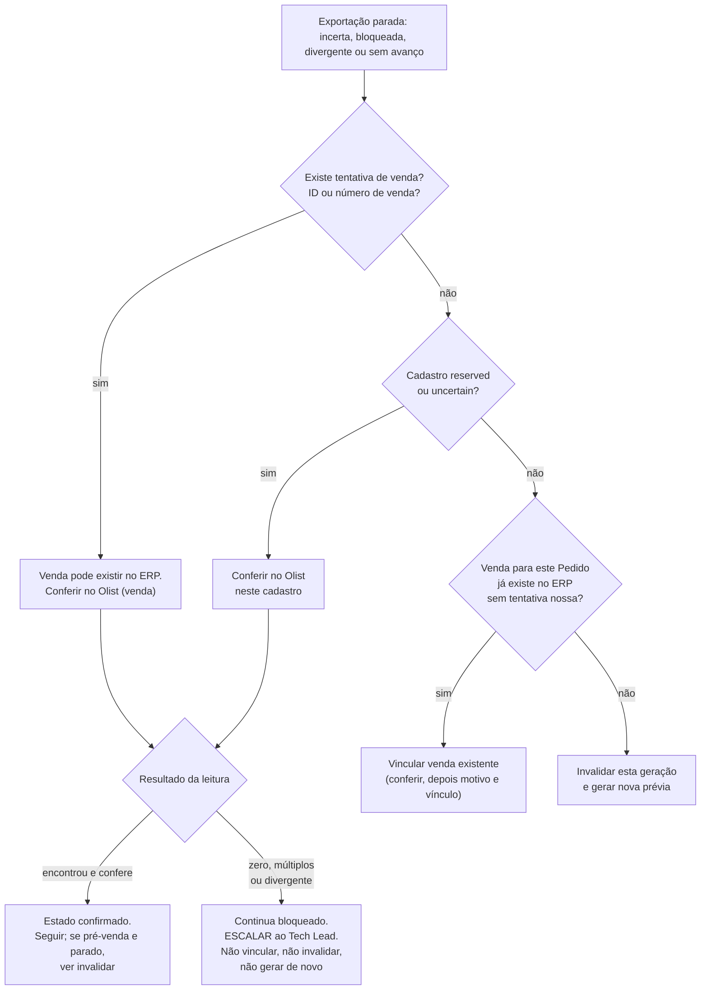

# Olist — operação (Fase 5, T15)

Runbook operacional da integração Olist/ERP. Entrega documental da OLIST-T15
([RFC 050](../rfc/050-geracao-assistida-de-pedidos-no-olist.md); requisitos
OLIST-03–05, 11, 16–17, 25–31 e 48–50). Descreve o que **existe** no código da
branch `codex/olist-t15` (empilhada sobre a PR 325, `codex/olist-liveness`).
Onde algo não existe, o texto diz "não existe". "Inferido" marca o que foi
concluído lendo o código ou a documentação e que nenhuma execução provou.

## 1. Escopo, estado da entrega e mapa de documentos

### 1.1 Estado

| Item                               | Estado em 09/11/2026                                                                                                                                |
| ---------------------------------- | --------------------------------------------------------------------------------------------------------------------------------------------------- |
| Geração real de cadastros e vendas | **Desligada.** Nenhuma conta ERP habilitada, nenhuma credencial real, nenhum usuário habilitado                                                     |
| Deploy                             | **Não houve.** Alvo EasyPanel não preparado (seção 11)                                                                                              |
| Piloto                             | **Não houve.** Operadora, amostra e período indefinidos (seção 13)                                                                                  |
| Este documento                     | Rascunho operacional da T15. **Não fecha a T15**: o ensaio sintético passou (seção 12), mas faltam o alvo (seção 11) e as decisões do PO (seção 13) |
| Fase 6 (T16–T18)                   | **Não está coberta**: vínculo do caso real, piloto e ampliação têm gate e runbook próprios                                                          |

Toda evidência local (PostgreSQL em Docker, ERP falso em processo, snapshot SQL)
vale só para o código. Ela não prova nada sobre EasyPanel, RustFS, backup real
ou o Olist real (seção 12).

### 1.2 Papéis e convenções

| Papel                | Quem                                          | O que faz neste runbook                                                     |
| -------------------- | --------------------------------------------- | --------------------------------------------------------------------------- |
| Admin comercial      | Usuário com capacidade `COMMERCIAL_ADMIN`     | Conexão OAuth, parâmetros, conferir, vincular, invalidar, checkbox Olist    |
| Operadora habilitada | Uma pessoa, `<ID_CRM_DA_OPERADORA>` (seção 5) | Prévia e geração do Pedido; lê o progresso. Não repara nada                 |
| DevOps               | `<RESPONSAVEL_DEVOPS>`                        | EasyPanel, variáveis, migrações, backup, restore, consultas somente leitura |
| Tech Lead            | Responsável técnico                           | Escalada de incerteza, liga/desliga flags da conta, integra e fecha gates   |
| PO                   | Proprietário                                  | Decisões da seção 13, aceite, retenção, revogação no ERP                    |
| Suporte              | `<RESPONSAVEL_SUPORTE>`                       | Primeiro contato da operadora; escala conforme a seção 10                   |

Placeholders usados neste documento, sempre entre `< >`: `<ID_CRM_DA_OPERADORA>`,
`<CONTA_ERP>`, `<ACCOUNT_KEY>`, `<ORIGEM_CRM_ERP>`, `<RESPONSAVEL_SUPORTE>`,
`<RESPONSAVEL_DEVOPS>`, `<AMOSTRA_PILOTO>`, `<PERIODO_PILOTO>`,
`<DIGEST_RUNTIME>`, `<DIGEST_EDGE>`. Nenhum nome, e-mail, documento, ID ou
credencial real entra neste arquivo, em issues, PRs, logs ou chat.

### 1.3 Mapa de documentos

| Assunto                                              | Documento                                                                                                                   |
| ---------------------------------------------------- | --------------------------------------------------------------------------------------------------------------------------- |
| Produto, requisitos, checklists de deploy e rollback | [RFC 050](../rfc/050-geracao-assistida-de-pedidos-no-olist.md)                                                              |
| Decisão por habilitação, subtotal e cancelamento     | [ADR 057](../adr/057-olist-por-habilitacao-subtotal-por-tamanho-e-cancelamento.md)                                          |
| Centavos exatos, frações bloqueadas                  | [ADR 062](../adr/062-olist-exportacao-com-unitario-exato-em-centavos.md)                                                    |
| Fontes comerciais suplementares                      | [ADR 067](../adr/067-fontes-comerciais-suplementares-sem-reescrever-ficha.md)                                               |
| Cancelamento local terminal                          | [ADR 068](../adr/068-cancelamento-local-terminal-pre-exportacao.md)                                                         |
| Invalidação administrativa de export                 | [ADR 069](../adr/069-olist-invalidacao-administrativa-de-export.md)                                                         |
| Quota com espera de leitura e folga                  | [ADR 070](../adr/070-olist-quota-com-espera-de-leitura-e-folga.md)                                                          |
| Conexão, dados e variáveis (Fase 2)                  | [olist-phase2.md](olist-phase2.md)                                                                                          |
| Cadastros, venda, vínculo, reconciliação (Fase 3)    | [olist-phase3.md](olist-phase3.md)                                                                                          |
| Interface administrativa e recuperação (Fase 4)      | [olist-phase4.md](olist-phase4.md)                                                                                          |
| Revisão T14, invalidação e quota (Fase 5)            | [olist-phase5.md](olist-phase5.md)                                                                                          |
| Observações do ERP (gatilhos, limites lidos)         | [caso controlado](../integrations/olist/controlled-case.md), [acesso de leitura](../integrations/olist/read-only-access.md) |
| Topologia, backups e drills                          | [EASYPANEL-TOPOLOGY.md](../../EASYPANEL-TOPOLOGY.md), [topology.json](../../ops/easypanel/topology.json)                    |
| Contrato HTTP                                        | [OpenAPI](../api/openapi.v1.yaml)                                                                                           |

Este runbook não repete o procedimento de invalidação (códigos, passos e
parâmetros em [olist-phase5.md](olist-phase5.md#invalidação-administrativa-e-quota)).
Ele o referencia e acrescenta o que faltava: liga/desliga, etapas, gatilhos,
identidade, OAuth, retenção, restore, rollback, telemetria e alvo.

## 2. Variáveis, flags e estado da conta

### 2.1 Quatro camadas independentes

Para gerar um cadastro ou uma venda **todas** precisam estar liberadas, e nada
as agrupa. Qualquer uma fechada impede o efeito seguinte.

| Camada | Onde vive                                                      | Como muda hoje                            | Auditado?                             |
| ------ | -------------------------------------------------------------- | ----------------------------------------- | ------------------------------------- |
| 1      | Variáveis de ambiente da API e do worker                       | Painel EasyPanel + reinício do serviço    | Só pelo histórico do painel           |
| 2      | `crm.olist_accounts` (`creation_enabled`, `recovery_required`) | **Somente SQL direto**                    | **Não** (seção 2.5)                   |
| 3      | `crm.users.olist_enabled` (checkbox "Habilitado Olist")        | Tela Usuários, por Admin                  | Sim: versão de autorização, auditoria |
| 4      | `creationEnabled` devolvido pela API à interface               | **Fixo em `false` no código** (seção 2.5) | Não se aplica                         |

### 2.2 Variáveis de ambiente (nomes reais)

Fonte: [`.env.example`](../../.env.example), `modules/olist/src/configuration.js`,
`apps/worker/src/worker.js` e `ops/easypanel/topology.json`. Os valores nunca
entram no repositório.

| Variável                          | API | Worker | Regra no código                                                                                                                                                                                                                 |
| --------------------------------- | --- | ------ | ------------------------------------------------------------------------------------------------------------------------------------------------------------------------------------------------------------------------------- |
| `OLIST_ENABLED`                   | sim | sim    | Exatamente `true`. Sem ela (ou com qualquer outra configuração inválida) `configured=false`: comandos da API devolvem `OLIST_NOT_CONFIGURED` (503) e o worker não sobe **nenhum** consumidor Olist                              |
| `OLIST_DISPATCH_ENABLED`          | —   | sim    | Exatamente `true` (`TRUE` e `1` não valem). Só então o worker consome a fila `olist` (`olist.export`). Lida na partida do processo: mudar exige reiniciar o worker                                                              |
| `OLIST_CLIENT_ID`                 | sim | sim    | Aplicativo OAuth privado. Padrão `^[a-zA-Z0-9_-]{1,200}$`. Entra no `context_key` da conexão                                                                                                                                    |
| `OLIST_CLIENT_SECRET`             | sim | sim    | 1 a 4096 caracteres, sem espaço ou controle. O worker também renova tokens, então precisa dele                                                                                                                                  |
| `OLIST_REDIRECT_URI`              | sim | sim    | HTTPS, **mesma origem que `APP_ORIGIN`**, caminho exato `/olist`, sem query, hash ou credenciais. Entra no `context_key`                                                                                                        |
| `OLIST_EXPECTED_ACCOUNT_DOCUMENT` | sim | sim    | Documento da empresa (CPF de 11 dígitos ou CNPJ de 14 posições). É normalizado; dele deriva `account_key` (HMAC). `/info` do ERP precisa coincidir                                                                              |
| `OLIST_ENVELOPE_KEY`              | sim | sim    | 32 bytes em base64, exclusiva do Olist. Cifra tokens, parâmetros, snapshots e respostas                                                                                                                                         |
| `OLIST_IDENTITY_HMAC_KEY`         | sim | sim    | 32 bytes em base64, **diferente** da anterior. Gera `account_key`, identidades, SKUs e hashes                                                                                                                                   |
| `APP_ORIGIN`                      | sim | sim    | Comparado **literalmente** com a origem de `OLIST_REDIRECT_URI`. A identidade aceita lista separada por vírgula; o Olist **não**: com mais de uma origem, `configured` fica `false` (inferido da leitura de `configuration.js`) |
| `IDEMPOTENCY_ENVELOPE_KEY`        | sim | —      | Sem ela, os comandos mutáveis da API devolvem `OLIST_NOT_CONFIGURED`                                                                                                                                                            |

Não existe variável para o limite de quota: o 30 é a constante `OLIST_QUOTA_LIMIT`
em `modules/olist/src/quota.js` (seção 4.2). Não existe variável por etapa
(cadastros × venda) nem de allowlist da operadora (seção 5).

O worker precisa de todo o conjunto `OLIST_*` e de `APP_ORIGIN` para que
`configured` seja verdadeiro. O texto de [olist-phase2.md](olist-phase2.md) que
diz "configuração somente da API" é anterior à T08 e está superado nesse ponto.

O consumidor de **reconciliação** (fila `olist_reconcile`, leituras
administrativas) sobe com `OLIST_ENABLED=true` e configuração completa,
**independente** de `OLIST_DISPATCH_ENABLED`. Por isso desligar só o despacho
preserva consulta e reconciliação.

### 2.3 Estado no banco

| Tabela e coluna                                                                                                               | Padrão                 | Efeito                                                                                                                      |
| ----------------------------------------------------------------------------------------------------------------------------- | ---------------------- | --------------------------------------------------------------------------------------------------------------------------- |
| `crm.olist_accounts.creation_enabled`                                                                                         | `false`                | Falso nega **todo** efeito (cliente, produto, variação, venda) e a aceitação de nova exportação (`OLIST_CREATION_DISABLED`) |
| `crm.olist_accounts.recovery_required`                                                                                        | `true`                 | Verdadeiro nega o mesmo conjunto. Marca conta que precisa de reconciliação (restore, incidente)                             |
| `crm.users.olist_enabled` e `olist_authorization_version`                                                                     | `false` e `0`          | Checkbox por usuário. Cada efeito revalida o booleano **e** a versão congelada na exportação                                |
| `crm.olist_connections` (`generation`, `version`, `reconnect_required`, `token_envelope`, `expires_at`, `refresh_expires_at`) | sem token              | Estado OAuth. `generation` sobe a cada conectar ou invalidação e invalida exportações antigas                               |
| `crm.olist_settings` (`version`, `settings_envelope`)                                                                         | versão 0, sem envelope | Parâmetros comerciais centrais cifrados. Salvar sobe a versão e invalida prévias                                            |
| `crm.olist_quotas`                                                                                                            | vazio                  | Contador compartilhado de chamadas por conta                                                                                |

A linha de `olist_accounts` nasce sozinha, com os padrões acima, no primeiro
comando que trava a conexão com `configured=true` (por exemplo **Conectar
Olist** ou salvar parâmetros); a simples leitura do status não a cria. Mudar
`OLIST_EXPECTED_ACCOUNT_DOCUMENT` ou `OLIST_IDENTITY_HMAC_KEY` cria **outra**
linha (outro `account_key`) com criação desligada e recuperação exigida; a
anterior permanece, sem uso.

### 2.4 Ordem segura

**Para ligar** (somente no piloto autorizado, T17; hoje **proibido**):

1. Conferir a lista de impedimentos da seção 13 (lacunas de implementação
   fechadas, parâmetros reais, operadora, alvo, gatilhos, quota).
2. Alvo implantado com tudo desligado e verificado (seção 11).
3. Admin conecta a empresa (seção 6) e salva os parâmetros reais (seção 11,
   item 15): `OLIST_ENABLED=true` é necessário desde este passo, mas ainda sem
   despacho.
4. Habilitar o checkbox **somente** da operadora piloto e conferir que ela é a
   única (seção 5).
5. `OLIST_DISPATCH_ENABLED=true` no worker e reiniciar o worker. Sem conta
   liberada, o consumidor não consegue efeito algum.
6. Por último, no banco e nesta ordem: `recovery_required=false`, depois
   `creation_enabled=true`. Nunca o contrário.
7. Acompanhar a primeira exportação ao vivo com as consultas da seção 3.1.

**Para desligar** (qualquer incidente, na dúvida desligue):

1. `creation_enabled=false` no banco. Vale no próximo efeito, sem reiniciar
   nada: recusa novas aceitações e qualquer cadastro ou venda ainda não iniciado.
   O que já foi iniciado termina e é reconciliado.
2. Se o incidente envolve uma pessoa, remover o checkbox dela na tela Usuários.
3. Esperar o que está em voo (lease de 30 s): nenhuma tentativa `reserved`,
   nenhum job `processing` (consultas 3.1-C e 3.1-E).
4. Retirar `OLIST_DISPATCH_ENABLED` e reiniciar o worker. Os jobs pendentes
   ficam na fila `olist`, parados.
5. **Manter** `OLIST_ENABLED=true`, a conexão e as chaves: consulta e
   reconciliação continuam disponíveis.
6. Se houve restore ou suspeita de divergência, `recovery_required=true` e
   siga a seção 8. Se foi só rollback de versão, siga a seção 9.

**Não fazer:** desconectar o OAuth como forma de "desligar" (apaga tokens e
impede Conferir); apagar linhas de `olist_accounts`; desabilitar triggers;
religar na ordem inversa; ligar `creation_enabled` com `OLIST_DISPATCH_ENABLED`
ativo fora do piloto aprovado (a rota `POST /orders/:id/olist/export` lê a
flag do banco, não a da tela: uma chamada direta autenticada seria aceita,
inferido da leitura de `repository.js`).

Reativar depois de um período desligado: jobs `olist.export` pendentes carregam
o snapshot, o ator e a `generation` da época em que nasceram. Antes de religar,
liste a fila (3.1-C) e invalide as gerações que ninguém mais quer.

### 2.5 Pendências de implementação (sem estas, nada liga)

1. **A criação é ligada e desligada por `UPDATE` direto, sem comando auditado e
   sem tela.** Nenhum trecho do código escreve `creation_enabled` ou
   `recovery_required`; só as migrações os definem. A revisão T14 registrou isso
   como achado de operação. Forma do comando, **apenas para referência e
   proibida até o PO liberar a T17**:

   ```sql
   -- ligar (NÃO executar antes da T17): registrar fora do banco quem, quando e por quê
   SELECT account_key, creation_enabled, recovery_required FROM crm.olist_accounts;
   UPDATE crm.olist_accounts SET recovery_required = false WHERE account_key = '<ACCOUNT_KEY>';
   UPDATE crm.olist_accounts SET creation_enabled = true  WHERE account_key = '<ACCOUNT_KEY>';

   -- desligar (seguro, pode ser executado em incidente)
   UPDATE crm.olist_accounts SET creation_enabled = false;
   ```

   Sem trilha no banco, o registro fica por conta do executor: data e hora,
   quem, motivo e o `SELECT` antes e depois, guardados fora do repositório.
   Falta um comando administrativo com autoria, motivo, versão e auditoria
   (e, de preferência, dupla confirmação).

2. **A interface nunca libera "Gerar".** `creationEnabled` é fixo em `false`
   na conexão, na projeção do Pedido, na prévia, na verificação da prévia e no
   recibo da exportação (`modules/olist/src/connection.js`,
   `apps/api/src/olist-runtime.js`, `olist-preview.js`, `olist-export-command.js`).
   O painel exige `true` na projeção **e** na prévia
   (`OrderOlistPanel.vue`). Mudar a flag no banco não muda isso: é necessário
   código que leia a conta e a exponha. Pré-requisito da T17.
3. **Não há flags separadas** para "cadastros" e "venda", como a RFC planejava:
   `creation_enabled` governa os dois.
4. **Não há marcador de época do banco** verificado na partida: o restore não
   tem trava técnica (seção 8).

## 3. Runbook por etapa

A exportação percorre Cliente → Produto e variações → Venda, cada uma com
reserva própria antes de qualquer chamada de escrita. A tela mostra o progresso
em três passos ("Cliente", "Produto e variações", "Venda") a partir do estado
persistido; não há polling do ERP.

### 3.1 Ler o estado persistido (somente leitura, sem PII)

Quem: DevOps ou Tech Lead, com acesso de leitura ao banco. Quando: antes e
depois de cada sessão do piloto, e em qualquer alerta. Resultado esperado: só
colunas técnicas (estados, códigos, contadores, datas). Não selecione colunas
`*_envelope`. As datas são `timestamptz`: confira o fuso da sessão SQL; a tela mostra horário de São Paulo.

```sql
-- A. conta e conexão
SELECT a.creation_enabled, a.recovery_required, c.generation, c.version,
       c.reconnect_required, (c.token_envelope IS NOT NULL) AS tem_token,
       c.expires_at, c.refresh_expires_at,
       (c.refresh_nonce IS NOT NULL OR c.exchange_nonce IS NOT NULL) AS troca_em_curso
FROM crm.olist_accounts a LEFT JOIN crm.olist_connections c USING (account_key);

-- B. usuários habilitados (somente a contagem)
SELECT count(*) FROM crm.users WHERE olist_enabled AND disabled_at IS NULL;

-- C. jobs não terminais da fila olist
SELECT status, last_error_code, attempt_count, max_attempts, available_at,
       locked_until, olist_export_id
FROM crm.outbox_jobs
WHERE job_type = 'olist.export'
  AND status IN ('pending','processing','retry','dead_letter','outcome_unknown')
ORDER BY updated_at;

-- D. exportações ativas e não concluídas
SELECT id, order_id, state, stage, version, last_error_code, connection_generation,
       (observed_sale_id IS NOT NULL) AS tem_id_venda, created_at, updated_at
FROM crm.olist_exports
WHERE state NOT IN ('confirmed','linked','invalidated') ORDER BY updated_at;

-- E. cadastros e tentativas em aberto
SELECT id, kind, state, version, updated_at FROM crm.olist_resources
WHERE state IN ('reserved','uncertain','rejected') ORDER BY updated_at;
SELECT stage, outcome, safe_code, created_at, export_id, resource_id
FROM crm.olist_attempts WHERE outcome IN ('reserved','uncertain','rejected');

-- F. reconciliação
SELECT id, job_id, reason, created_at FROM crm.reconciliation_items WHERE status = 'open';
SELECT stage, status, safe_code, created_at, completed_at, export_id
FROM crm.olist_read_requests ORDER BY created_at DESC LIMIT 20;

-- G. quota
SELECT window_started_at, used, remaining, blocked_until, now() AS agora FROM crm.olist_quotas;

-- H. últimos eventos (códigos e IDs, sem motivo e sem PII)
SELECT occurred_at, event_code, export_id, resource_id, version
FROM crm.olist_events ORDER BY occurred_at DESC LIMIT 50;
```

Vocabulário (os rótulos entre aspas são os da tela):

| Objeto                                 | Estados                                                                                                                                                                                                     |
| -------------------------------------- | ----------------------------------------------------------------------------------------------------------------------------------------------------------------------------------------------------------- |
| Exportação (`olist_exports.state`)     | `queued`, `resolving`, `ready`, `reserved`, `confirmed` ("Venda Olist conferida"), `linked` (vínculo manual), `uncertain` ("Operação bloqueada para conferência administrativa"), `rejected`, `invalidated` |
| Etapa (`stage`)                        | `customer`, `product`, `variation`, `sale`, `complete`                                                                                                                                                      |
| Cadastro (`olist_resources.state`)     | `pending` ("Pendente"), `reserved` ("Reservado"), `confirmed` ("Vinculado"), `uncertain` ("Incerto"), `rejected` ("Rejeitado")                                                                              |
| Tentativa (`olist_attempts.outcome`)   | `reserved`, `confirmed`, `uncertain`, `rejected`. Imutável depois de sair de `reserved`                                                                                                                     |
| Leitura (`olist_read_requests.status`) | `queued` ("Na fila"), `succeeded` ("Leitura concluída"), `blocked` ("Sem prova do resultado")                                                                                                               |
| Job (`outbox_jobs.status`)             | `pending`, `processing`, `retry`, `completed`, `dead_letter`, `outcome_unknown`                                                                                                                             |

Regras que valem para as três etapas (não há exceção):

- A reserva é gravada **e confirmada** no banco antes de qualquer `POST`. Só
  existe um `POST` por reserva.
- Timeout, queda do processo, 5xx, corpo inválido, resposta sem ID ou falha ao
  gravar depois do `POST` viram **incerteza** da etapa. Nunca há novo `POST`.
- Zero resultado em uma busca depois de incerteza **não prova ausência** e não
  libera nova criação.
- O ID devolvido é gravado antes de qualquer leitura seguinte.
- Cadastro já existente no ERP nunca é atualizado nem sobrescrito.
- Nada é apagado no ERP, e nenhum vínculo ou cadastro é apagado no CRM.

### 3.2 Cliente (comprador)

**O que faz.** Busca o comprador pelo CPF/CNPJ do cadastro do CRM (situações
A, B, I e E; formatos normalizado e mascarado; paginação completa, no máximo
5 páginas e 250 candidatos). Ausente e com cadastro completo: reserva um
recurso por conta e documento (vários Pedidos do mesmo comprador compartilham
uma criação), cria o contato como comprador **sem acesso ao sistema** (situação
B, sem o campo `codigo`), grava o ID e lê de volta. Já existente e conferido:
reaproveita o ID. Divergente: bloqueia. Nunca cria usuário do ERP.

| Sinal (tela, código seguro ou estado)                                              | Significado                                                   | Ação do operador                                                                                                                           | Nunca                                                  |
| ---------------------------------------------------------------------------------- | ------------------------------------------------------------- | ------------------------------------------------------------------------------------------------------------------------------------------ | ------------------------------------------------------ |
| "Cliente" em andamento, estado `resolving`                                         | Etapa rodando                                                 | **Esperar.** Atualizar progresso                                                                                                           | Gerar de novo                                          |
| Prévia com `OLIST_BUYER_REQUIRED`, `OLIST_BUYER_INVALID`, `OLIST_CUSTOMER_INVALID` | Cadastro do comprador incompleto ou inválido para o ERP       | Quem tem a ACL comercial corrige a origem do dado (a habilitação Olist não concede edição). Gerar nova prévia                              | Inventar documento, endereço ou IE                     |
| `OLIST_AMBIGUOUS_MATCH`                                                            | Mais de um contato corresponde. Nada foi escolhido            | Admin confere no ERP qual é o correto (por documento) e **escala** ao Tech Lead; o desfecho depende do que o ERP mostra                    | Escolher "o mais parecido"; criar outro                |
| `OLIST_INCOMPLETE_LOOKUP`                                                          | A busca estourou limite de páginas/quota e não prova ausência | Esperar a janela de quota; nova tentativa pelo fluxo normal. Se persistir, escalar                                                         | Tratar como "não existe" e criar                       |
| `OLIST_CUSTOMER_DIVERGENT`                                                         | O contato do ERP difere do cadastro do CRM                    | Admin compara no ERP. Se a diferença é legítima, o contorno é lançar a venda no ERP e **vincular** (seção 3.4); `payload_hash` é imutável  | Editar o contato no ERP "para igualar"; apagar vínculo |
| Cadastro `uncertain` / `OLIST_RESOURCE_UNCERTAIN`; exportação bloqueada            | O `POST` pode ter criado o contato                            | Admin: **Conferir no Olist** no cadastro. Ver árvore (seção 3.4)                                                                           | Repetir a geração; SQL para destravar                  |
| Cadastro `rejected`                                                                | O ERP recusou a criação                                       | Escalar; o detalhe do provedor não é exibido. A tela ainda oferece Conferir e o servidor recusa (`OLIST_RESOURCE_RECONCILIATION_REQUIRED`) | Tentar de novo por conta própria                       |

Critério de escalada: ambiguidade, divergência, ou `uncertain` que ainda é
`uncertain` depois de um Conferir.

### 3.3 Produto pai e variações (tamanhos)

**O que faz.** Para cada grupo do Pedido, procura o produto pai por SKU exato
(situações A, I e E, paginação completa). Ausente: reserva e cria o pai com a
grade inicial de tamanhos numa só chamada; cada tamanho do lote inicial recebe
sua própria reserva antes do `POST`. Pai existente de outro Pedido: reaproveita
e cria só os tamanhos que faltam (variação adicional, reserva própria). O vínculo
do tamanho exige ler o pai (SKU e grade) e ler o filho de forma independente.
Preço e estoque do catálogo **não** são definidos nem alterados: o subtotal fica
no snapshot da exportação. Mais de 100 tamanhos distintos para um pai é
pendência da prévia. Política fiscal do produto (NCM, origem, unidade) é
obrigatória para criar produto novo e vem dos parâmetros centrais; nada é
inferido.

| Sinal                                                             | Significado                                                                              | Ação do operador                                                                                | Nunca                                                 |
| ----------------------------------------------------------------- | ---------------------------------------------------------------------------------------- | ----------------------------------------------------------------------------------------------- | ----------------------------------------------------- |
| "Produto e variações" em andamento                                | Etapa rodando; a tela conta variações vinculadas                                         | **Esperar**                                                                                     | Gerar de novo                                         |
| `OLIST_PRODUCT_FISCAL_REQUIRED`, `OLIST_PRODUCT_FISCAL_DIVERGENT` | Política fiscal ausente ou diferente da do pai existente                                 | Admin completa os parâmetros (seção 4) ou escala. Parâmetro salvo invalida prévias: nova prévia | Preencher NCM/origem "por padrão"                     |
| `OLIST_PRODUCT_DIVERGENT`, `OLIST_VARIATION_DIVERGENT`            | Pai ou tamanho do ERP não corresponde ao esperado                                        | Admin compara no ERP; contorno: lançar a venda no ERP e vincular                                | Renomear ou editar o produto no ERP; apagar o vínculo |
| `OLIST_PARENT_UNRESOLVED`                                         | Variação sem pai confirmado                                                              | Resolver o pai primeiro (Conferir no pai)                                                       | Criar variação avulsa                                 |
| `OLIST_RESOURCE_BATCH_LIMIT` (prévia)                             | Lote além do limite aceito                                                               | Escalar. Não dividir o produto nem compensar valores                                            | Dividir produto para "caber"                          |
| Cadastro `uncertain` (pai ou tamanho)                             | O `POST` pode ter criado o pai ou o tamanho. **Bloqueia os dependentes**                 | Admin: **Conferir no Olist** nesse cadastro. Árvore na seção 3.4                                | Repetir; criar um pai substituto com outra chave      |
| `OLIST_RATE_LIMITED` / `dead_letter` depois de muitas variações   | Re-execução com muitas leituras estourou a janela (capacidade: V ≤ 22 com dois produtos) | Seção 3.6 e seção 4.2                                                                           | Aumentar limite por conta própria                     |

Observação: "pai confirmado e tamanho incerto" mantém o pai e bloqueia o
tamanho e a venda (recurso incerto bloqueia seus dependentes).

### 3.4 Árvore de decisão: incerteza → reconciliar → vincular ou invalidar



Leitura da árvore, em ordem:

1. **Há tentativa de venda ou número de venda?** Então um `POST` saiu. Vincular
   fica **negado** pelo servidor (`OLIST_RECONCILIATION_REQUIRED`) e Invalidar
   também (`OLIST_INVALIDATION_BLOCKED`). O único caminho é **Conferir no
   Olist** (venda): a leitura compara, linha a linha, cliente, itens, quantidade
   e subtotal, e os dois totais. Encontrou e confere → a venda vira conferida.
2. **Cadastro `reserved` ou `uncertain`?** Conferir **nesse** cadastro. Um
   cadastro `confirmed` com ID remoto libera a invalidação mesmo que a tentativa
   antiga continue registrada como `uncertain` (histórico imutável).
3. **Venda já existe no ERP, sem tentativa nossa** (por exemplo
   `OLIST_SALE_ALREADY_EXISTS`, ou alguém lançou à mão): **Vincular venda
   existente** (Admin). Duas etapas: conferir pelo ID da venda e, se confere,
   informar motivo e vincular. Referência de outro Pedido, fusão, linha omitida
   ou compensação de valores bloqueiam.
4. **Sem venda, sem cadastro em aberto, parada por causa terminal** (versão,
   parâmetros, `generation`, autorização, retries esgotados): **Invalidar** e
   gerar nova prévia. Procedimento e códigos em
   [olist-phase5.md](olist-phase5.md#procedimento-do-admin).
5. **Zero, múltiplos ou divergência depois de Conferir:** continua bloqueado.
   Esperar alguns minutos e conferir **uma** vez mais (o tempo de indexação do
   provedor não está documentado: inferido). Persistindo, escalar ao Tech Lead
   com os IDs internos e os códigos. Alguém humano pode procurar no ERP pelo
   número ou pela referência `CRM-…`; se achar, o Tech Lead decide o vínculo.

**Nunca**, em nenhuma ramificação: apagar vínculo, cadastro, venda ou histórico;
`UPDATE`/`DELETE` em `olist_*` para "liberar" um `POST`; desabilitar triggers
`protect_olist_*`; cancelar a venda no ERP como desfazer (o ERP estorna contas
automaticamente ao cancelar, conforme o [caso controlado](../integrations/olist/controlled-case.md));
gerar uma segunda exportação enquanto a primeira não está resolvida; pedir a
outra pessoa para "tentar de novo".

### 3.5 Venda

**O que faz.** Com os cadastros confirmados: consulta a referência `CRM-<uuid>`
no ERP (antes dos cadastros e de novo imediatamente antes da reserva);
revalida habilitação, conta, conexão, parâmetros, cancelamento e versões;
reserva o efeito da venda e só então faz **um** `POST /pedidos`. Grava o ID e o
número devolvidos **antes** de ler; lê o pedido e compara linha a linha
(marcador, produto, quantidade, unitário e subtotal exatos) e os dois totais.
O corpo enviado usa situação `0` (em aberto, conforme o contrato T02), parcela
única com o vencimento dos parâmetros e vendedor, natureza, depósito, origem e
meio de pagamento centrais. Não emite nota, não baixa estoque, não confirma
pagamento e não altera o Pedido do CRM.

A conferência só aceita a venda se ela voltar **em aberto**, sem nota fiscal,
sem data de faturamento, sem pagamentos integrados e com desconto, frete e
outras despesas iguais a zero. Qualquer automação do ERP que mude isso depois
do `POST` faz uma venda **correta** parecer divergente (seção 4.1).

| Sinal                                                                                   | Significado                                                                                                                    | Ação do operador                                                                                             | Nunca                                               |
| --------------------------------------------------------------------------------------- | ------------------------------------------------------------------------------------------------------------------------------ | ------------------------------------------------------------------------------------------------------------ | --------------------------------------------------- |
| "Venda" em andamento                                                                    | Reserva feita ou leitura em curso (a leitura pós-venda espera quota)                                                           | **Esperar** até 3 minutos e atualizar                                                                        | Gerar de novo; cancelar                             |
| `OLIST_SALE_UNCERTAIN`                                                                  | O `POST` pode ter criado a venda                                                                                               | Admin: **Conferir no Olist** (venda). Árvore 3.4                                                             | Vincular, invalidar, repetir                        |
| `OLIST_SALE_ALREADY_EXISTS`                                                             | Já há venda com essa referência sem tentativa nossa                                                                            | Admin: **Vincular venda existente**                                                                          | Gerar outra                                         |
| `OLIST_SALE_READBACK_MISMATCH`, `OLIST_SALE_DIVERGENT`                                  | A venda lida não confere (inclui automação do ERP alterando a venda)                                                           | **Escalar.** A venda existe. Conferir aplica a mesma regra estrita; não há caminho sancionado para "aceitar" | Vincular (negado); editar a venda no ERP para casar |
| `OLIST_SALE_REQUEST_CHANGED`                                                            | O pedido congelado difere do corpo reservado                                                                                   | Escalar; revisão humana                                                                                      | Repetir                                             |
| `OLIST_PAYMENT_DUE_REQUIRED`                                                            | Vencimento explícito ausente nos parâmetros                                                                                    | Admin completa os parâmetros; invalidar e nova prévia                                                        | Calcular vencimento pelo texto do prazo             |
| `OLIST_SALE_EXACT_CENT_REQUIRED` / subtotal com fração de centavo                       | O unitário não é exato; só a exportação é bloqueada ([ADR 062](../adr/062-olist-exportacao-com-unitario-exato-em-centavos.md)) | Nada a fazer no CRM; o Pedido segue válido. Decisão de produto fora deste runbook                            | Dividir linha, arredondar ou compensar              |
| `OLIST_RATE_LIMITED` antes do ticket                                                    | Sem folga de quota para a escrita e suas leituras                                                                              | Esperar. Retries do job (seção 3.6)                                                                          | Forçar                                              |
| `OLIST_CONNECTION_CHANGED`, `FORBIDDEN`, `VERSION_CONFLICT`, `OLIST_RECONNECT_REQUIRED` | Mudou a conexão, a autorização, a versão do Pedido, dos parâmetros ou do contato                                               | Corrigir a causa (seção 6) e **invalidar** + nova prévia                                                     | Esperar que se resolva sozinho                      |

Venda **concluída**: estado `confirmed` ("Venda Olist conferida") com número do
ERP, ou `linked` quando foi vínculo manual. Pedido enviado ou vinculado não
oferece editar, cancelar nem gerar de novo.

### 3.6 Job em retry ou `dead_letter`

Falhas **antes de qualquer ticket** de efeito (`OLIST_RATE_LIMITED`,
`OLIST_UNAVAILABLE`, `OLIST_REFRESH_IN_PROGRESS`) são repetidas pela fila,
até 8 tentativas, só se a prova de ausência de efeito (`assertRetrySafe`) for
verdadeira. As demais causas são terminais na primeira vez.

| `last_error_code` do job ou da exportação                                                                                                                                                  | Situação                                                                                | Ação                                                                                                                                       |
| ------------------------------------------------------------------------------------------------------------------------------------------------------------------------------------------ | --------------------------------------------------------------------------------------- | ------------------------------------------------------------------------------------------------------------------------------------------ |
| `OLIST_RATE_LIMITED`, `OLIST_UNAVAILABLE`, `OLIST_REFRESH_IN_PROGRESS` com `retry`                                                                                                         | Aguardando próxima tentativa                                                            | Esperar. Conferir quota (3.1-G) e conexão (3.1-A)                                                                                          |
| Os mesmos, com `dead_letter`                                                                                                                                                               | Retries esgotados, sem efeito                                                           | Resolver a causa (janela de quota, indisponibilidade, reconexão) e **invalidar** + nova prévia. Não existe comando para reenfileirar o job |
| `OLIST_CONNECTION_CHANGED`, `FORBIDDEN`, `VERSION_CONFLICT`, `OLIST_CREATION_DISABLED`, `OLIST_NOT_CONFIGURED`, `OLIST_PAYMENT_DUE_REQUIRED`, `OLIST_SALE_PLAN_INVALID`, `INVALID_REQUEST` | Terminal sem efeito                                                                     | Corrigir a causa (para `OLIST_CREATION_DISABLED`, religar só pela seção 2.4, se autorizado) e **invalidar** + nova prévia                  |
| `ORDER_CANCELLED`                                                                                                                                                                          | Pedido cancelado antes da venda                                                         | Nada a fazer                                                                                                                               |
| `OLIST_*_UNCERTAIN`, `OLIST_*_RECONCILIATION_REQUIRED`, `OLIST_*_DIVERGENT`, `OLIST_AMBIGUOUS_MATCH`, `OLIST_INCOMPLETE_LOOKUP`                                                            | Possível efeito                                                                         | Seção 3.4: **Conferir** primeiro                                                                                                           |
| `OLIST_JOB_LEASE_LOST`, `OLIST_PERSISTENCE_FAILED`, `OLIST_DISPATCH_FAILED`, job `outcome_unknown`                                                                                         | Perda de lease ou falha ao gravar depois de o job começar: tratada como possível efeito | **Conferir antes**; invalidar só se o servidor aceitar (sem venda, sem cadastro em aberto)                                                 |
| `OLIST_DISPATCH_DISABLED`                                                                                                                                                                  | Job chegou com o despacho desligado                                                     | Religar só pela seção 2.4; invalidar o que não faz mais sentido                                                                            |

Um `processing` com `locked_until` vencido é órfão (o worker morreu): a
invalidação o retira; um job que perdeu o lease depois de começar vai a
`outcome_unknown` e **não** é reentregue.

> **AJUSTAR QUANDO A PR 325 FOR MESCLADA.** O backoff efetivo do worker
> difere da documentação, confirmado na leitura de `worker.js`. A
> [ADR 069](../adr/069-olist-invalidacao-administrativa-de-export.md) e o
> [runbook da fase 5](olist-phase5.md#parâmetros-de-quota-e-retry) descrevem 15 s
> a 300 s (cerca de 17 minutos até `dead_letter`). `createOlistWorkerRuntime` só
> aplica essa política quando **não** recebe uma fila, mas a partida do worker
> (`apps/worker/src/worker.js`, fila padrão criada na linha ~768 e passada na
> ~871) entrega a fila padrão ao consumidor Olist: base de 1 s, dobrando até
> 300 s. **Até a correção da PR 325 chegar, o backoff efetivo é o padrão da fila
> (cerca de 2 minutos até `dead_letter`); após a correção (o consumidor Olist
> passará a criar a própria fila na partida real), será de 15 s a 300 s (cerca
> de 17 minutos).** Os testes não passam fila e por isso já enxergam os 15 s.
> Depois da mesclagem, reescrever esta nota e a pendência 13.

## 4. Gatilhos da conta e quotas

### 4.1 Gatilhos e automações do ERP (OLIST-20)

Quem: PO com o Admin do ERP; Tech Lead valida o efeito no código. Quando:
**antes** do piloto, e de novo a cada mudança de configuração da conta.
Resultado esperado: nenhuma automação reage ao novo pedido ou ao novo cadastro
de forma que altere situação, nota, estoque, contas, cobrança ou mensagens.
Bloqueia o piloto se houver efeito incompatível.

As linhas "observado" vêm da inspeção de 04/11/2026
([caso controlado](../integrations/olist/controlled-case.md)). Nada garante que
a conta do piloto seja a mesma nem que a configuração não tenha mudado:
**revalidar tudo** e preencher a coluna final.

| Item a verificar no ERP                                | Observado em 04/11/2026                         | Por que importa para o CRM                                                                                             | Resultado na conta do piloto |
| ------------------------------------------------------ | ----------------------------------------------- | ---------------------------------------------------------------------------------------------------------------------- | ---------------------------- |
| Aprovação automática do pedido de venda                | "Aprovação por pagamento" desabilitada          | A conferência exige a venda **em aberto** (situação `0`). Aprovação automática = divergência em venda correta          | `A PREENCHER`                |
| Emissão automática de NF-e / faturamento ao incluir    | Painel de automações: emitir NF-e desabilitado  | A conferência exige sem nota e sem `dataFaturamento`                                                                   | `A PREENCHER`                |
| Baixa/saída de estoque e reserva de estoque            | Saída manual; reserva de estoque não instalada  | OLIST-20: o CRM não faz baixa de estoque. Automação que reaja a pedido mudaria o estoque                               | `A PREENCHER`                |
| Contas a receber, boletos, cobrança por e-mail         | A receber só ao autorizar a nota; boleto manual | Venda criada não deve gerar cobrança. Estorno é automático ao **cancelar** pedido: nunca cancelar no ERP como desfazer | `A PREENCHER`                |
| Cálculo de impostos nas vendas                         | Habilitado                                      | Pode alterar valores ou totais. A conferência exige total igual ao snapshot e desconto/frete/despesas zero             | `A PREENCHER`                |
| Marcador de "primeira venda" para novo comprador       | Habilitado                                      | Pode marcar o contato recém-criado. Verificar se o marcador altera algo conferido                                      | `A PREENCHER`                |
| Expedição, envio de documentos e mensagens automáticas | Expedição ao salvar nota; documentos por link   | Não deve disparar mensagem ou expedição ao incluir pedido                                                              | `A PREENCHER`                |
| Integrações de canais (marketplaces) e sincronizações  | Conectadas, sincronizando pedidos               | A origem CRM deve ser exclusiva; o produto novo não pode ser associado a um canal nem movimentar saldo                 | `A PREENCHER`                |
| Numeração sequencial                                   | Sequencial                                      | Cada venda consome um número real, sem reutilização. Um erro de piloto não é reversível                                | `A PREENCHER`                |
| Webhooks ou API de Gatilhos ativos                     | Webhooks não instalado                          | Ausência de uma integração externa não foi provada                                                                     | `A PREENCHER`                |

Se qualquer item disparar efeito: **não pilotar**. Efeito colateral sem
remédio conhecido (numeração, e-mail enviado, estorno) é motivo para decisão do
PO, não para tentativa.

### 4.2 Quotas

**O limite de 30 chamadas por minuto é suposição de desenho e ainda NÃO está
confirmado na conta do piloto** ([ADR 070](../adr/070-olist-quota-com-espera-de-leitura-e-folga.md)).
O único dado observado é o cabeçalho de limite de **leitura** (30 por minuto)
nos oito `GET` da prova T02 de 04/11/2026
([acesso de leitura](../integrations/olist/read-only-access.md)); ele não
certifica a quota de escrita, a concorrência nem o plano da conta do piloto.
O instante em que a janela libera capacidade (fim de 60 s) também é premissa.

Parâmetros em vigor (código de `modules/olist/src/quota.js`; contador no
PostgreSQL, compartilhado por API e worker, janela fixa a partir da primeira
chamada):

| Parâmetro                                          | Valor                                                                                    |
| -------------------------------------------------- | ---------------------------------------------------------------------------------------- |
| Limite da conta                                    | 30 por janela de 60 s (constante, **não** configurável por variável)                     |
| Espera de leitura do worker (despacho, sem ticket) | até 90 s, teto 30 por janela                                                             |
| Espera de leitura com ticket (conferência)         | até 180 s, teto 30; toda a reconciliação do worker                                       |
| Espera da API (prévia, consultas, administração)   | até 8 s **no total por requisição**, teto 24 por janela (6 ficam para o worker)          |
| `verifyAccount` (conectar e renovar token)         | até 15 s, teto 30                                                                        |
| Folga para escrita (leituras que o `POST` obriga)  | cliente 2, produto 2, variação 3, venda 2; sem folga a escrita falha **antes** do ticket |
| 429 do provedor                                    | respeita `Retry-After`; sem o cabeçalho, bloqueia a conta por 60 s                       |
| Escrita                                            | nunca espera, nunca repete                                                               |

O código também lê `x-ratelimit-remaining` quando vem na resposta e só **reduz**
o saldo local com ele, nunca aumenta.

**Como observar.** Consulta 3.1-G: `used` perto de 30 de forma frequente indica
janela cheia; `blocked_until` no futuro indica 429 recente; `remaining` abaixo
de `30 - used` indica que o provedor informou menos que o desenho. Jobs em
`retry`/`dead_letter` com `OLIST_RATE_LIMITED` (3.1-C) e respostas 429 da API
na prévia confirmam o mesmo.

**Se o limite real for menor que 30** (ou a escrita tiver limite próprio):

1. **Parar:** desligar (seção 2.4) e não elevar nada. O código não tem
   variável de ambiente para isso.
2. Registrar o valor e a evidência (cabeçalho lido, página de limites do plano).
3. O Tech Lead altera a constante e **recalcula** o que depende dela: a folga
   de escrita (2, 2, 3, 2), o teto de 24 da API e a capacidade por variações
   (V ≤ 22 com dois produtos). Mudança de código, com testes e novo deploy.
4. A [ADR 070](../adr/070-olist-quota-com-espera-de-leitura-e-folga.md) fala em
   "ajustar `OLIST_QUOTA_LIMIT`": trata-se da constante de código, não de
   variável.

Checklist de verificação com a conta (placeholders; a cargo do PO e do Tech
Lead, antes da T17, com orçamento de chamadas aprovado):

- [ ] Plano e limite documentados para `<CONTA_ERP>`: `A PREENCHER PELO PO`
- [ ] Cabeçalhos de limite e saldo lidos em leitura **e** em escrita: `A PREENCHER PELO TECH LEAD`
- [ ] Comportamento do 429 e presença de `Retry-After`: `A PREENCHER PELO TECH LEAD`
- [ ] Limite compartilhado com outras integrações da mesma conta (marketplaces, outros apps): `A PREENCHER PELO PO`
- [ ] Decisão: manter 30 ou alterar a constante e reavaliar folgas e capacidade: `A PREENCHER PELO TECH LEAD`

Limitação conhecida: reconectar (seção 6) pode falhar se a quota estiver
bloqueada por mais de 15 s no momento da verificação de conta.

## 5. Identidade privada da operadora piloto (OLIST-48)

**O mecanismo técnico de allowlist por ID privado ainda não existe.** Hoje o
único controle por pessoa é o checkbox "Habilitado Olist" (seção 2.3) somado às
flags das camadas 1, 2 e 4. A RFC exige "uma operadora validada por ID privado
mais checkbox"; o ID privado não é lido por nenhum código. A revisão T14
registrou isso como pendência de T15/T17. **É pré-requisito da T17.**

Desenho esperado (a decidir e implementar; não existe):

- Um valor privado (variável de ambiente do worker e da API, ou tabela
  administrada fora do repositório) com o(s) ID(s) de usuário permitido(s).
- `lockOlistActor` e as guardas de efeito recusam (`FORBIDDEN`) qualquer ator
  fora da lista, mesmo com checkbox verdadeiro.
- A lista não é editável por usuário comum nem pela tela Usuários; mudança
  exige o mesmo rito de ligar/desligar (auditado).
- Teste negativo: e-mail parecido, outro usuário habilitado e Admin sem
  checkbox nunca geram.

Como a identidade deve ser guardada **hoje**:

- No registro privado do PO (gerenciador de segredos ou nota privada),
  **fora do repositório, de diffs, de PRs, de issues, de logs e de chat**:
  `<ID_CRM_DA_OPERADORA>`, data da habilitação e quem aprovou. O nome e o
  e-mail da pessoa não entram em nenhum artefato do projeto.
- A conta ERP da empresa é referida como `<CONTA_ERP>`. O documento esperado
  vive só em `OLIST_EXPECTED_ACCOUNT_DOCUMENT`.

Procedimento provisório de habilitação (controle compensatório, enquanto não
houver allowlist):

1. PO informa ao Admin qual usuário do CRM é a operadora (por ID, não por
   e-mail parecido) e confirma que está ativa.
2. Admin marca o checkbox **somente** nesse usuário (tela Usuários).
3. Conferir a contagem: consulta 3.1-B deve devolver **1**. Qualquer outro
   valor é bloqueante.
4. Conferir que o ID habilitado confere com o registro privado, sem copiar o ID
   para canais compartilhados.
5. Revalidar a contagem no início de cada sessão do piloto e depois de qualquer
   mudança em Usuários.

Admin sem checkbox não gera. Revogar o checkbox ou desativar o usuário impede o
**próximo** efeito de toda etapa, e o que já foi iniciado é reconciliado.

## 6. Reconexão OAuth

Quem: Admin comercial. Onde: `/olist`, painel "Conexão da empresa". Todas as
chamadas usam hosts oficiais fixos, estado aleatório de 10 minutos, de uso
único e preso à sessão.

### 6.1 Quando acontece

- **Rotina:** o acesso dura o prazo devolvido pelo provedor (a documentação
  indica cerca de 4 horas) e é renovado **sob demanda** quando uma chamada
  precisa de credencial a menos de 60 s de vencer. O refresh dura cerca de um
  dia segundo a documentação (o código usa os prazos devolvidos).
  Inferido: como a renovação só ocorre quando alguém usa a integração, ficar
  mais de um dia sem uso tende a exigir reconexão no uso seguinte. Reconecte
  **antes** da janela do piloto.
- **Falha segura:** 401/403 do provedor (`authFailure`), refresh vencido ou
  abandonado (processo morto depois de gastar o token), token que não decifra,
  divergência de conta em `/info`, ou verificação de conta que não coube na
  quota. Todas marcam `reconnect_required=true`, apagam o token e fazem
  `generation + 1` e `version + 1`.
- **Conectar de novo** (`complete`) também sobe `generation`, mesmo sem falha.

### 6.2 Efeito sobre exportações

Mudar a `generation` torna **terminais** as exportações pré-venda que a
carregam (`OLIST_CONNECTION_CHANGED`): é preciso invalidar e gerar nova prévia.
Uma venda ou cadastro **em voo** perde as credenciais e vira incerto (inferido
do fluxo de credenciais e de `markSaleUncertain`): depois de reconectar,
**Conferir** (nunca repetir). Alterar parâmetros também invalida
prévias e exportações pré-venda. Logo:

- reconecte em momento sem geração ativa, sempre que possível;
- não salve parâmetros com geração ativa;
- depois de reconectar, liste (3.1-D) as exportações não concluídas e trate uma
  a uma pela seção 3.4.

### 6.3 Passo a passo

1. Conferir pré-condições: "Atualizar conexão" mostra a conexão; nenhuma edição
   de parâmetros aberta; quota livre (3.1-G: `blocked_until` vencido);
   ninguém gerando prévia ao mesmo tempo.
2. Clicar em **Reconectar Olist** (ou **Conectar Olist**). A tela segue ao
   destino OAuth oficial.
3. No ERP, entrar com a **empresa correta** (`<CONTA_ERP>`) e autorizar.
4. A volta cai em `/olist`; o código e o estado saem da URL antes de qualquer
   requisição e a troca é feita uma única vez. Não recarregar nem repetir o
   retorno.
5. Esperado: "Acesso válido até ..." (horário de São Paulo), `reconnectRequired`
   falso, `generation` maior que a anterior, eventos `OLIST_CONNECT_RESERVED` e
   `OLIST_CONNECTED` (3.1-H).
6. Tratar as exportações pendentes (6.2).

### 6.4 Validação de conta e empresa (OLIST-05)

Todo token novo só é gravado depois de `/info` devolver o documento esperado.
Outra empresa → `OLIST_ACCOUNT_MISMATCH`: nada é instalado, outra conta nunca
herda vínculos, cadastros, parâmetros ou jobs. Ação: sair do ERP, entrar com a
empresa correta e recomeçar. Se o `account_key` esperado mudou por configuração,
é outra conta (seção 7.4).

### 6.5 Falhas na reconexão

| Código ou sinal                               | Causa                                                                                       | Ação                                                                                                             |
| --------------------------------------------- | ------------------------------------------------------------------------------------------- | ---------------------------------------------------------------------------------------------------------------- |
| `OLIST_INVALID_STATE`                         | Estado vencido (10 min), de outra sessão ou já usado                                        | Recomeçar em **Conectar Olist**                                                                                  |
| `OLIST_ACCOUNT_MISMATCH`                      | Empresa diferente da esperada                                                               | Seção 6.4                                                                                                        |
| `OLIST_RATE_LIMITED` ao concluir              | A quota não deu espaço em até 15 s para a verificação. O código de autorização já foi gasto | Esperar a janela terminar (60 s, ou `blocked_until`), **recomeçar do zero**, sem outras consultas ao mesmo tempo |
| `OLIST_INVALID_RESPONSE`, `OLIST_UNAVAILABLE` | Provedor devolveu resposta inválida ou indisponibilidade                                    | Esperar e recomeçar; persistindo, escalar                                                                        |
| `OLIST_NOT_CONFIGURED`                        | Variáveis incompletas ou `APP_ORIGIN` com mais de uma origem                                | DevOps corrige (seção 2.2)                                                                                       |

Risco residual da [ADR 070](../adr/070-olist-quota-com-espera-de-leitura-e-folga.md):
quota bloqueada por mais de 15 s durante a verificação invalida a conexão
mesmo com o token novo válido. Não há como "instalar e verificar depois"
sem migração; a saída é recomeçar a conexão.

### 6.6 Rotação, revogação e desconexão

| Ação                                            | O que faz de fato                                                                           | Observações                                                                                              |
| ----------------------------------------------- | ------------------------------------------------------------------------------------------- | -------------------------------------------------------------------------------------------------------- |
| **Desconectar Olist** (tela)                    | Apaga tokens e estados OAuth, `generation + 1`, `version + 1`, `reconnect_required=false`   | **Não** revoga a autorização do aplicativo no provedor. Invalida prévias e exportações pré-venda         |
| Revogar no ERP                                  | PO, em Gestão de Aplicativos do ERP                                                         | Único modo de cortar o acesso do lado do provedor. Depois, desconectar e reconectar                      |
| Rotacionar `OLIST_CLIENT_SECRET`                | Novo segredo no ERP, nova variável na API **e** no worker, reiniciar os dois                | Não muda o `context_key`. Se o provedor invalidar os refresh tokens antigos (não verificado), reconectar |
| Mudar `OLIST_CLIENT_ID` ou `OLIST_REDIRECT_URI` | Muda o `context_key`: nasce outra conexão; exportações da anterior não despacham (inferido) | Só com a fila drenada e nenhuma geração ativa. Registrar a nova URI no aplicativo do ERP                 |
| Rotacionar chaves de envelope/HMAC              | **Não rotacionar** (seção 7.4)                                                              | —                                                                                                        |

Suspeita de vazamento de credencial: (1) desligar (seção 2.4, itens 1 a 4);
(2) PO revoga ou rotaciona o aplicativo no ERP; (3) atualizar variáveis e
reiniciar; (4) Desconectar; (5) reconectar; (6) revisar eventos (3.1-H) e
exportações. **Nunca** colar token, segredo, `token_envelope` ou resposta do
provedor em chat, ticket, log ou commit; **nunca** editar `olist_connections`
por SQL para fingir conexão (o envelope não decifraria e a conexão seria
invalidada).

## 7. Retenção, expurgo e chaves (OLIST-28, 29 e 04)

### 7.1 O que é guardado

Tudo que contém PII está em envelopes AES-256-GCM (chave `OLIST_ENVELOPE_KEY`,
AAD por finalidade, conta e entidade). Auditoria e eventos guardam só códigos e
IDs.

| Onde (`crm.…`)                                                 | Conteúdo                                                                                                                | PII?                     | Alteração depois de gravado                                                    |
| -------------------------------------------------------------- | ----------------------------------------------------------------------------------------------------------------------- | ------------------------ | ------------------------------------------------------------------------------ |
| `olist_connections.token_envelope`                             | Tokens de acesso e refresh                                                                                              | Credencial               | Substituído a cada renovação; apagado ao desconectar                           |
| `olist_settings.settings_envelope`                             | Parâmetros comerciais centrais (IDs do ERP, fiscal, vencimento)                                                         | Não pessoal              | Versionado; sobrescrito por nova versão                                        |
| `olist_exports.snapshot_envelope`                              | Snapshot da venda: comprador (documento, endereço), itens, valores                                                      | **Sim**                  | **Imutável** (`protect_olist_snapshot`); coluna `NOT NULL`                     |
| `olist_exports.resource_mapping_envelope`, `readback_envelope` | Mapeamento de IDs e prova da leitura da venda                                                                           | Parcial                  | Imutáveis depois de preenchidos (`protect_olist_sale_evidence`)                |
| `olist_resources.snapshot_envelope`                            | Base do cadastro enviado (comprador, produto, variação)                                                                 | **Sim**                  | Imutável depois do `payload_hash` (`protect_olist_resource_base`)              |
| `olist_attempts.request_envelope`, `response_envelope`         | Corpo reservado e resposta de cada tentativa                                                                            | **Sim**                  | Imutável fora de `reserved`; `DELETE` proibido (`protect_olist_attempt`)       |
| `olist_read_requests.request_envelope`, `result_envelope`      | Pedido e resultado de cada conferência administrativa                                                                   | Parcial                  | Imutável depois de concluído; `DELETE` proibido (`protect_olist_read_request`) |
| `order_olist_source_revisions.data_envelope`                   | Complementos comerciais (legado e loja)                                                                                 | **Sim**                  | Append-only                                                                    |
| `olist_export_invalidations.reason_envelope`                   | Motivo da invalidação                                                                                                   | Possível                 | Append-only (`protect_olist_history`)                                          |
| `orders.cancellation_reason_envelope`                          | Motivo do cancelamento local                                                                                            | Possível                 | Terminal (`orders_cancellation_terminal`)                                      |
| `olist_events`                                                 | Código, versão, ator, correlação                                                                                        | Não                      | Append-only (`protect_olist_history`)                                          |
| `audit_events` (`olist.*`)                                     | Ação, alvo, versão, código                                                                                              | Não                      | Conforme a política geral de auditoria                                         |
| Colunas em claro, não pessoais                                 | `identity_hash`, `payload_hash`, `request_hash`, `reference`, `remote_id`, `observed_*`, `state`, `verified_remote_sku` | Não (chaveados por HMAC) | Em sua maioria imutáveis                                                       |

As respostas idempotentes dos comandos usam a infraestrutura de idempotência
existente (`IDEMPOTENCY_ENVELOPE_KEY`); a retenção dela não foi verificada aqui.

### 7.2 Por quanto tempo: **não está definido**

A RFC remete o prazo ao PO (T15). Não existe política, prazo, job ou função de
expurgo. Opções:

| Opção | Descrição                                                                                                                                                                                                                       | Efeito                                                                                |
| ----- | ------------------------------------------------------------------------------------------------------------------------------------------------------------------------------------------------------------------------------- | ------------------------------------------------------------------------------------- |
| A     | Manter tudo enquanto o Pedido existir                                                                                                                                                                                           | Máxima rastreabilidade; PII fiscal e de endereço retida indefinidamente nos snapshots |
| B     | **Anular só os envelopes com PII de exportações e cadastros concluídos (`confirmed`/`linked`) depois de um prazo `<N>` dias**, mantendo `identity_hash`, `remote_id`, `reference`, estado, números, hashes, eventos e auditoria | Mantém deduplicação, vínculo e auditoria; elimina a PII que não é mais necessária     |
| C     | Anular os envelopes logo depois da conferência                                                                                                                                                                                  | Mínimo de PII; perde a janela de diagnóstico de divergência e de reconferência        |

**Recomendação: B**, por privacidade. Os princípios de necessidade e de
eliminação ao fim do tratamento (LGPD; sem parecer jurídico neste documento)
pedem não reter documento e endereço do comprador além do necessário. Os
campos que sustentam a deduplicação (`identity_hash`, `remote_id`,
`reference`, `state`) não carregam PII legível e **devem** ficar. Itens que
nunca expiram enquanto não resolvidos: exportação ou cadastro `uncertain`,
`reserved`, `rejected` ou com leitura em aberto. O valor de `<N>` e a regra
para motivos de cancelamento e invalidação: `A PREENCHER PELO PO`.

### 7.3 Limitação real: não existe expurgo nem recifragem

- Os triggers `protect_olist_*` recusam `UPDATE` e `DELETE` nos envelopes e
  nas tentativas; `snapshot_envelope` das exportações é `NOT NULL`; a
  constraint `olist_resource_base_complete` exige `snapshot_envelope` presente
  junto do `payload_hash`.
- `keyVersion` está fixo em 1 (`olist_envelope_valid` exige `keyVersion = 1`
  e `version = 1`; `open` recusa qualquer outro valor). Não há leitura com duas
  chaves nem ferramenta de recifragem.
- Logo, **hoje nenhum caminho sancionado apaga PII dos envelopes**. Contorná-lo
  exige desabilitar triggers: **proibido**. Isto é uma **pendência de
  implementação** que bloqueia a política B (seção 13).

Desenho esperado (a validar em ADR/RFC antes de codificar):

1. Migração expand que torna a anulação possível sem enfraquecer o resto
   (por exemplo, substituir envelopes por um marcador válido "expurgado" ou
   relaxar `NOT NULL`/CHECKs só para esse caso).
2. Função sancionada, com papel de banco restrito, que anula **apenas** os
   envelopes elegíveis (estado concluído, mais antigos que `<N>`) e preserva
   `identity_hash`, `remote_id`, `reference`, `state`, hashes, eventos e
   auditoria.
3. Triggers atualizados para aceitar exclusivamente essa transição.
4. Idempotência, lote limitado, evento de auditoria com contagem (sem PII).
5. Testes SQL: elegível é anulado; incerto, reservado e rejeitado não são; a
   deduplicação continua funcionando depois; a reconciliação não quebra.

### 7.4 Chaves: rotação e perda

`OLIST_ENVELOPE_KEY` e `OLIST_IDENTITY_HMAC_KEY` **não têm rotação suportada**.

| Mudança                                  | Efeito (inferido da leitura do código)                                                                                                                                                                                                                                                               |
| ---------------------------------------- | ---------------------------------------------------------------------------------------------------------------------------------------------------------------------------------------------------------------------------------------------------------------------------------------------------- |
| Trocar `OLIST_ENVELOPE_KEY`              | Nenhum envelope existente decifra (`OLIST_ENVELOPE_INVALID`): tokens (reconectar), parâmetros (a leitura do status falha), snapshots e respostas (despacho e reconciliação das exportações antigas falham). Sem recifragem, perde-se o histórico legível                                             |
| Trocar `OLIST_IDENTITY_HMAC_KEY`         | Muda o `account_key` e todas as identidades, referências e SKUs derivados. A nova conta nasce com criação **desligada** e `recovery_required=true`, sem parâmetros, sem conexão e sem vínculos. Reenviar o mesmo comprador ou produto **duplica cadastros** no ERP. **Não fazer sem plano aprovado** |
| Perder uma das chaves (sem cópia)        | Equivale à troca acima, sem volta                                                                                                                                                                                                                                                                    |
| Trocar `OLIST_EXPECTED_ACCOUNT_DOCUMENT` | Também muda o `account_key`; mesmo efeito de conta nova                                                                                                                                                                                                                                              |

Uma troca só é aceitável como parte de um plano que inclua: parada total,
inventário do ERP, reconexão, reconfiguração dos parâmetros, decisão sobre
cadastros duplicados e aprovação do PO. Esse plano não existe.

### 7.5 Backup: cifrado e com chaves no recovery (checklist)

- [ ] Backup do PostgreSQL com cópia **fora do host** e armazenamento cifrado
      (hoje sem evidência de cópia externa no [inventário](../../ops/easypanel/topology.json)): `pendente do DevOps`
- [ ] `OLIST_ENVELOPE_KEY` e `OLIST_IDENTITY_HMAC_KEY` em escrow separado do
      backup, acessível a duas pessoas designadas ([topologia](../../EASYPANEL-TOPOLOGY.md), seção 10): `pendente do PO/DevOps`
- [ ] Mesmas chaves registradas no kit de recovery (versões e ordem de restore), **sem os valores** no repositório: `pendente`
- [ ] `OLIST_CLIENT_SECRET` e o documento esperado em escrow; reconexão exigida após o restore (seção 8): `pendente`
- [ ] Ensaio de restore com as chaves do escrow, não as do ambiente vivo: `pendente`
- [ ] Prazo de retenção do backup coerente com a política da seção 7.2 (um backup guarda PII que a produção já expurgou): `pendente do PO`

## 8. Restore (OLIST-28)

**Quando:** qualquer restauração do banco do CRM que seja usada por API ou
worker com o Olist configurado (incidente, migração de host, recuperação de
corrupção). O drill mensal isolado (`postgres-restore-drill`, sem worker, sem
API e sem credenciais externas) não precisa deste procedimento, **mas** se
algum processo CRM com variáveis `OLIST_*` subir sobre o banco restaurado, ele
passa a ser restore.

**Por que é obrigatório.** O restore **não tem trava técnica**: as flags vivem
no próprio banco restaurado (se o backup foi feito com `creation_enabled=true`,
o banco restaurado também está liberado). O backup pode não conter cadastros e
vendas criados no ERP depois dele. A referência da venda é `CRM-<uuid sorteado
na exportação>`: uma nova exportação do mesmo Pedido recebe **outra** referência,
então a consulta por referência não encontra uma venda feita sob a referência
perdida. Sem este procedimento o worker pode repostar o que o ERP já recebeu.
Risco aceito do piloto (decisão de 08/11/2026): o interlock é procedural.

**Quem:** DevOps executa; Tech Lead e PO aprovam cada saída; Admin comercial
executa as ações pela tela.

**Alinhamento com o ensaio.** Os passos 1 a 7 abaixo têm a mesma ordem e os
mesmos nomes do roteiro do cabeçalho de
`test/olist-recovery-rehearsal-postgres-live.test.js` (T15-A, concluído), e o
SQL dos passos 2 e 3 é o que `restoreProcedure()` executa (passos 2 a 4) e o
`assertWindowReconciled()` verifica (passo 6). Os itens marcados
**complemento de produção, não ensaiado** não existem no ensaio (ele usa um ERP
falso e uma fotografia SQL) e valem só para um restore real. Resultado do
ensaio na seção 12.

### 8.1 Preparação (antes do passo 1)

- **P1. Fixar a janela.** Registrar `T_backup` (momento do backup restaurado) e
  `T_falha` (último momento em que o ambiente antigo pode ter falado com o
  ERP). Janela = `(T_backup, T_retomada]`. Com `pg_dump` horário, conte com até
  ~1 hora a mais pelo RPO da [topologia](../../EASYPANEL-TOPOLOGY.md).
- **P2. Parar o ambiente antigo.** Nenhum API ou worker do ambiente anterior
  pode continuar apontado para o ERP: dois conjuntos com bancos diferentes é o
  pior cenário.
- **P3. Restaurar o banco** em instância sem nenhum processo CRM conectado.
  Aplicar migrações pendentes só pelo CLI (`node modules/database/src/cli.js`),
  que não sobe API nem worker.

### 8.2 Roteiro (idêntico ao do ensaio)

1. **Manter todos os consumidores desligados.** Nenhum worker com
   `OLIST_DISPATCH_ENABLED=true` e nenhum worker de reconciliação
   (`OLIST_ENABLED` ausente no worker) antes de concluir o passo 4. A API pode
   subir com `OLIST_ENABLED=true` apenas para o comando do passo 4. Conferir
   no painel os valores efetivos.
2. **Guardas da conta, no banco restaurado** (SQL: não existe comando):

   ```sql
   BEGIN;
   UPDATE crm.olist_accounts SET creation_enabled = false, recovery_required = true;
   SELECT account_key, creation_enabled, recovery_required FROM crm.olist_accounts;
   COMMIT;
   ```

   Esperado: todas as linhas `false` / `true`. Sem `WHERE`, de propósito. Este
   passo vem **antes** de qualquer processo CRM tocar o banco; se a ordem
   prática exigir a API no passo 1, execute o SQL antes de subi-la.

3. **Aposentar os leases das filas Olist** (SQL: não existe comando), para que
   o primeiro poll classifique o que estava em voo: efeito iniciado vira
   `outcome_unknown` e **nunca** é reentregue. É o SQL do ensaio (no ensaio o
   instante é o relógio injetado; em produção, `now()`):

   ```sql
   UPDATE crm.outbox_jobs SET locked_until = now()
   WHERE queue IN ('olist','olist_reconcile') AND status = 'processing';
   ```

   É a única alteração de SQL em `outbox_jobs` permitida. Não mudar `status`,
   tentativas ou códigos de job. Num restore realista os leases do backup já
   venceram; o passo é cinto e suspensório e custa uma linha.

4. **Expirar as prévias em aberto.** As prévias não têm estado no servidor
   (TTL de 15 minutos). O caminho sancionado é **regravar as configurações**
   pelo comando administrativo (`connection.settings`, versão + 1; no ensaio,
   com os mesmos valores): uma prévia carrega a versão dos parâmetros e o
   comando de exportação recusa a antiga. Na tela: Admin abre **Parâmetros
   comerciais**, confere e **salva**. **Efeito colateral:** toda exportação em
   voo também carrega a versão antiga e passa a falhar em `VERSION_CONFLICT`;
   para as que ainda não têm venda, o desfecho é a invalidação administrativa
   ([ADR 069](../adr/069-olist-invalidacao-administrativa-de-export.md)); para
   as cuja venda já existe no ERP, o desfecho é vincular (passo 5).
   - **Complemento de produção:** remover o checkbox de **todos** os usuários
     Olist na tela Usuários. Sobe a `olist_authorization_version`: qualquer
     prévia, job ou ator restaurado passa a falhar em `FORBIDDEN`.
   - **Complemento de produção:** os tokens do backup provavelmente estão
     obsoletos (o refresh rotaciona) e o provedor não tem como informar isso ao
     banco restaurado. Com `OLIST_ENABLED=true` na API (o worker segue desligado), **Desconectar
     Olist** e **Conectar Olist** (seção 6): sobe a `generation`, invalida o que
     foi restaurado e valida a empresa (OLIST-05). Isso é necessário antes do
     passo 5 porque Conferir exige conexão saudável.

5. **Reconciliar a janela somente por leitura.** Ligar o worker com
   `OLIST_ENABLED=true` e **sem** `OLIST_DISPATCH_ENABLED` (sobe só a
   reconciliação). Para cada efeito `reserved` ou `uncertain` (3.1-D/E): **Conferir
   no Olist**. Para cada venda achada no ERP sem ticket local: **Vincular venda
   existente**. Nada é postado.
   - **Complemento de produção: inventário da janela no ERP** (humano, somente
     leitura, na interface do ERP). Montar uma lista privada, fora do
     repositório, de tudo o que a integração pode ter criado desde `T_backup`:
     vendas com origem `<ORIGEM_CRM_ERP>` e referência `CRM-…` criadas na janela;
     produtos e variações com SKU `CRM-P-…` / `CRM-V-…` criados na janela;
     contatos cadastrados na janela como comprador sem acesso ao sistema (os
     contatos criados pela integração não levam código; inferido). Relacionar
     cada item a um Pedido do CRM. Item sem registro local: identificar o Pedido
     e classificar; se o servidor não aceitar o vínculo, **escalar**.
   - **Demonstrado no ensaio (R3):** o vínculo manual por ID de venda funciona
     para uma venda cuja referência `CRM-…` não existe no banco restaurado:
     produto, variações e venda criados depois do backup foram vinculados por
     "Vincular venda existente" com zero `POST` e zero duplicata. Vale para o
     ERP falso; o ERP real não foi exercitado.
   - **Pedidos tocados na janela ficam sem geração** até serem classificados: a
     ausência do checkbox (passo 4) é a trava; não religá-lo antes do passo 7.

6. **Conferir que nada ficou sem reconciliar** (`assertWindowReconciled()`).
   O ensaio exige zero exportações fora de `confirmed`, `linked`, `invalidated` ou
   `rejected`, zero cadastros fora de `confirmed` e zero tentativas
   `reserved`. **O sistema não impõe esta conferência**: nada impede o passo 7
   com a janela aberta; quem impede é o operador. Todos verdadeiros e
   registrados:
   - passo 2 conferido por consulta (3.1-A);
   - nenhuma exportação não terminal sem classificação; nenhum cadastro
     `reserved`/`uncertain`; nenhum item de reconciliação aberto (3.1-D/E/F);
   - cada item do inventário do passo 5 corresponde a um registro local ou a
     uma decisão documentada do PO sobre o órfão;
   - conexão saudável e empresa verificada; quota sem bloqueio (3.1-G);
   - aprovação do Tech Lead e do PO registrada.
7. **Só então religar a criação**, pela ordem da seção 2.4: checkbox da
   operadora, `OLIST_DISPATCH_ENABLED`, `recovery_required=false`, depois
   `creation_enabled=true` (SQL: não existe comando), com decisão explícita.

**Nunca:** apagar vínculos, produtos ou clientes (no CRM ou no ERP) como
rollback; `UPDATE` em `olist_*` para liberar `POST` incerto; desabilitar
triggers; usar o backup para "tentar de novo"; ligar `OLIST_DISPATCH_ENABLED`
antes do passo 6; regerar a exportação de um Pedido da janela; zerar o HMAC da
conta para recriar cadastros.

## 9. Rollback de código e de dados

Regras, em ordem:

1. **Desligar inclusões primeiro** (seção 2.4), preservando consulta e
   reconciliação. Pausar jobs sem efeito; investigar entidades e vendas
   iniciadas. Reconciliar a janela antes de retomar.
2. **Não fazer rollback de código depois da primeira invalidação.** A migração
   0071 só relaxa a unicidade para "uma operação ativa por Pedido e conta", mas
   leitores antigos usam `rows[0]` sem filtrar o estado e podem ler a geração
   arquivada como a atual ([ADR 069](../adr/069-olist-invalidacao-administrativa-de-export.md)).
   Antes da primeira invalidação o rollback é seguro. Depois, só avanço
   (forward-fix).
3. **O código anterior só volta se mantiver** as guardas de checkbox, de
   cancelamento terminal (ADR 068), de total calculado e o schema expand. Uma
   versão anterior à T23 trata cancelados como ativos; uma anterior à T21 reabre
   total livre. Nenhuma delas é aceitável com dados novos.
4. **Dados:** migrações são expand-only; não existe `down`. Nunca remover
   tabela ou coluna, recibo, vínculo, tentativa, envelope ou histórico. Não
   restaurar backup como primeira resposta (seção 8).
5. **ERP:** não apagar cliente, produto ou venda, nem cancelar venda, como
   rollback técnico.
6. A quota (ADR 070) não tem migração: voltar o código volta o `reserve()` sem
   espera e reabre os achados originais.
7. Rollback normal da imagem: reapontar para o digest anterior registrado
   (seção 11), com flags desligadas.
8. Antes de retomar: seção 3.1 inteira, sem exportação ou cadastro em aberto sem
   classificação.

## 10. Telemetria e suporte

### 10.1 O que existe hoje

| Camada           | O que há (leitura do código)                                                                                                                                                                                 | Limite                                                                                                                                                                                                 |
| ---------------- | ------------------------------------------------------------------------------------------------------------------------------------------------------------------------------------------------------------ | ------------------------------------------------------------------------------------------------------------------------------------------------------------------------------------------------------ |
| Worker           | Log `worker_job_failed` e contador `worker_jobs_failed_total` por job; `worker_heartbeat_unixtime_seconds` e `worker_oldest_job_age_seconds` por fila                                                        | A lista fechada de rótulos de `observability.js` converte fila `olist` em `unknown_queue`, `olist.export` em `unknown_job` e `OLIST_*` em `UNCLASSIFIED_ERROR` (inferido): não há como separar o Olist |
| API              | Log de requisição com status; **`respond()` de `olist-routes.js` captura toda falha, devolve `application/problem+json` e não registra log nem métrica**                                                     | O código de erro só aparece no corpo da resposta (achado de revisão T14)                                                                                                                               |
| Banco            | `olist_events` (códigos, versão, ator, correlação), `audit_events` (`olist.connection`, `olist.resource`, `olist.export.request`, `olist.invalidate`), `outbox_jobs`, `reconciliation_items`, `olist_quotas` | Sem painel, sem alerta; consulta manual                                                                                                                                                                |
| Saúde e erros    | Nenhuma integração Olist encontrada no [runbook de saúde](saude-erros.md)                                                                                                                                    | —                                                                                                                                                                                                      |
| Health do worker | Heartbeat no PostgreSQL com idade menor que 120 s, único para o processo                                                                                                                                     | Não distingue o consumidor Olist                                                                                                                                                                       |

### 10.2 O que falta (pendência de implementação)

Métricas por etapa (aceitações, buscas, cadastros e vendas confirmados,
incertezas, falhas seguras, reconexões, conflitos), fila, duração e idade do
job `olist.export`; alerta de `dead_letter`, de `reconnect_required` e de quota;
registro do código seguro na falha da API; rótulos Olist permitidos na lista
fechada de observabilidade. Sem isso, a observação é manual.

### 10.3 Sinais mínimos a observar manualmente

Durante o piloto: antes de cada sessão, a cada geração e ao fim do dia (consultas da seção 3.1).

| Sinal                                                 | Consulta | Limiar de ação                                             | Ação                                          |
| ----------------------------------------------------- | -------- | ---------------------------------------------------------- | --------------------------------------------- |
| Job em `retry` ou `dead_letter`                       | 3.1-C    | Qualquer `dead_letter`; `retry` por mais de alguns minutos | Seção 3.6                                     |
| Exportação `uncertain` / bloqueada                    | 3.1-D    | Qualquer uma                                               | Seção 3.4; escalar ao Tech Lead               |
| Cadastro `reserved`/`uncertain`                       | 3.1-E    | Qualquer um                                                | Seção 3.4                                     |
| Versão do export subindo                              | 3.1-D    | Subidas repetidas no mesmo Pedido                          | Causa que a nova geração não resolve; escalar |
| `last_error_code` repetido                            | 3.1-C/D  | O mesmo código em Pedidos diferentes                       | Causa sistêmica (conta, quota, conexão)       |
| Conexão: `reconnect_required` ou `expires_at` vencido | 3.1-A    | Qualquer um                                                | Seção 6                                       |
| Quota: `blocked_until` futuro ou `used` próximo de 30 | 3.1-G    | Repetido                                                   | Seção 4.2                                     |
| Item de reconciliação aberto                          | 3.1-F    | Qualquer um                                                | Resolver pelo Conferir                        |
| Usuários habilitados                                  | 3.1-B    | Diferente de 1                                             | Desligar; seção 5                             |

### 10.4 Suporte

- Responsável: `<RESPONSAVEL_SUPORTE>`. Canal e horário: `<CANAL_E_HORARIO_DE_SUPORTE>`. Reserva: `<RESERVA_DE_SUPORTE>`. `A PREENCHER PELO PO`.
- Amostra e período do piloto: `<AMOSTRA_PILOTO>` e `<PERIODO_PILOTO>`. `A PREENCHER PELO PO`.
- Ao escalar, enviar apenas: ID interno da exportação, estado, etapa, código
  seguro, horário (com fuso) e o que já foi feito. **Nunca** nome, documento,
  e-mail, endereço, valores, token ou captura que mostre dados do comprador.
- Quem escala o quê: operadora → suporte; suporte → Admin comercial (conferir,
  vincular, invalidar); Admin → Tech Lead (incerteza que persiste, divergência,
  suspeita de duplicidade, quota, restore); Tech Lead → PO (decisões da seção 13).

## 11. Preparar o alvo (EasyPanel) com criação desligada

Checklist para PO e DevOps. **Nada foi executado.** Cada item abaixo está
**pendente do PO/DevOps**; marcar com data, executor e evidência (sem
segredos).

| #   | Item                                                                                                                                                                                                                                                                                                                   | Evidência esperada                                                                | Estado                |
| --- | ---------------------------------------------------------------------------------------------------------------------------------------------------------------------------------------------------------------------------------------------------------------------------------------------------------------------- | --------------------------------------------------------------------------------- | --------------------- |
| 1   | Código das PRs de Olist na `master`, com a numeração de ADR, RFC e migrações relida da `origin/master` no momento do merge (0063–0071 estão assim na branch)                                                                                                                                                           | Commit e digest publicados pelo CI                                                | pendente do PO/DevOps |
| 2   | Digest da imagem `runtime` (API e worker) `<DIGEST_RUNTIME>` e do `edge-web` `<DIGEST_EDGE>`, mais o digest **anterior** recuperável; conferir que o serviço roda o digest escaneado, não só "latest"                                                                                                                  | Registro de projeto, serviço, gatilho, digest atual e anterior                    | pendente do PO/DevOps |
| 3   | Backup verificado antes de migrar                                                                                                                                                                                                                                                                                      | Backup com data e teste de leitura                                                | pendente do PO/DevOps |
| 4   | Migrações **0063 a 0071** (expand). O deploy da `master` **não aplica** migrações (observado em 10/10/2026; reconfirmar): rodar `node modules/database/src/cli.js` no console da API, digitar sozinho, esperar `{"applied_count":N,...}`                                                                               | Saída do CLI; as tabelas `olist_*` existem; contagem de linhas Olist igual a zero | pendente do PO/DevOps |
| 5   | `APP_ORIGIN` com **uma única** origem HTTPS (lista com vírgula desconfigura o Olist) e `OLIST_REDIRECT_URI` = `<origem>/olist`; a **mesma** URI registrada no aplicativo OAuth do ERP                                                                                                                                  | Configuração conferida; registro do aplicativo                                    | pendente do PO/DevOps |
| 6   | Aplicativo OAuth no ERP com o mínimo: contatos, produtos, pedidos e informações da conta; **sem** exclusão, fiscal, estoque ou baixa                                                                                                                                                                                   | Lista de permissões do aplicativo                                                 | pendente do PO        |
| 7   | Segredos no escopo `silmer`, nunca em arquivo versionado: `OLIST_CLIENT_ID`, `OLIST_CLIENT_SECRET`, `OLIST_EXPECTED_ACCOUNT_DOCUMENT`, e duas chaves aleatórias **distintas** de 32 bytes em base64 (`openssl rand -base64 32`) para `OLIST_ENVELOPE_KEY` e `OLIST_IDENTITY_HMAC_KEY`; cópia no escrow de duas pessoas | Inventário de nomes (sem valores); escrow confirmado                              | pendente do PO/DevOps |
| 8   | Proxy externo (Traefik/EasyPanel) sem access logs na rota HTTPS exata `/olist` (inclui query e Referer), antes do primeiro consentimento ([fase 2](olist-phase2.md))                                                                                                                                                   | Evidência da configuração remota                                                  | pendente do DevOps    |
| 9   | Flags desligadas: `OLIST_DISPATCH_ENABLED` ausente; `OLIST_ENABLED` ausente até a conexão; `creation_enabled=false` e `recovery_required=true` (a linha da conta só existe depois do primeiro comando de conexão); nenhum usuário com `olist_enabled`                                                                  | Consultas 3.1-A e 3.1-B                                                           | pendente do DevOps    |
| 10  | Health e readiness: `/healthz` (edge), `/api/health/live`, `/api/health/ready` e heartbeat do worker com idade menor que 120 s. Não há health próprio do Olist                                                                                                                                                         | Respostas e heartbeat                                                             | pendente do DevOps    |
| 11  | Ordem de deploy: migração, API e worker, depois edge; o worker só enxerga o consumidor Olist se a flag existir                                                                                                                                                                                                         | Registro da ordem executada                                                       | pendente do DevOps    |
| 12  | Verificação pós-deploy somente leitura: tela `/olist` mostra "configuração pendente" ou conexão coerente; `GET /api/v1/integrations/olist/status` com `creationEnabled: false`; fila `olist` sem consumidor; zero linhas novas em `olist_exports`                                                                      | Capturas sem dados reais; consulta 3.1-C/D                                        | pendente do DevOps    |
| 13  | Backup e restore: cópia externa comprovada, escrow das chaves, ensaio de restore (seção 7.5 e seção 8)                                                                                                                                                                                                                 | Relatório de drill                                                                | pendente do PO/DevOps |
| 14  | Rollback ensaiado: digest anterior reapontável, lembrando a regra da primeira invalidação (seção 9)                                                                                                                                                                                                                    | Registro                                                                          | pendente do DevOps    |
| 15  | Parâmetros reais da conta ERP (vendedor, natureza, depósito, meio de pagamento, forma de recebimento, lista de preços, origem CRM, vencimento, política fiscal) conferidos **no ERP** e salvos pela tela                                                                                                               | Versão dos parâmetros; sem valores neste repositório                              | pendente do PO        |

## 12. Evidência do ensaio sintético

### 12.1 O que um ensaio sintético local cobre e o que não cobre

O ensaio da T15-A (`test/olist-recovery-rehearsal-postgres-live.test.js`, parte
de `npm run test:olist:live`) é a prova **de código**, em máquina de
desenvolvimento, com dados sintéticos: PostgreSQL real em bancos dedicados
`crm_silmer_test_t15_*`, um ERP **falso em processo** (um `fetch` que conta cada
`GET` e `POST`), relógio injetado e a janela de quota reabastecida pelo próprio
ensaio (nenhum teste dorme). O worker real (fila, lease, handler), o despachante,
o resolvedor, os escritores, o repositório, o repositório administrativo e o
worker de reconciliação rodam sem alteração.

**Cobre:**

- Migrações, constraints e triggers num PostgreSQL real, com conexões
  concorrentes independentes.
- O código real de despacho, resolvedor, escritores, inspetor somente leitura e
  fila contra o ERP falso, com falhas injetadas (queda, timeout, resposta
  inválida, sem ID, falha ao gravar, quota esgotada, revogação, reconexão).
- O roteiro de restore (seção 8.2) sobre uma fotografia SQL, com entidades
  remotas criadas **depois** da fotografia.
- Que a retenção não tem caminho de expurgo (seção 7.3), sem construir um.

**Não cobre (e nada neste ensaio substitui):**

| Limite                                                    | Por quê                                                                                                                                                       |
| --------------------------------------------------------- | ------------------------------------------------------------------------------------------------------------------------------------------------------------- |
| Docker ou PostgreSQL local **não é o EasyPanel**          | Rede, Traefik e proxy, volumes, variáveis, auto-deploy, reinício de serviço, permissões e o PostgreSQL de produção não estão em jogo                          |
| Armazenamento local **não é o RustFS remoto**             | Este fluxo não usa o RustFS, mas o recovery do projeto o inclui; o drill dele é separado                                                                      |
| ERP falso em processo **não é o Olist**                   | Sem latência, formatos reais, indexação atrasada, 429 real, OAuth real, rotação de refresh, gatilhos da conta, quota do plano                                 |
| `CREATE DATABASE … TEMPLATE` **não é backup de produção** | Fotografia lógica local. Sem `pg_dump` real, sem cópia externa, sem criptografia de backup, sem escrow de chaves, sem RPO/RTO medidos                         |
| Dados e chaves sintéticos                                 | Não valida chaves reais, documento real, conta real nem comprador real                                                                                        |
| Sem inclusão manual concorrente no ERP                    | A proteção local não controla o que alguém lança à mão                                                                                                        |
| Atraso de busca do provedor                               | A premissa "zero em busca não prova ausência" é **modelada**, não observada                                                                                   |
| Refresh token rotacionado depois do backup                | Ficaria obsoleto no banco restaurado e exigiria reconexão; o ensaio não o modela (o runbook exige reconexão no passo 4 do restore)                            |
| Contador de `olist_quotas` revertido pelo restore         | Não modelado                                                                                                                                                  |
| Ordem executada por um operador real                      | O operador faz à mão os passos 2, 3, 6 e 7; o ensaio os executa por código                                                                                    |
| Ramo `pg_dump -Fc` + `pg_restore`                         | Existe por `OLIST_REHEARSAL_PG_BIN`, mas **não foi exercitado**: não há `pg_dump` nesta máquina (o embedded-postgres só traz `initdb`, `pg_ctl` e `postgres`) |

### 12.2 Resultado

Execução de 09/11/2026 da T15-A, relatada pelo Tech Lead. Nada abaixo foi
reexecutado por este documento.

| Item                                          | Resultado                                                                                                                                                                   |
| --------------------------------------------- | --------------------------------------------------------------------------------------------------------------------------------------------------------------------------- |
| Arquivo                                       | `test/olist-recovery-rehearsal-postgres-live.test.js`                                                                                                                       |
| PostgreSQL e bancos                           | 17.10 real; bancos dedicados `crm_silmer_test_t15_*`                                                                                                                        |
| Mecanismo de backup e restore                 | `CREATE DATABASE … TEMPLATE` (fotografia lógica), igual local e no CI; `pg_dump -Fc` + `pg_restore` **não exercitado**                                                      |
| Arquivo novo                                  | 69/69 em 4 execuções seguidas (52 a 99 s)                                                                                                                                   |
| `npm run test:olist:live`                     | 305/305 (eram 236, mais 69 novos)                                                                                                                                           |
| `npm run test:orders:live`                    | 38/38                                                                                                                                                                       |
| Unitários `olist-*` e `identity-olist-access` | 280/280                                                                                                                                                                     |
| Estilo e tipos                                | prettier, eslint, tsc e `git diff --check` limpos                                                                                                                           |
| Custo no CI                                   | Acrescenta 50 a 100 s ao job de PostgreSQL; exige `CREATE DATABASE` e `pg_terminate_backend` para o usuário do CI (superuser no `postgres:17-alpine`)                       |
| Divergências entre o ensaio e o runbook       | Nenhuma no roteiro (passos 1 a 7 idênticos). Diferenças só nos complementos de produção, que o ensaio não cobre. Divergência de backoff do worker: seção 3.6 e pendência 13 |

Cenários por falha de etapa (cada um sem segundo `POST`):

| Cenário       | O que injeta                                                                 | Desfecho comprovado                                                                                                                                                                         |
| ------------- | ---------------------------------------------------------------------------- | ------------------------------------------------------------------------------------------------------------------------------------------------------------------------------------------- |
| T15-REH-1     | Queda depois da reserva e antes do `POST`                                    | 0 `POST`; o lease vencido vira `outcome_unknown`; reentrega forçada não posta; `/reconcile` por leitura fica `blocked`                                                                      |
| T15-REH-2 e 3 | `lost`, 5xx, corpo inválido, sem ID                                          | 1 `POST` por estágio; ticket `uncertain`; dependentes bloqueados; `/reconcile` vincula sem `POST`                                                                                           |
| T15-REH-2b    | Reconciliar, invalidar, gerar de novo                                        | A nova geração reutiliza o cliente: 1 `POST` de cliente no total                                                                                                                            |
| T15-REH-4     | Falha ao gravar depois do `POST`                                             | Ticket fica `reserved`; `/reconcile` resolve sem `POST`                                                                                                                                     |
| T15-REH-5     | Quota esgotada antes da escrita                                              | Retry, sem ticket e sem `POST`; depois conclui com 1 `POST` por identidade                                                                                                                  |
| T15-REH-6     | Revogar checkbox ou desativar usuário durante o `POST`                       | Próximo efeito impedido; efeito iniciado `uncertain` com `observed_remote_id`; `/reconcile` confirma                                                                                        |
| T15-REH-7     | Reconexão OAuth real no meio                                                 | `generation + 1`; o job falha com `OLIST_CONNECTION_CHANGED` sem postar a venda; tickets de variação `reserved` exigiram `/reconcile` antes da invalidação; a nova geração só posta a venda |
| T15-REH-8     | `DELETE`/`UPDATE` direto em tentativas, snapshots, base de recurso e eventos | Recusado pelos triggers; **não existe** função de expurgo                                                                                                                                   |

Restore (R1 a R4):

| Cenário | O que mostra                                                                                                                                                                                                                                                                                                          |
| ------- | --------------------------------------------------------------------------------------------------------------------------------------------------------------------------------------------------------------------------------------------------------------------------------------------------------------------- |
| R1a     | **Sem** o procedimento e com busca consistente: as buscas seguram e há 0 `POST`, mas o banco restaurado diz `creation_enabled=true` e `recovery_required=false` e `validateDispatch` passa. É a guarda que falta                                                                                                      |
| R1b     | **Sem** o procedimento e com busca do ERP atrasada (premissa modelada, não observada no ERP real): o ERP recebe 1 produto e 1 venda **duplicados**. Documenta o risco aceito do piloto (restore sem trava técnica) na CI                                                                                              |
| R2      | **Com** o procedimento (passos 2 a 4): 0 `POST` mesmo com busca atrasada e mesmo com um worker de despacho ligado de propósito; flags bloqueadas; nenhum job `processing`; job em voo vira item de reconciliação; versão de settings acima da prévia anterior ao backup                                               |
| R3      | Reconciliação só lê: venda confirmada por `/reconcile`; produto, variações e venda criados **depois** do backup vinculados por "Vincular venda existente": 0 `POST`, 0 duplicata. Responde à dúvida sobre a referência `CRM-<uuid>`: o vínculo por ID de venda funciona para venda sem referência no banco restaurado |
| R4      | `assertWindowReconciled` passa; criação religada; prévia antiga recusada com `VERSION_CONFLICT`; novo export posta só a venda: 3 vendas no ERP, sem duplicatas                                                                                                                                                        |

Mutações provadas (a reversão do controle faz o teste falhar): sem aposentar
leases (R2-leases), sem invalidar prévias (R2-previews), ligar a criação antes de
reconciliar (R2-flags), pular a reconciliação (R3-window, R4-gate). Dois controles
se sobrepõem (b2/b3): um cobre o outro.

### 12.3 O que o ensaio prova e o que não prova

**Prova** (OLIST-16, 17, 27, 28, 29, 48; ADR 069), contra o ERP falso:

- Falhas por etapa (queda, timeout, 5xx, corpo inválido, sem ID, falha ao gravar,
  quota, revogação, reconexão) nunca geram um segundo `POST`; todo efeito
  incerto se resolve por leituras (`/reconcile` ou vínculo).
- Com os passos 2 a 4 do restore, nenhum `POST` é feito sobre entidade que o ERP
  já tem, mesmo com busca atrasada e despacho ligado; a reconciliação somente
  leitura confirma ou vincula o que foi criado depois do backup, sem duplicar;
  depois do passo 6, a criação religada posta só o que falta.
- Sem o procedimento, o restore **duplica** (R1b) e o banco restaurado vem
  liberado (R1a): o interlock é procedural, como aceito no piloto.
- Não existe caminho de expurgo de tentativas, snapshots, base de recurso e eventos.

**Não prova**, em qualquer hipótese: operação no EasyPanel; backup, restore e
retenção reais; RustFS remoto; RPO e RTO; comportamento do Olist (quota, atraso
de índice, rotação do refresh token); que um operador consiga executar a ordem
em uma operação real; o ramo `pg_dump`/`pg_restore`.

### 12.4 Lacunas que o ensaio revelou

Registradas como pendências na seção 13.

1. **Não há comando para `creation_enabled` e `recovery_required`.** São `UPDATE`
   direto em `crm.olist_accounts`, sem trigger, auditoria nem evento. Nada
   impede religar sem reconciliar: o passo 6 é do operador.
2. **Não há comando para aposentar leases.** É `UPDATE` direto em
   `crm.outbox_jobs`. Num restore realista os leases já venceram.
3. **As prévias não têm estado.** O caminho sancionado para invalidá-las é
   regravar as configurações (versão + 1), o que congela todo export em voo com
   `VERSION_CONFLICT`: depois, invalidação administrativa (ADR 069) ou, se a
   venda já existe no ERP, vínculo.
4. **Reentrega manual de job `outcome_unknown`** reconcilia por leitura e segue
   para as etapas seguintes (baixa severidade; a fila nunca reentrega esse job).

## 13. Pendências para o PO e fora desta entrega

| #   | Pendência                                                                                                                                                                                                                                                                                                                                | Dono                | Bloqueia                  |
| --- | ---------------------------------------------------------------------------------------------------------------------------------------------------------------------------------------------------------------------------------------------------------------------------------------------------------------------------------------- | ------------------- | ------------------------- |
| 1   | Valores reais da conta e parâmetros do ERP: vendedor, natureza de operação, depósito, meio de pagamento, forma de recebimento, lista de preços, origem CRM, situação, condição e vencimento; conferência dos gatilhos (seção 4.1)                                                                                                        | PO + Admin do ERP   | T16, T17                  |
| 2   | Operadora piloto: identidade (`<ID_CRM_DA_OPERADORA>`), registro privado                                                                                                                                                                                                                                                                 | PO                  | T17                       |
| 3   | Amostra e período do piloto (`<AMOSTRA_PILOTO>`, `<PERIODO_PILOTO>`); suporte (`<RESPONSAVEL_SUPORTE>`)                                                                                                                                                                                                                                  | PO                  | T17                       |
| 4   | Retenção definitiva (seção 7.2: opção e `<N>`)                                                                                                                                                                                                                                                                                           | PO                  | Fecha OLIST-28/29         |
| 5   | **Expurgo e recifragem sancionados** (hoje inexistentes; seção 7.3)                                                                                                                                                                                                                                                                      | Backend/Privacidade | Aplicar a retenção        |
| 6   | **Mecanismo de allowlist por ID privado** (seção 5)                                                                                                                                                                                                                                                                                      | Backend             | T17                       |
| 7   | **Comando auditado para ligar e desligar a criação**, e a interface/projeção lerem a flag da conta (seção 2.5)                                                                                                                                                                                                                           | Backend/Frontend    | T17                       |
| 8   | Telemetria Olist e erro registrado na API (seção 10.2)                                                                                                                                                                                                                                                                                   | Backend/DevOps      | Operação segura do piloto |
| 9   | Alvo no EasyPanel: digest, migrações 0063–0071, health, segredos, proxy `/olist` (seção 11)                                                                                                                                                                                                                                              | PO/DevOps           | T16, T17                  |
| 10  | Quota real da conta (seção 4.2) e decisão de manter 30                                                                                                                                                                                                                                                                                   | PO + Tech Lead      | T17                       |
| 11  | Aprovação da amostra da ficha v7 e gates físicos (a v7 está endereçável, mas o validador recusa sua seleção)                                                                                                                                                                                                                             | PO                  | Trocar o template         |
| 12  | Backup externo comprovado, escrow das chaves e ensaio de restore reais (seções 7.5 e 8)                                                                                                                                                                                                                                                  | PO/DevOps           | T17                       |
| 13  | **Ajustar quando a PR 325 for mesclada:** até a correção, o backoff efetivo do worker é o padrão da fila (cerca de 2 min até `dead_letter`); depois dela, 15 s a 300 s (cerca de 17 min) (seção 3.6). Também: `OpenAPI` documentando 401 onde o código devolve 403 (decidir documentar 403 ou passar `authenticationFailureStatus: 401`) | Tech Lead           | Consistência              |
| 14  | **Resolvida no ensaio (R3):** o vínculo manual por ID de venda funciona para venda cuja referência `CRM-…` não existe no banco restaurado (ERP falso). Falta confirmar no ERP real, na T16                                                                                                                                               | Tech Lead           | T16                       |
| 15  | Riscos aceitos do piloto a constar no aceite do proprietário: comprador ou produto recorrente com cadastro alterado (`OLIST_RESOURCE_DIVERGENT`) e restore sem trava técnica                                                                                                                                                             | PO                  | Gate F5                   |
| 16  | **Resolvida:** roteiro da seção 8.2 alinhado ao ensaio da T15-A (mesma ordem e nomes; SQL dos passos 2 e 3 idêntico ao de `restoreProcedure()`). Reconferir se o ensaio mudar                                                                                                                                                            | Tech Lead           | —                         |
| 17  | Decisões D1, D2 e D5 da [ADR 069](../adr/069-olist-invalidacao-administrativa-de-export.md) aguardam confirmação do proprietário                                                                                                                                                                                                         | PO                  | Aceite                    |
| 18  | **Sem comando para `creation_enabled` e `recovery_required`** (SQL direto, sem trigger, auditoria nem evento). Nada impede religar sem reconciliar; o passo 6 do restore é do operador (seção 12.4)                                                                                                                                      | Backend             | T17                       |
| 19  | **Sem comando para aposentar leases** (SQL direto em `outbox_jobs`; num restore realista os leases já venceram) (seção 12.4)                                                                                                                                                                                                             | Backend/DevOps      | Baixa severidade          |
| 20  | **Prévias sem estado:** o único caminho sancionado para invalidá-las é regravar as configurações (versão + 1), que congela toda exportação em voo com `VERSION_CONFLICT` e exige invalidação (ADR 069) ou vínculo. Avaliar um mecanismo de época mais fino (seção 12.4)                                                                  | Backend             | Backlog                   |
| 21  | Reentrega manual de job `outcome_unknown` reconcilia por leitura e segue às etapas seguintes; a fila nunca o reentrega (seção 12.4)                                                                                                                                                                                                      | Backend             | Baixa severidade          |
| 22  | Ramo `pg_dump -Fc` + `pg_restore` do ensaio não exercitado (sem `pg_dump` na máquina); exercitar com `OLIST_REHEARSAL_PG_BIN`                                                                                                                                                                                                            | Tech Lead/DevOps    | Evidência de restore      |

**Fase 6 (T16–T18) não está coberta por este runbook.**

### 13.1 Divergências entre a RFC e o código real

| RFC 050 espera                                                         | Código real                                                                                                                                                                                                                                           |
| ---------------------------------------------------------------------- | ----------------------------------------------------------------------------------------------------------------------------------------------------------------------------------------------------------------------------------------------------- |
| Flags de "criação/cadastros" e "geração" separadas                     | Uma só: `creation_enabled` na conta, mais `OLIST_DISPATCH_ENABLED` no worker                                                                                                                                                                          |
| Piloto por ID privado validado, além do checkbox                       | Não existe; só o checkbox                                                                                                                                                                                                                             |
| `POST /retry` (nova prévia e prova de ausência)                        | Não existe. Saída: invalidar e gerar nova prévia                                                                                                                                                                                                      |
| `POST /candidates`, `POST /previews`, `POST /exports`                  | Existem `POST /orders/:orderId/olist/preview`, `/preview/check` e `/export`; não há `/candidates`                                                                                                                                                     |
| Erros 422 (pendência) e 503 (integração indisponível antes de aceitar) | A maioria das recusas é 409 ou 503 com `application/problem+json`; códigos como `OLIST_NOT_ENABLED`, `OLIST_SUBTOTAL_NOT_REPRESENTABLE` e `ORDER_ALREADY_EXPORTED` não existem; `OLIST_RESOURCE_OUTCOME_UNKNOWN` só aparece no mapa de textos da tela |
| Conta com flag de criação ligável e refletida na tela                  | A tela e a API devolvem `creationEnabled: false` fixo                                                                                                                                                                                                 |
| Telemetria por etapa, fila, duração e idade                            | Inexistente para o Olist                                                                                                                                                                                                                              |
| Retenção e expurgo "sem perder deduplicação" (T15)                     | Sem caminho sancionado (seção 7.3)                                                                                                                                                                                                                    |
| Backoff de 15 s a 300 s (ADR 069/070)                                  | A partida do worker passa a fila padrão (base de 1 s, cerca de 2 min até `dead_letter`) até a correção da PR 325; depois, 15 s a 300 s. **Ajustar quando a PR 325 for mesclada** (seção 3.6)                                                          |
| OpenAPI com 401 nos GET administrativos                                | Todas as rotas Olist devolvem 403 para sessão inválida                                                                                                                                                                                                |
